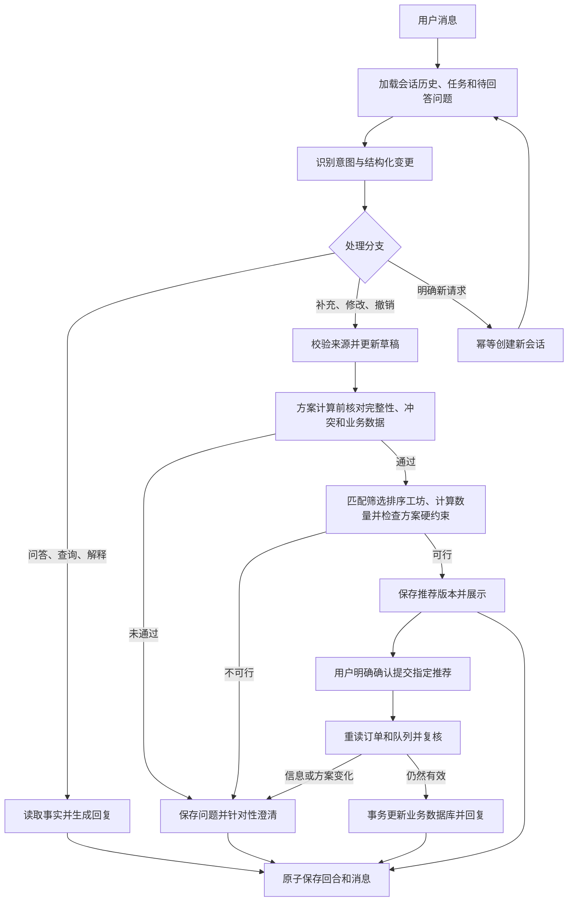

# 独立多轮对话与订单分配开发计划

日期：2026-10-14。本文基于当前工作区代码制定，属于开发设计与验收计划，核心功能已实施。已按澄清更新：信息核对通过后才进行 workshop 资格检查、匹配、筛选、排序和数量计算；确认提交才更新业务数据库；聊天和现有 recommendation 栏可以确认同一推荐，任意入口提交成功后都向对应会话保存结果反馈。当前代码存在较多未提交重构，应以工作区实际实现为基线，不按历史文档中的旧目录开发。

实施更新（2026-10-15）：P0–P4 的共享内核、Chat v2 持久化、上下文/意图、核对和双入口前端已落地；P5 的自动化回归、80 条离线评估及浏览器流程已执行。真实在线模型验收和独立人工 holdout 复核仍待具备相应条件。代码、运行方式与实际验证范围见 [Chat v2 使用说明](CHAT_V2_CN.md) 和 `evaluation/results/chat_implementation_verification.json`。以下保留原开发设计与验收目标，阶段工期为原估计。

## 1. 目标与范围

交付一个独立的聊天入口 `/chat`，支持新请求创建 session、持续回复、结合历史理解新消息，以及通过对话完成订单分配的识别、澄清、核对和推荐。

完整业务流程：

> 新请求 → 创建会话 → 理解当前消息与历史 → 回答或更新任务 → 查询业务数据 → 核对并确认信息完整、一致 → 澄清缺漏/矛盾 → 匹配、筛选、排序 workshop 并计算分配方案 → 展示推荐 → 用户明确确认提交 → 再次校验 → 更新业务数据库 → 继续回答追问。

全文采用以下术语，不再单独用 `allocate` 表示数据库更新：

| 术语 | 含义 | 是否更新业务数据库 |
|---|---|---|
| 信息核对／核对确认 | 确认订单、用户要求和业务数据完整、有效、无未解决的矛盾 | 否 |
| 分配方案计算（allocation planning） | 根据核对后的信息检查工坊资格、匹配、筛选、评分排序，并计算各 workshop 的分配数量 | 否 |
| 推荐（recommendation） | 将校验通过的计算结果及理由展示给用户 | 否；可以保存聊天草稿、核对报告和推荐记录 |
| 用户确认提交（confirm / commit allocation） | 用户明确接受当前有效推荐，复核后更新订单、生产分配和工坊队列 | 是 |

代码中的 `allocation` 通常是计算出的方案数据，planner 返回的 `ALLOCATE` 状态也不单独证明已提交；是否发生业务更新要看提交路径和 `committed`。现有 `planner.plan()` 负责方案计算，session 的 `action=confirm` 经复核后通过 `_apply()` 写入业务数据。

第 6 项需求的核对发生在**方案计算之前**，而不只是数据库提交之前。信息不完整、存在未解决的冲突或不支持的要求时，不进入工坊方案匹配、筛选、排序和数量计算；先澄清。输入核对通过后，计算结果仍需检查硬约束可行性，合格才展示推荐。用户确认提交时再复核一次，防止业务数据已经变化。

| 用户需求 | 本轮交付 | 验收方式 |
|---|---|---|
| 1. New request 新建 session | 按钮或明确的新请求指令创建独立会话；普通补充留在当前会话 | 新会话不继承旧订单、约束、推荐和待回答问题；重复提交同一创建操作不重复创建 |
| 2. 能够回答用户 | 支持问候、帮助、业务查询、解释推荐、澄清和错误回复 | “为什么选它”“订单现在是什么状态”能得到基于事实的回答，不被一律当作字段修改 |
| 3. 结合历史生成新对话 | 使用最近消息、已确认事实、约束变更记录和待回答问题构建上下文 | “还是按之前的要求”“取消刚才那条”“它能准时吗”能够承接，无法确定指代时追问 |
| 4. 独立前端对话框 | `/chat` 独立 HTML、样式和控制器，具有会话列表、气泡和输入框 | 可直接访问、刷新恢复和切换会话，不依赖原推荐页的表单状态 |
| 5. 订单分配意图与边缘情况 | 业务意图分类、结构化变更、歧义与不支持约束识别 | 查询、方案请求、修改、拒绝、确认提交、换单、撤销等走正确分支，复杂表达不丢约束 |
| 6. 核对完整后再计算和推荐 | 方案计算前的统一 preflight 检查与结构化核对报告 | 缺漏、冲突、非法数据、未知工坊和不支持要求阻断方案计算；计算后发现硬约束不可行则不展示正式推荐；都说明原因和下一步 |

补充交付要求：聊天记录中的推荐卡片与现有 recommendation 栏展示同一方案，均可确认提交；任意入口成功后，两处显示已执行，并在对应会话中保存“已成功分配至 workshop …”等基于实际提交结果的助手反馈。

本轮默认一个会话只处理一个活动的订单分配任务。其他订单的只读查询可以在会话内回答；要分配另一个订单时创建新会话。批量订单、订单主数据修改、精确比例拆分和新优化算法不作为首版执行能力，但相关意图必须被识别并明确反馈。

## 2. 当前代码的基础与缺口

| 位置 | 当前实际行为 | 开发影响 |
|---|---|---|
| `app/ui/desk.js` 的 `startRequest()` | 已经通过 UUID 和 `/api/sessions` 创建新会话 | 不重复宣称这是从零开发；新聊天入口需要同样的创建、恢复和重试语义 |
| `app/services/sessions.py` | 保存草稿、版本、双角色消息，支持幂等和事务 | 可以复用一致性设计；当前回合读取的 snapshot 没有历史消息 |
| `app/agent/router/nodes/conversation.py` | `identify_intent()` 根据 action、changes 和版本分流；followup 解析当前一句再合并 | 需要真正的语义意图和历史上下文，不只是增加 Prompt 文案 |
| `app/agent/router/graph.py` | 主要是解析/编辑 → validate → 澄清/预览；validate 节点本身只传递 issue | 要增加查询、解释和统一核对；现有底层业务校验仍然保留 |
| `app/agent/router/checkpointer.py` | 每次尝试使用新的 graph thread，checkpoint 用于诊断 | 多轮记忆要来自持久化会话，不能把当前 checkpoint 当成跨回合记忆 |
| `app/agent/intake/validator.py` | Parser v1 校验字段必须有当前消息证据 | 历史字段不能直接塞进 v1 输出；应新增上下文协议和证据校验 |
| `app/tools/database/order_repository.py` | 精确订单 ID 查询，比较用户字段与数据库字段，发现一个冲突就返回 | 继续精确查询；新核对报告应一次收集相关问题并展示双方值 |
| `app/tools/allocator/planner.py` | 确定性资格检查、匹配筛选、拆单、目标评分排序和硬交期计算；本身不写业务数据库 | 继续作为方案计算算法；统一输入核对通过后才调用，模型负责理解与回答 |
| `app/agent/responses/formatter.py` | 有基于事实的澄清与分配摘要 | 保留可靠的事实格式化，同时扩展问答和解释能力 |
| `app/agent/models/registry.py` | 已有多供应商统一调用，但 selection 中的 Prompt hash 绑定 parser 快照 | 扩展任务级 Prompt 元数据，保证意图/上下文/回复各阶段可追踪 |
| `app/services/sessions.py` 的确认分支 | 确认提交成功后会话 CLOSED；提交前基于最新队列重新计算，仅订单版本变化明确阻断旧确认 | 新聊天要在提交后继续问答；推荐变化后不能直接提交用户没见过的新方案 |
| `app/db/database.py` 与 migrations | DB v7；旧 sessions/messages 有状态、动作枚举及位置式 INSERT | 采用增量新表，避免直接扩充旧表破坏 v1 写入逻辑 |

已有文档中的部分描述落后于工作区代码，例如旧文档对供应商后续消息支持范围的说明。实施时以现有多模型 gateway、router 和测试为准。

## 3. 架构决定

### 3.1 独立 Chat v2，复用业务内核

新增 `/api/chat/...` 和 `/chat`，使用独立的 Chat v2 契约与数据表。现有 `/api/sessions` 与 `/legacy` 保留 v1 契约；现有推荐工作台保留 v1 功能，同时新增 Chat v2 推荐的展示和确认适配。聊天与 recommendation 栏对同一 Chat v2 推荐使用相同数据和确认接口，不将其复制成另一个 v1 session 或重新计算成独立方案。各入口调用同一个订单查询、信息核对、方案计算、推荐与确认提交内核。

这样可以表达普通问答、查询、推荐卡片及确认提交后的追问，同时避免让每条聊天都必须伪装成一个分配决定。普通聊天写入聊天审计；方案推荐和确认提交关联现有业务审计。

首先从现有 dispatch/session 服务中提取有明确输入输出的公共业务接口，覆盖“查询事实、核对输入、计算方案、校验并展示推荐、确认提交”。方案计算和数据库写入分别提供清晰接口，前者只能使用通过核对的输入，后者只能使用用户明确接受的有效推荐。旧入口先接入并回归，新聊天再接入。不要长期依赖 `_decide()`、`_apply()` 等私有函数，也不要另写第二套分配算法。

### 3.2 会话与任务分别管理

| 对象 | 状态 | 含义 |
|---|---|---|
| Chat session | OPEN / ARCHIVED | 管理历史消息、所有者、会话版本和模型设置 |
| Allocation task | COLLECTING / BLOCKED / READY / RECOMMENDED / CONFIRMED / CANCELLED | 管理订单、约束、核对、方案计算和推荐；READY 表示输入核对通过，CONFIRMED 表示确认提交成功，只结束任务 |

用户可以在 CONFIRMED 后问“分了多少”“为什么选这个工坊”。这类问答不会再次提交或更新业务数据库。首版修改已提交任务时说明已提交的状态，并引导现有生产流程或新请求。

明确的 New request 操作直接创建新会话。只出现另一个订单号时，需要区分查询、比较和换单；无法确定时询问“查询这个订单，还是新建分配请求”，不会覆盖当前订单。

### 3.3 对话流程



“如何确认”“如果确认会怎样”属于问答。这里的“信息核对确认”是代码检查事实和约束，“用户确认提交”才是接受推荐并授权业务更新。文本“确认”可以识别为确认提交意图，但只有明确针对当前有效推荐、没有夹带新约束的确认才进入提交。夹带“确认，但不要 W3”的消息先按约束修改处理，生成新推荐后再次确认提交。

## 4. 数据、接口与上下文协议

### 4.1 数据模型

建议新增 `008_chat_sessions.sql`；若实施前出现其他迁移，以实际下一个编号为准。迁移只新增聊天表和必要索引，保留旧业务表与旧历史。

| 新表 | 核心内容 |
|---|---|
| `chat_sessions` | session_id、owner_username、title、status、version、business_date、默认模型选择、created_at/updated_at |
| `chat_turns` | turn_id、session_id、request_id、输入指纹、基础版本、动作、输入/响应、模型与 Prompt 元数据、处理结果 |
| `chat_messages` | message_id、session_id、turn_id、sequence、role、content、结构化卡片 metadata、created_at |
| `chat_allocation_tasks` | task_id、session_id、order_id、task_version、state、draft、字段来源、待回答问题、核对报告 |
| `chat_recommendations` | recommendation_id、session_id、task_id、task_version、业务数据指纹、方案内容、展示内容、valid/superseded/confirmed 状态、confirmation_turn_id、关联业务 request_id 和实际提交结果 |

约束：每个 session 的 message sequence 唯一；chat request_id 在新 API 幂等空间内唯一；一个 session 只允许一个活动分配任务；推荐属于确定的 session 和 task version。业务操作使用服务端派生的独立 request_id，关联 chat turn，避免与旧接口的幂等键冲突。同一 recommendation_id 只允许一次成功的确认提交；提交结果和确认 turn 持久化，供两个入口读取。跨入口产生不同 request_id 时，也不能绕过推荐状态与业务幂等检查而重复提交。

Chat v2 新会话按登录账号过滤列表、读取、修改和确认。业务订单仍沿用当前共享工作区。旧 v1 会话缺少可靠所有者，本轮不猜测归属，也不自动纳入个人聊天列表。

更新 `DB_VERSION`、新库初始化和全部受支持旧库升级路径。迁移失败必须回滚；已发布的 001–007 不改写。

### 4.2 HTTP 契约

| 接口 | 用途 |
|---|---|
| `POST /api/chat/sessions` | 使用创建幂等键创建 session，可携带第一条消息并返回实际 session_id |
| `GET /api/chat/sessions` | 当前账号的会话列表，支持游标分页 |
| `GET /api/chat/sessions/{id}` | 当前任务、核对报告、有效推荐和会话元数据 |
| `GET /api/chat/sessions/{id}/messages` | 按 sequence 游标读取消息历史 |
| `GET /api/chat/recommendations` | 当前账号有权访问的 Chat v2 推荐列表，供现有 recommendation 栏展示；支持状态和游标分页，返回所属会话、推荐版本、方案与实际提交状态 |
| `POST /api/chat/sessions/{id}/turns` | 发送消息或明确动作；传 request_id、expected_version、action、message，确认额外传 recommendation_id；聊天和 recommendation 栏对 Chat v2 推荐统一调用此接口 |

动作至少包括 `message`、`new_request`、`confirm`、`archive`。普通文字不要求前端提前猜意图；后端负责识别。明确动作与文字含义不一致时返回具体问题，不能悄悄忽略文字。

返回包含 `session_id`、`session_version`、`turn_id`、`assistant_message`、`intent`、`task_state`、`validation_report`、`cards`、`suggested_actions`、`replayed` 和 `committed`。cards 可为订单事实、核对信息或推荐卡片。确认响应额外返回 recommendation_id、推荐状态、实际提交结果和反馈 message_id，供两处按同一记录刷新。新建分支返回 `previous_session_id` 和新 `session_id`，前端据此切换。

推荐列表显式区分 `chat_v2` 和旧 v1 来源；Chat v2 条目包含 session_id、session_version、task_version 和 recommendation_id，确认始终走 Chat v2 接口。工作台复用同一权限检查，不能因为展示在共享工作台就扩大其他账号对聊天或推荐的访问范围。

普通澄清使用 200；参数错误 400；无权限/不存在按统一资源策略处理；版本、幂等或推荐失效使用 409；模型或数据库临时不可用使用 503。提交接口必须在后端检查，不能只依赖按钮是否可点。

### 4.3 上下文与变更

上下文由持久化记录重建，包括：当前消息、最近完整的 user/assistant 回合、有效订单事实、当前约束及来源、约束变更记录、待回答问题、当前推荐，以及 session 固定的业务日期。

长历史按模型输入预算裁剪；原始消息仍完整保留。需要压缩时以结构化事实与事件为主，摘要带来源 sequence。摘要不能作为凭空增加业务约束的证据；指代涉及被裁剪的内容时可按来源补读。

新增上下文输出协议，而不是修改冻结的 `parser_v1`：

```text
TurnInterpretation:
  intent / candidate_intents / ambiguity_reason
  referenced_order_id / referenced_recommendation_id
  patch_operations[]: set | unset | add | remove | undo
  evidence[]: message_sequence + 原文片段/位置 + 对应字段
  unsupported_constraints[]
  answered_question_ids[]
```

未提及字段保持原值；否定、清空与撤销使用显式操作。撤销根据变更记录恢复指定字段，“取消刚才那条”不会默认清空全部排除。用户明确更正旧偏好可覆盖；同一句互相矛盾的要求必须澄清。

引用 assistant 消息可以定位“第二个方案”，但不能把 assistant 的猜测当作用户要求。数据库字段、用户约束、界面默认值分别记录来源。跨 session 不共享订单与任务记忆。

新增 `conversation.intent`、`conversation.interpret`、`conversation.reply` 的版本化 Prompt；记录各阶段 Prompt hash、模型、输入上下文范围与耗时，沿用现有 registry/provider 调用边界。

## 5. 意图识别与边缘情况

### 5.1 意图集合

首版至少区分：`new_request`、`allocate_request`、`answer_clarification`、`modify_constraints`、`undo_change`、`query_order`、`query_workshop`、`explain_recommendation`、`reject_recommendation`、`confirm_allocation`、`cancel_task`、`help_or_chat`、`unsupported_or_ambiguous`。

其中 `allocate_request` 表示请求计算分配方案和推荐，不直接授权数据库更新；`confirm_allocation` 才表示用户确认提交，仍需检查推荐版本和业务状态。

明确 UI 动作、精确命令先走确定性规则；其余自然语言由模型输出结构化解释，再经代码校验。候选意图冲突、指代无法定位或证据不足时追问。模型自报 confidence 只用于诊断，不单独作为执行许可。

一条消息可以同时查询和提出约束；必须识别完整内容。先应用已明确的约束并失效旧推荐，再回答问题；未解决的语义部分持续阻断推荐和确认，不能只执行前半句。

### 5.2 必测情况

| 类别 | 示例或情况 | 预期处理 |
|---|---|---|
| 缺失信息 | “帮我分配，越便宜越好” | 记住成本目标，只问订单 ID；拿到 ID 后查询数据库，不重复要求已存在字段 |
| 多订单/换单 | 同一句包含 ORD-045 与 ORD-109 | 明确单订单首版边界；询问先处理哪一个或新建会话 |
| 非换单查询 | “ORD-109 现在怎么样” | 只读查询，不更换当前分配任务 |
| 模糊指代 | “别选它”“还是第二个”“和刚才一样” | 唯一可定位时处理，否则展示候选并询问 |
| 撤销与否定 | “不排除 W3 了”“撤销刚才的目标修改” | 分别执行 remove 和 undo，保留其他约束 |
| 复合要求 | “成本最低，最多两个工坊，不要 W3” | 三项全部保留；输入核对通过后才能匹配、筛选、排序工坊并计算方案 |
| 同轮矛盾 | “只能 W3，但排除 W3” | 返回两项冲突，询问保留哪一项 |
| 目标优先级 | “必须最便宜也必须最快” | 澄清优先级；不擅自映射成现有 hybrid，当前 hybrid 并不包含成本权重 |
| 订单字段冲突 | 用户数量或交期与订单数据库不同 | 展示用户值与数据库值；不能自动修改订单主数据，也不能无提示覆盖用户值 |
| 部分完工 | 用户说的件数是总量还是剩余量 | 明确核对 total/completed/remaining；方案计算和确认提交都只针对未完工数量 |
| 非法数值与日期 | 0/负件数、非法工坊数量、无效日期 | 指出字段和允许范围；相对日期以会话 business_date 为基准并显示解释 |
| 不存在订单 | 错误 ID 或只有客户名称 | 提供修正指引，不猜测后计算分配方案；可展示只读候选供明确选择 |
| 订单状态 | WORKING、COMPLETED、LAPSED | 解释状态和允许操作；重派转现有生产流程，不生成重复分配推荐或重复提交 |
| 工坊问题 | W99、关闭/暂停、品类不匹配、无产能、缺队列 | 提供原因；未知指定/排除工坊不能被静默忽略 |
| 工坊语义 | “优先 W3”与“只能 W3” | 区分软偏好和硬指定；现有 preferred 实际强制单工坊，首版必须说明或澄清 |
| 不可行约束 | 硬交期、批量上限、工坊上限无法满足 | 保留原约束，解释不可行；提出可选修改但不自动放宽 |
| 不支持约束 | 预算上限、精确拆分、特殊质量阈值 | 保存为未解决要求并阻断方案计算；明确当前方案计算能力，不能用“成本最低”替代预算上限 |
| 模拟问题 | “如果允许迟交会怎样” | 回答假设条件下的对比；不默认改正式约束、不提交 |
| 模糊取消 | “取消” | 根据明确上下文取消未提交任务；已提交分配或含义不清时询问/引导生产流程 |
| 确认夹带修改 | “确认，不过排除 W3” | 先修改、失效旧推荐、重新展示，不提交 |
| 推荐失效 | 修改约束、订单改动、队列占用、跨业务日期 | 重新核对和展示推荐，旧 recommendation_id 不可提交 |
| 可靠性 | 模型超时/限流、畸形输出、断网重试、双击 | 明确错误，幂等恢复；不丢历史、不重复分配、不能靠旧推荐绕过未处理的新约束 |
| 会话边界 | 新请求、切换账号、恢复/切换会话 | 只加载当前 session 和账号允许访问的记录；状态不串线 |

范围内的自然语言需要通过独立评估；任意表达无法保证都理解，但无法理解时必须给出可继续的澄清，不能假装已经满足。

## 6. 方案计算前核对、推荐校验与确认提交

### 6.1 两级检查

新增统一 `AllocationPreflight`。第一层核对请求和业务数据，通过后才运行 planner，进行 workshop 匹配、筛选、排序和分配数量计算；第二层验证计算出的方案是否满足所有支持的硬约束，通过后才展示正式推荐。

第一层是用户第 6 项需求的主要落点。存在 blocking issue 时，不得先调用 planner 计算后再隐藏结果，也不能只在确认提交前补做检查。第二层用于发现计算可行性问题，例如输入完整但硬交期无法满足；它不能替代第一层的信息核对。

核对报告的每个问题应包含 `code`、`field`、`severity`、`user_value`、`database_value`、`source`、`question` 和可选修正方式。报告同时包含 `ready_for_planning`、`ready_for_recommendation`、`blocking_issues`、`warnings`、`resolved_fields`、`effective_constraints` 和来源。`ready_for_planning` 仅在输入核对通过后为 true；`ready_for_recommendation` 还要求方案计算成功且方案检查通过。

检查顺序：

1. **意图与语言完整性**：是否真的请求计算分配方案；是否遗漏子要求；是否仍有不支持约束或待回答问题。
2. **订单身份**：唯一明确的订单 ID、存在性、允许状态，订单字段与数据库的一致性。
3. **必要业务字段**：品类、数量、订单日期、交期、完成量和剩余量是否有效。数据库能补齐的信息不用重复问；数据库缺损不能由模型编造。
4. **用户约束**：目标/优先级、工坊数、排除/指定、硬交期及它们之间的矛盾。默认目标、默认单工坊、软交期等必须显示在核对卡片中。
5. **资源数据**：工坊状态、能力、产能、批量上限、费用、质量参数、队列及时间有效性。错误数据要报告，不能将异常统一伪装为“请补订单”。
6. **方案检查**：第 1–5 步通过后才开始方案计算，再检查数量为整数、总量等于 remaining、工坊数量和资格符合要求、指定/排除符合要求、硬交期满足。不可行属于约束问题，不代表继续索要更多无关字段。

已知订单的数据库事实是方案计算与确认提交的基准；用户可以更正约束，不能通过聊天隐式更改订单主数据。冲突必须按明确回复解决，不因下一条无关问答就清除。

用户对默认值提出异议时更新草稿并重新核对。首版在核对通过的同一回复中展示核对摘要和推荐，不强制增加一个固定的“确认信息”步骤；涉及冲突或歧义时必须先得到回答。

### 6.2 推荐有效性与确认提交

保存推荐时绑定：session_id、task_version、有效约束 hash、order.version、业务日期、参与计算的工坊/队列事实 hash、确定性方案 hash，以及用户看到的卡片。

任何约束修改都失效旧推荐。纯查询和解释可以更新 session version，但不改变 task version；UI 使用最新 session version 和原有效 recommendation_id 确认。

用户确认提交时，在短事务内重读业务数据、运行同一核对与计算，并检查用户授权的推荐是否仍有效。这是提交前的再次复核，不代替首次方案计算前的核对：

- 订单、约束或相关资源指纹变化时，返回推荐已失效，重新核对并展示新方案；新方案需要再次明确确认。
- 信息仍有效时，提交确定性方案，保证订单、队列、业务审计、任务状态与确认消息原子保存。
- 双击、网络重试及跨客户端确认依靠幂等键、会话/任务版本和业务订单版本只提交一次。

模型调用不放在 SQLite 写锁内。结构化核对、事实回复和业务写入是完成回合的可靠基础；解释模型失败时可以使用模板回复，解析不确定或约束未解决时继续阻断。不能因为生成漂亮的摘要失败，让客户端误判已经完成的数据库提交为未提交。

### 6.3 聊天与 recommendation 栏的双入口确认

同一方案在两个位置展示：聊天历史中的推荐卡片，以及现有工作台的 recommendation 栏。两处共享 recommendation_id、所属 session、task version、方案内容和状态；用户可从任意一处点击确认。聊天中的明确文字确认也解析为对同一个有效 recommendation_id 的确认提交。

两个入口调用第 4.2 节的同一个 Chat v2 确认接口，执行第 6.2 节的同一复核与事务逻辑。工作台确认必须记录到推荐所属的 session；页面此时打开另一个会话，也不能把反馈写入那个会话。

任意一处确认成功后，两处的推荐状态都变为 confirmed，并显示“已执行”及实际提交结果，确认按钮不可再次提交。修改、拒绝或业务数据变化导致推荐失效时，两处也同步失效，不允许其中一处继续确认旧方案。

同步以服务器持久化状态为准：当前页面在操作结束后刷新相应消息和推荐；其他页面或标签页在获得焦点、进入 recommendation 栏或短周期轮询时刷新。首版不依赖 WebSocket。同步尚未完成的另一个入口即使继续点击，后端也必须保证只提交一次。

同 recommendation_id 的重复确认，在权限检查后返回已有提交结果或明确的“已执行”状态，并定位原反馈 message_id；不再次更新订单/队列，也不重复生成成功反馈。仍按原规则拒绝同 request_id 携带不同输入的幂等冲突。

### 6.4 执行结果反馈与持久化

确认提交成功后，无论来自聊天还是 recommendation 栏，都在所属 session 保存一条 assistant 结果消息。订单/队列更新、推荐 confirmed 状态、任务 CONFIRMED 状态、业务审计和成功反馈在同一事务中完成；刷新或重新打开会话能恢复这条消息。

仅生成 allocation plan 时的反馈为“推荐将 ORD-045 的 150 件分配至 workshop W5，等待确认”，此时不更新业务订单与队列，不能使用“已成功分配”的措辞。

确认提交成功后的反馈示例为：“已成功将 ORD-045 的 150 件分配至 workshop W5，预计于 YYYY-MM-DD 完成。”实际文本必须使用本次已提交结果中的订单、workshop、数量和预计日期；该示例不代表当前真实分配结果。

拆分至多个 workshop 时逐项列出各工坊和件数，并反馈合计。推荐失效、复核失败或数据库事务回滚时反馈具体原因和下一步，不返回成功消息。若数据库已经提交但客户端断网，重试恢复同一成功结果与原反馈，不创建第二条成功记录。预计完成日期继续标明为预计值。

## 7. 前端设计

新增 `app/ui/chat.html`、`chat.css` 和 `chat.js`，从现有工作台增加一个入口链接，并扩展原 recommendation 栏展示和确认 Chat v2 推荐。继续使用当前轻量静态前端与 FastAPI，无需为本轮引入新的前端框架。

页面包含：

- 左侧会话列表、New request、当前会话标识；标题和列表由后端持久化。
- 主区消息气泡、发送中状态、可重试错误和输入框；支持 Enter 发送与 Shift+Enter 换行。
- 对话内订单事实卡、核对卡、澄清选项、推荐卡、推荐版本及确认/修订动作。
- 已提交后的结果与后续追问；移动宽度下可收起会话列表。

现有 recommendation 栏增加带 Chat v2 来源标识的推荐条目、确认按钮、已执行/失效状态及“查看对应对话”入口。两处确认同一方案，结果反馈始终进入该方案所属会话。方案列表读取共享服务器记录，不在浏览器分别保存两份独立方案。

复用现有账号、字号和模型目录接口，聊天控制器的本地状态与旧 desk 分离，通过共享 Chat v2 接口同步推荐和提交状态。localStorage 按账号和 Chat v2 命名，只保存当前会话 ID、模型选择及未确认操作；消息和任务以后端为准。

切换会话时请求结果绑定发起时的 session_id，避免慢响应写入新会话。存在未确认的提交时先恢复该操作结果，再允许依赖它的确认。新建会话与第一条消息的重试复用原创建键和 turn 键。

首版使用普通请求响应，提供清晰的加载反馈，不将流式输出作为交付前提。长历史采用分页。流式文本、后台 chat job 和消息搜索可在主流程验收后扩展。

## 8. 开发顺序与代码落点

按单名熟悉项目的开发者估计约 **13–17 个工作日**，包含双入口适配、自动化回归和浏览器验收；真实模型配额、人工标注与外部服务问题可能延长周期。下面是工作量估计，不是保证完成日期。

| 阶段 | 预计工作量 | 主要代码位置 | 交付与验收门槛 |
|---|---|---|---|
| P0 契约与共享内核 | 2 天 | 新 `app/schemas/chat.py`、`app/services/allocation.py`；调整 `dispatch.py`、`sessions.py` | 冻结 intent/patch/report/recommendation 协议；旧入口接共享内核，旧行为回归通过 |
| P1 会话与持久化 | 2 天 | 新 migration、`app/tools/database/chat_repository.py`、`app/services/chat.py`、`app/api/routes/chat.py`；更新 database/routes/main | 会话创建、列表、消息恢复、所有者、幂等、版本冲突和普通模板问答完整可用；升级旧库不损坏历史 |
| P2 上下文与意图 | 2–3 天 | 新 `app/agent/conversation/context.py`、`interpreter.py`、`patches.py`、`validator.py`；独立 `chat_graph.py`/chat state；新增 Prompt YAML | 全模型模式使用相同上下文契约；跨多轮保留约束、补充、更正、撤销和指代；无来源字段被拒绝 |
| P3 核对、方案计算与推荐 | 3–4 天 | 新 `app/services/allocation_preflight.py`、共享 allocation 服务；扩展 responses | 聚合完整核对报告；未解决问题不调用 planner；核对通过后匹配筛选排序与数量计算；方案通过检查才推荐；版本变化后再次确认提交；统一双入口提交，成功结果与聊天反馈原子保存；数量守恒与事务验收通过 |
| P4 独立聊天页、双入口与回复 | 3–4 天 | 新 chat HTML/CSS/JS；扩展 `app/main.py` 静态路径；修改 `app/ui/desk.js`、`index.html` 及必要样式适配 Chat v2 推荐；扩展推荐只读模型/API；新 `app/agent/conversation/reply.py` | 聊天页完成完整闭环；recommendation 栏展示同一方案并调用同一确认接口；两处已执行/失效状态同步；任意入口的结果反馈持久化到对应会话 |
| P5 评估与交付 | 1–2 天 | 新测试、`evaluation/evaluate_conversation.py`、结果报告；更新会话/API/UI文档 | 固定用例、独立 holdout、浏览器与真实模型验证分开报告；完成六项需求的端到端验收 |

依赖关系为 P0 → P1 → P2 → P3 → P4 → P5。P1 即可交付最小会话骨架与普通回复；后续逐步接入能力。若需要分工，前端可以在 P0 契约固定后使用固定样例开展，但最终必须与真实后端联调。

P2 新建独立 chat graph，不直接改掉 v1 路由的动作含义。P0 的共享内核提取必须先验证原有会话和单请求接口，后续只保留一套业务规则。

P3 对暂不支持的预算/精确拆分实现识别和阻断。未来若要支持执行，先新增相应字段、业务规则、算法和用例，再解除阻断，不能只修改 Prompt 声称已支持。

## 9. 验证与交付标准

### 9.1 自动化测试

新增或扩展以下有行为意义的测试：

- `test_chat_sessions.py`：创建、恢复、会话列表、所有者检查、幂等、版本冲突、消息顺序、迁移回滚。
- `test_conversation_context.py` / `test_conversation_intents.py`：历史上下文、来源校验、撤销、否定、复合消息、指代、查询与修改的区别。
- `test_allocation_preflight.py`：完整性、数据冲突、未解决约束、资源缺损、默认值、剩余数量、不可行解释。
- `test_chat_allocation.py`：缺漏/冲突/不支持要求时断言 planner 未被调用；输入核对通过后才匹配筛选排序与数量计算；方案不满足硬约束时不推荐；推荐不写业务；失效推荐不提交；修改后再次确认提交；并发只提交一次；SQL 故障全体回滚。
- `test_chat_api.py`：输入输出契约、错误状态、创建首条消息重试、跨账号访问和旧接口兼容。
- `test_chat_ui.cjs`：刷新/切换、pending 重试、慢响应不串会话、推荐失效、重复点击和安全文字渲染。

上述测试补充双入口覆盖：同一 recommendation_id 从两处分别确认均可成功完成首次提交；两处同时确认且 request_id 不同也只更新一次；工作台确认生成所属会话的成功反馈；重复确认不重复写消息；修改或推荐失效后两处均不可提交；切换会话、刷新和跨标签页后恢复实际状态。旧 desk 控制器测试增加 v1/v2 来源分流、权限、跳转和状态同步用例。

模型使用模拟传输覆盖可重复的业务与错误测试。旧 Python 测试和现有前端控制器回归作为兼容门槛；实施更新（2026-10-15）：完整 Python 回归 325 项、前端 17 项以及 80 条离线多轮脚本通过，具体证据见实施验证报告。

### 9.2 自然语言评估

建立约 80–120 条多轮脚本，覆盖第 5 节各类情况，其中保留至少 30 条未用于调试的人工复核 holdout。记录每轮 intent、patch、字段来源、blocking issues、回复事实和是否推荐/提交。

建议验收目标：范围内意图识别正确率 ≥95%，多轮最终约束匹配率 ≥95%，回复中的订单/数量/成本/交期事实正确率 ≥98%。同时设置必须全通过的固定阻断用例：缺失/冲突/不支持要求不进入方案计算，计算后硬约束不可行不推荐，不隐式提交、不重复提交、不跨会话污染，以及分配数量和队列守恒。未达到这些门槛不交付。

模拟测试、离线规则和每个实际可用的在线模型分别报告。离线模式只保证已支持的规则、模板和表单路径，不宣称具备任意自然语言问答。真实模型测试需要实际可用配置；超时/限流算端到端失败，并另外报告收到输出时的理解质量，不能用模拟通过率替代在线质量。

### 9.3 端到端验收场景

1. New request：输入“帮我分配，成本越低越好”；创建 session A，助手只询问缺失订单 ID。
2. 回复“ORD-045”；从数据库补齐事实，显示有效目标、默认约束、核对摘要和推荐。
3. 问“为什么选这个工坊”；结合当前方案回答，不改变任务约束。
4. 回复“最多两个工坊，不要 W3”；保留成本目标，失效旧推荐，重新核对并推荐。
5. 回复“撤销刚才对工坊数量的修改”；只撤销该字段，保留 W3 排除。
6. 输入与数据库不同的数量或相矛盾约束；展示具体冲突，后端不调用 planner、不继续匹配筛选排序，确认提交也被阻断。
7. 解决冲突后才计算方案并获得有效推荐；输入“确认，但不要 W6”只触发修订，随后明确确认提交新推荐才更新业务数据库。
8. 确认提交后追问“最终分了多少，预计什么时候完成”；根据已提交结果回答，会话仍可用。
9. 再次 New request 创建 session B；A 的订单、约束和推荐不进入 B，切回 A 可恢复完整消息。
10. 刷新、断网重试、双击、另一个客户端改订单/队列；无重复分配，变化后的方案重新展示并要求确认。
11. 聊天生成推荐后，现有 recommendation 栏显示同一个 recommendation_id 和相同方案；分别使用独立测试订单验证从聊天及 recommendation 栏确认，都能更新业务数据，并在对应会话保存“已成功分配至 workshop …”的结果反馈，两处显示已执行。
12. 在两个标签页同时确认同一推荐；仅一笔实际提交和一条成功反馈。另一个入口恢复已有结果，不再次增加队列；推荐失效时两个入口均拒绝旧确认。
13. 在工作台确认会话 A 的推荐，聊天页面当前打开 B；反馈只进入 A，B 不出现 A 的结果。切回 A 或刷新后，成功反馈和状态仍在。
14. 仅计算出 allocation plan 时显示“推荐……，等待确认”；确认提交失败时显示失败原因；只有实际提交成功才显示“已成功分配”。多 workshop 方案逐项显示件数，反馈合计与已提交记录一致。

验收使用独立临时数据库，不修改开发者当前业务运行库。浏览器至少检查桌面和移动宽度、键盘输入、长消息、会话恢复和完整确认链。

## 10. 本轮完成定义

六项需求及双入口确认、结果反馈各有代码实现、自动化证据和可演示场景；独立聊天页完成闭环；Chat v2 使用历史上下文；信息在方案计算前核对完整、一致，问题可解释、可解决；workshop 匹配、筛选、排序和数量计算沿用确定性内核；聊天与 recommendation 栏共享同一方案及状态，任意入口可确认且只提交一次；业务数据库只在用户明确确认提交并复核通过后更新；成功反馈原子保存到对应会话并可恢复；旧入口回归通过。

交付包含代码、增量迁移、接口说明、运行指引、多轮评估用例与报告，以及明确记录的在线模型验证范围。单独完成 Prompt、漂亮的聊天界面或模拟测试，均不能视为整项完成。
