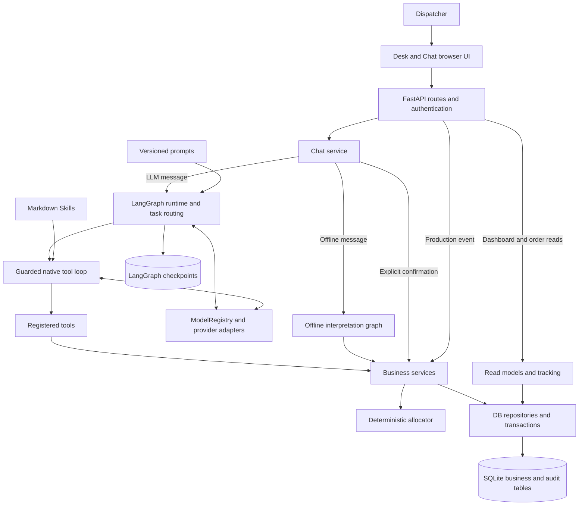

# SweaterCo: whole-codebase understanding with AOCI

This document explains the current working tree: what the application does, how its parts connect, where business decisions happen, what is persisted, and which claims the available tests support. It includes the locally added operations dashboard and order tracking. It is written in English following the repository's documentation convention.

## 1. Snapshot and evidence

| Item | Observed value |
| --- | --- |
| Repository | `zh72640/dss5105_project`, active local `Workspace` checkout |
| Branch | `ningtao` |
| HEAD | `4925cfaa14f1176c3193b90a44067e35e3e8b6d8` |
| Scope | HEAD plus existing modified and untracked working files; this is not a description of HEAD alone |
| Application | `mvp_v0.6`; package version `0.6.0` |
| Business schema | SQLite schema version 9 |
| Current LLM workflow | `main_v2`, with recovery support for saved older workflows |
| AOCI | `0.1.0-rc20`, build commit `45990a1dcfc4415efdc6fbfa13bc159a415f127c` |
| Source inventory time | `2026-10-18T12:41:12Z` |
| AOCI manifest | `business-source-manifest/v1`, 332 managed candidate files |
| Manifest identity | `0a40f6d3cb8e1304a503bc9aec1fa1c3d01f81624e374653a4866e0ddbfb1b57` |

### How AOCI was used

The installed AOCI CLI was invoked against this checkout, using `--version`, `status --json`, `doctor --json`, `source manifest --json`, and `index inventory --json`. Its source manifest supplied the file inventory, per-file SHA-256 fingerprints, exclusion summary and aggregate identity. Source code, SQL migrations, prompt configuration, frontend code and existing verification evidence were then inspected to establish the behavior described below. AOCI supplied deterministic inventory evidence; the architectural interpretation is the host agent's synthesis of that evidence and the code.

This checkout has no formal `aoci.txt` or AOCI Baseline. Consequently, Doctor reported missing index/Baseline assets, and `index inventory` returned configuration exit code 3. `source manifest` succeeded without initialization. The old AOCI index under `remote-checkouts/` was not used as evidence for this working tree. This document does **not** claim that a complete AOCI semantic index has been built, scored or verified. No AOCI AI endpoint was configured or called; the manifest reports `network_accessed: false`.

The manifest includes all 163 application source/resource files: 123 Python, 9 SQL, 7 Markdown, 14 YAML, 5 JavaScript, 3 CSS and 2 HTML files. The remaining `app/` files found on disk are macOS `.DS_Store` metadata. No paths under `remote-checkouts/`, `runtime/` or `.venv/` occur in the manifest. Other managed groups include 56 documentation files, 57 evaluation files, 38 test files, 4 data files, 3 demos and the simulation harness. These are AOCI-selected counts, not an assertion that every historical artifact or fixture is managed.

Raw local evidence is retained in `runtime/aoci-understanding-20261018/source-manifest.json` and `inventory.json`. This runtime directory is ignored by Git. The aggregate above describes the source snapshot **before adding this document**. All 332 source fingerprints were checked against the working tree during preparation.

## 2. What the project implements

SweaterCo is a local decision-support application for allocating garment orders to subcontracting workshops. A dispatcher can describe an order and constraints, obtain a feasible recommendation, compare its implications, explicitly approve it, record production changes and inspect the resulting history.

The application combines two distinct capabilities:

- **Conversational coordination:** an LLM interprets a request and uses permitted tools, or an explicitly selected Offline mode interprets supported expressions with rules.
- **Deterministic operations:** Python validates registered facts, checks workshop eligibility, computes quantities and delivery estimates, validates approvals, updates queues and records auditable state changes.

An LLM explanation is not the authority for an allocation. Saved recommendations are previews. A successful confirmation transaction creates the production allocation. The dashboard reads those persisted facts.

The bundled dataset contains 120 orders and 8 workshops. Its quality and cost fields are planning inputs. The project does not currently implement accounting invoices, observed inspection results, stock management, or separate cutting, sewing, inspection and shipping states.

## 3. Architecture and directory responsibilities



This is the main logical flow. Some existing read models and orchestration code still execute SQL directly; it is not a claim that every SQL statement has already moved into a repository.

| Location | Current responsibility and useful entry points |
| --- | --- |
| `app/server.py`, `app/cli/server.py` | Local Uvicorn launch, one worker, loopback socket and command-line options |
| `app/main.py` | FastAPI factory, router registration, explicit static-file routes and OpenAPI handling |
| `app/config/` | Application settings, immutable model configuration and startup override precedence |
| `app/core/` | ASGI lifespan, account security and built-in administrator provisioning |
| `app/api/` | Request schemas at HTTP boundaries, authentication dependencies, error conversion and request policy |
| `app/agent/` | Main graph, allocation preparation graph, native tool executor, Skill loading, explanation and response nodes |
| `app/offline/` | Separate rule-based interpretation and reply path for Offline Chat |
| `app/tools/` | Named LangChain tools, registry, task permissions and trusted invocation context |
| `app/skills/` | Six runtime-readable instructions for allocation, inquiries, revisions, explanation and production |
| `app/services/chat/` | Durable conversations, extraction checks, preparation, constraints, recommendation state, confirmation and response reconciliation |
| `app/services/allocation/` | Preflight checks, recommendation orchestration, complete solution validation, alternatives and approval differences |
| `app/allocator/` | Pure allocation entry, eligibility rules, single-workshop scoring and integer planning |
| `app/services/production/` | Production transitions, queue accounting, Agent event authorization and read-only order tracking |
| `app/services/desk/` | Dashboard, workshop and audit read models |
| `app/services/intake/` | Deterministic text normalization and local rule parser |
| `app/services/responses/` | Deterministic business reply templates and formatting |
| `app/db/` | SQLite connections, nine migrations, CSV validation and domain repositories |
| `app/schemas/` | HTTP, business, allocation, Agent and tool contracts |
| `app/llm/` | Model catalogue, provider adapters, structured-output handling and normalized errors |
| `app/prompts/` | Versioned YAML templates, manifest, rendering and validation |
| `app/ui/` | Static HTML/CSS/JavaScript for the Desk, Chat, charts and order journey |
| `data/` | Bundled CSV snapshots, example requests and dictionary |
| `tests/` | Python regression tests and Node frontend tests |
| `evaluation/` | Repeatable acceptance runner, language evaluations, browser checks, simulator adapters and historical results |
| `harness/simulate.py` | Shared fixed-seed simulation harness, separate from live application state |
| `demos/` | Scripted retrieval, dispatch and lifecycle demonstrations |
| `docs/` | Architecture targets, implementation reports, guides and historical review material |
| `runtime/` | Local databases, backups and temporary evidence; not source to publish |
| `remote-checkouts/` | Separate local clone history; not part of the active application |

There is no React/Vue build pipeline for the current UI and no external chart dependency. Node is used for frontend tests, not required to serve the application. Python dependencies are declared in [pyproject.toml](../pyproject.toml) and resolved in `uv.lock`; Python `>=3.11,<3.15` is declared.

## 4. Startup and public interfaces

The normal launch path is `app.server` → `app.cli.server` → `LocalServer` → `create_app` → ASGI lifespan. Startup resolves the selected database and business date, checks initialization for normal CLI startup, initializes the model registry and prepares the SQLite checkpointer. Existing database initialization applies supported migrations; it does not reload CSV over established business data.

The default database is `runtime/dispatch.sqlite3`. A separate database can be selected with `--db`. The HTTP server requires a file database because requests and graph execution use separate connections. The server binds to `127.0.0.1`, not a public network interface.

| Interface | Meaning | Implementation |
| --- | --- | --- |
| `/` | Dashboard and Desk views, including recommendations, workshops, audit and order tracking | `app/ui/index.html`, `desk.js` |
| `/chat` | Persistent conversation assistant | `chat.html`, `chat.js`, `chat-common.js` |
| `/api/chat/sessions` | Create/list owner-scoped conversations | `app/api/routes/chat.py` |
| `/api/chat/sessions/{id}/turns` | Message, explicit confirmation and other supported session actions | `app/services/chat/service.py:turn` |
| `/api/chat/sessions/{id}/messages` | Saved messages | Chat repository/service |
| `/api/chat/sessions/{id}/trace` | Owner-scoped Agent execution evidence | Agent repository/service |
| `/api/chat/sessions/{id}/requests/{request_id}/end` | Explicitly end an interrupted request under version checks | `request_runs.py` |
| `/api/chat/recommendations` | Recommendations visible to the authenticated owner | Chat service |
| `/api/orders/{id}` | Current order, allocations, recent events and full tracking projection | `production/lifecycle.py:inspect_order` |
| `/api/events` | Controlled production state change | `production/lifecycle.py:process_event` |
| `/api/dashboard`, `/api/workshops` | Operational read models | `services/desk/` |
| `/api/audit`, `/api/audit/{id}`, `/api/audit/export`, `/api/history` | Business audit views and exports | Desk API/service |
| `/api/auth/me`, `/api/auth/login`, `/api/auth/logout` | Local identity and login session | Auth routes/security |
| `/api/health`, `/api/ai/status`, `/api/models` | Service state and model catalogue | System routes |
| `/docs`, `/redoc`, `/openapi.json` | Generated API documentation | FastAPI |

The active router list is authoritative: [app/api/routes/__init__.py](../app/api/routes/__init__.py). `/api/requests`, the old `/api/sessions` and `/api/jobs` are retired. Historical tables and migration files with related names do not make these APIs active again.

## 5. The current LLM allocation workflow

The current route is:

```text
POST /api/chat/sessions/{id}/turns
  → services/chat/service.py:turn
  → services/chat/agent_turns.py:turn
  → agent/runtime.py:run
  → main_graph.py: identify
  → allocation_graph.py: extract → prepare → load_skill → executor
  → main_graph.py: explanation → response → finish
  → saved session/message response
```

1. **Associate the request with a durable session.** The authenticated owner, request ID and expected session version determine whether it is new, replayed, stale or an interrupted run that must resume. A process-local execution claim protects concurrent execution in the same session; durable run records support recovery.
2. **Route the task.** The main graph classifies a message as `allocation` or `compat`. The latter uses the reusable executor for other supported tasks, such as inquiries and production actions. The main graph does not implement allocation formulas.
3. **Extract and validate fields.** `allocation_graph.py` uses `allocation.extract` and validates both output format and grounding. There are at most two extraction attempts. Attempt details are persisted, and saved prompt versions are retained for recovery.
4. **Prepare facts deterministically.** `services/chat/allocation_preparation.py` reads the registered order, applies supported grounded constraint changes and runs preflight. Registered master facts replace conflicting supplied order facts; the differences are preserved as `resolved_differences`. This does not edit the master order.
5. **Build the Skill input.** The required fields are `order_id`, `product`, `pieces` and `due_date`. Missing information, unsupported constraints or unusable records produce a structured blocked result.
6. **Load the allocation Skill.** `allocation-recommendation/SKILL.md` is loaded after preparation. A saved waiting executor can reuse its pinned Skill snapshot.
7. **Run a constrained tool sequence.** For the current `allocation_v2` execution policy, the only enabled allocation actions are `check_requirements` → `compute_plan` → `save_recommendation`. Code enforces that order and allows one stale-plan recovery. The larger tool registry is not a grant to call every tool in this workflow.
8. **Check completion against saved evidence.** `services/chat/completion.py` verifies that the expected recommendation was saved, is valid and matches the current task. Saving a preview produces `TaskResult.status = waiting_user`.
9. **Explain and assemble separately.** `agent/explanation.py` explains the validated result using `allocation.explain`; `agent/response.py` and `services/chat/presentation.py` preserve the typed recommendation numbers while assembling the response. Unexpected explanation tool calls are rejected. Reconciliation suppresses recommendation content that has become stale.

**Current scope:** the native LLM allocation subgraph supports one workshop. `single_workshop_issues()` rejects a requested limit above one with `MULTI_WORKSHOP_UNSUPPORTED`, and the saved recommendation projection requires one allocation part. The underlying allocator's split capability must not be advertised as supported by this LLM path.

The generic executor is bounded by 12 model steps and 32 executable tool calls. `ask_user` supports a pending question in applicable executor paths. A subsequent turn can resume with the saved Skill snapshot. `runtime.py` preserves saved `main_v1` and older dynamic graph recovery; their presence is compatibility logic, not a second current public chat product.

## 6. Offline mode, Skills, tools and prompts

### Offline mode

`app/offline/graph.py`, `interpreter.py` and `reply.py` implement the explicit rules demonstration. It shares allocation, recommendation, confirmation and production services with the application, but does not execute the native LLM task-routing/tool loop.

Offline mode can plan across multiple workshops when the user explicitly authorizes a limit and provenance records that authorization. Without such authorization, planning remains single-workshop. Its supported phrase coverage is narrower than unrestricted natural language. Conflicting supplied order facts ordinarily cause clarification in this path, whereas LLM fixed preparation uses registered facts and records the differences.

An unavailable or unconfigured LLM is not silently represented as a successful Offline model response.

### Skills and tools

The six Skill folders are `allocation-recommendation`, `order-inquiry`, `workshop-inquiry`, `constraint-revision`, `recommendation-explanation` and `commit-and-production`. A Skill is loaded text with metadata and a content hash. It guides execution; it is neither an executable workflow nor permission to bypass code.

`app/tools/registry.py` registers 16 tools covering orders, workshops, queues, scoring, constraint changes, requirement checks, planning, recommendation persistence/inspection, user questions, Skill loading and production events. Trusted connection/session/owner/date context is injected by Runtime rather than accepted as model-authored identity. The registry and task/execution policies restrict invocation independently of Skill text.

There is no general model tool that substitutes for the user pressing a recommendation's explicit confirmation action. Production events use their own supported tool and separate authorization rules.

### Prompts and models

Prompts live in `app/prompts/catalog/` and are selected by `manifest.yaml`. Relevant active versions include `allocation.extract: v3`, `allocation.explain: v2`, `allocation.execute: v1` and `agent.intent: v1`. Rendered prompt metadata supports audit and recovery; extraction retry feedback has its own template.

`app/llm/registry.py` constructs LangChain adapters for configured OpenAI, Anthropic/Claude, Gemini and DeepSeek models. `app/config/model_settings.py` reads startup configuration; running calls use that snapshot. The application does not automatically load `.env`. Model/provider support in code does not establish live availability or answer quality.

## 7. Deterministic allocation and decision rules

The public computational entry is [app/allocator/allocator.py](../app/allocator/allocator.py): `allocate(AllocationRequest)`. It has no database or Agent dependency. Services provide the order, workshop snapshots, date, objective and constraints.

### Eligibility and hard constraints

Before ranking a plan, the system checks active workshop status, product category capability, user exclusions, batch caps, valid capacity/queue data and quantity conservation. It validates order state and registered data before allocation. Every allocation part must contain a positive integer number of pieces, and the parts must sum to the remaining order quantity.

`preferred_workshop` currently means a **required sole workshop**, not a soft preference. Lateness is normally reported as a warning; an explicitly required deadline becomes a hard feasibility condition. Conditional alternatives describe what could work if the user changes a constraint; they do not silently modify that constraint or authorize a commit.

### Planning quantities and objectives

For workshop `w` receiving quantity `q`:

```text
estimated_days(w, q) = queue_days(w) + q / capacity(w) + pickup_lead_days(w)
plan_duration       = maximum estimated_days across its allocation parts
estimated_cost      = sum of quantity × registered unit cost
weighted_defects    = sum of quantity × registered defect rate / total quantity
```

| Planner objective | Value minimized |
| --- | --- |
| `min_delay` | Plan completion duration |
| `min_cost` | Estimated total allocation cost |
| `min_defects` | Quantity-weighted expected defect rate |
| `hybrid` | `0.6 × plan_duration + 0.4 × weighted_defects × 100` |

`max_workshops` defaults to 1 and is validated within 1–8. The planner enumerates permitted workshop subsets. Speed planning uses integer capacity checks and a binary search over finish time. Cost/defect allocation fills bounded capacity in the relevant ranking order. Multi-workshop hybrid planning examines attainable integer completion breakpoints and fills available capacity by defect rate to optimize its weighted objective for the current order.

The UI receives up to five distinct best plans from evaluated subsets, with quantities, estimated dates, cost, defect rate and constraints. These are not every possible integer split. Estimated delivery dates round the duration upward to a whole calendar day. This is a bounded current-order optimizer, not a global optimum for all future orders.

`app/allocator/scoring.py:get_hybrid_score` is a separate original comparison formula: it returns the workshop defect rate when on time and a large penalty otherwise. It is **not** the weighted planner hybrid score. The named scoring tools retain this distinction in their outputs.

## 8. Preview, explicit confirmation and recovery

```mermaid
sequenceDiagram
    participant UI as Browser
    participant Chat as Chat service
    participant Plan as Allocation service
    participant DB as SQLite
    UI->>Chat: Message with request ID and expected version
    Chat->>Plan: Prepare facts and compute recommendation
    Plan-->>Chat: Plan, facts hash and plan hash
    Chat->>DB: Save preview and conversation state
    Chat-->>UI: Reviewable recommendation
    UI->>Chat: Explicit confirm with recommendation ID
    Chat->>DB: Begin write transaction and re-read current state
    Chat->>Plan: Recalculate with current facts
    alt Facts, task version or plan changed
        Chat->>DB: Supersede old preview; save replacement if feasible
        Chat-->>UI: 409 and differences; renewed review required
    else Recommendation remains valid
        Chat->>DB: Apply allocation, queue updates, audit and confirmation
        Chat-->>UI: Persisted committed result
    end
```

The main implementation is `services/chat/service.py:turn` with `services/allocation/service.py` and the repositories. Confirmation checks owner, session version, task version, recommendation identity/status, current constraints, facts hash and plan hash. A confirmation cannot also include revision text. A changed plan is returned for another review; it is not committed using the earlier approval.

Request fingerprints detect mismatched reuse of an ID. Replaying a matching confirmation returns the stored outcome rather than allocating twice. Agent tool invocations have stable replay identities, and a production tool derives a stable event ID. Requests that were interrupted must be resumed or explicitly ended before conflicting new work proceeds.

LangGraph checkpoints preserve execution position, messages and Skill snapshots. Business tables remain authoritative for orders, tasks, recommendations and committed quantities. Checkpoints alone do not ensure exactly-once business effects; transactions, idempotency keys, version checks and saved results provide the necessary controls.

## 9. Order lifecycle, queue accounting and traceability

### State changes

| Action | Allowed current state | Result |
| --- | --- | --- |
| Confirm allocation | `READY` or `UNASSIGNED`, after checks | `WORKING`, with recorded workshop assignments |
| `complete` | `WORKING` | Add newly completed pieces; stay `WORKING` or become `COMPLETED` |
| `cancel` | `WORKING` | Release remaining assignment reservations and return to `READY` |
| `reassign` | `WORKING` | Atomically replace assignments for the remaining quantity; stay `WORKING` |
| `lapse` | `READY`, `UNASSIGNED` or `WORKING` | Become `LAPSED`; release active assignments if present |

Production transitions are centralized in [app/services/production/lifecycle.py](../app/services/production/lifecycle.py). Required fields include the action, order, actor, reason, expected order version and event ID. Completion additionally requires a workshop and a positive **incremental** completed quantity. An event cannot exceed the remaining assigned pieces or move the business date backwards.

Cancellation and reassignment preserve already completed quantities. `LAPSED` and `COMPLETED` have different meanings; restoring lapsed orders is not implemented. Registration represents imported/registered order data, not a new order-entry API introduced by the dashboard.

A savepoint protects the business transition while the outer transaction records the outcome. A failed reassignment restores the original allocation and queue reservations. An audit-write failure rolls back the transaction. Duplicate event IDs are checked for matching fingerprints before changes execute.

### Queue accounting

`services/production/queue.py` manages FIFO reservation aging and release. The queue consists of imported baseline workload plus recorded allocation reservations. It checks that these components reconcile, ages them using calendar days and releases only the relevant allocation's unelapsed reservation. Capacity-at-assignment is retained for that accounting.

Queue aging is an estimate. A queue reaching zero does not automatically mark an order complete. Completion needs an explicit recorded production event. Weekends, observed shop-floor telemetry and random rework are not part of this live queue model.

### New order journey

`db/tracking_repository.py` reads committed allocation decisions and lifecycle records. `services/production/tracking.py` projects them into four display stages: Registered, Allocation, Production and Completed. `inspect_order()` reads the snapshot and history within the same read transaction.

The projection includes applied events, separately listed unsuccessful attempts, actor, timestamp, business date, reason, allocation quantities, completed quantities and record identifiers where available. Its full production trail is not restricted to the legacy recent-events limit. An assigned order without recorded completion remains at Allocation; partial completion advances recorded production. Imported completed orders show unknown intermediate stages rather than fabricated events.

This tracking layer is read-only. It introduces no new production states or database migrations.

## 10. Data model and persistence

The nine application migrations define 26 named tables. LangGraph manages additional checkpoint tables separately. The important groups are:

| Tables | Role |
| --- | --- |
| `orders`, `workshops` | Registered master facts, quantities, workshop capability/cost/quality and order state/version |
| `workshop_queue` | Current and baseline queue days with snapshot date |
| `working_order` | Active allocation parts, completed part quantities, reserved queue and assignment capacity |
| `unassigned_order`, `completed_order`, `lapsed_order` | Supporting state records, completion dates and lapse reasons |
| `requests`, `request_parsing_history`, `decision_log`, `request_actors` | Business request/result evidence, historical parsing, decisions and authenticated approvers |
| `lifecycle_events` | Production action, actor, reason, business date, applied flag and before/after snapshots |
| `desk_users`, `login_sessions` | Local accounts, role and login sessions |
| `chat_sessions`, `chat_allocation_tasks` | Owner, business date, model/mode, version, draft constraints and task state |
| `chat_turns`, `chat_messages` | Turn replay results and persistent conversation |
| `chat_recommendations` | Versioned preview, facts/plan hashes and validity/confirmation state |
| `chat_agent_runs`, `chat_agent_tool_calls`, `chat_agent_events` | Durable Agent requests, replayable tools, extraction and execution evidence |
| `sessions`, `session_messages`, `jobs` | Historical compatibility schema; not current public session/job APIs |
| `schema_migrations` | Applied application migration versions |

`Database.transaction()` uses `BEGIN IMMEDIATE`, committing the group of writes or rolling it back. Database setup validates bundled or supplied CSV data. Existing database files are not a disposable seed cache, and setup refuses to overwrite an existing file.

Chat task state (`COLLECTING`, `BLOCKED`, `READY`, `RECOMMENDED`, `CONFIRMED`, `CANCELLED`) must not be confused with order production state. A blocked recommendation task can coexist with an unchanged ready order. A recommended task is still a preview.

There are also two clocks: the fixed session **business date** drives queues and delivery calculations; actual **UTC timestamps** record approvals and events. A recommendation's business date is not automatically today's date.

## 11. Frontend and the new operations dashboard

The Desk is a static application with hash navigation controlled by `desk.js`. Chat uses its own controller and shared recommendation rendering/state helpers. API calls load business data; browser code does not independently decide committed production state.

The new visualization layer is in [app/ui/operations.js](../app/ui/operations.js) and [app/ui/operations.css](../app/ui/operations.css). It uses DOM and SVG, with no chart CDN or additional package installation. It provides hover/focus/tap tooltips, keyboard dismissal, responsive layouts, order search and filters, progress bars and stage icons. Selecting an order navigates to `#production?order=...`, preserving selection across reload.

| Dashboard display | Exact data meaning |
| --- | --- |
| Availability donut | Counts of registered ACTIVE, SUSPENDED and CLOSED workshops |
| Workload bars | Calendar queue days, including imported baseline workload |
| Quality bars | Registered expected defect rate; not a live inspection defect rate |
| Cost bars | Registered unit quote per piece; not realized spend or invoices |
| Active workshops | Workshops available for allocation; not necessarily idle |
| In production | Orders with active assignments; not proof that physical work has started |
| Outstanding pieces | Remaining pieces in recorded active allocations |
| Completed orders | Includes imported completion records |

The existing production action form still performs review and explicit confirmation. After success the view refreshes from server facts. Terminal orders hide the action form. Imported history, unknown stages and unsuccessful attempts are explicitly distinguished. See the detailed [operations dashboard guide](OPERATIONS_DASHBOARD.md).

## 12. Identity, permissions and safety boundaries

HTTP authentication uses local accounts and an HttpOnly login cookie. Chat sessions and Agent traces are owner-scoped. Production actors come from authenticated context; a request body cannot impersonate a different actor. The built-in administrator role exists, but ordinary users and administrators share the current business workspace. This is not a multi-tenant installation.

The `--no-auth` local demonstration uses the regular identity `local-demo`. It does not grant an administrator role. The application has request-size limits, same-origin checks for POSTs, JSON requirements and security headers. Audit CSV export neutralizes spreadsheet formula prefixes. Static routes expose an explicit allowlist of files.

The Agent production-event service requires the current message to state the action, order and reason; completion must also name the workshop and quantity. These checks and lifecycle validation remain necessary even if a Skill or model proposes the action. They are implementation safeguards, not evidence of exhaustive production security testing.

Model credentials and local business databases are excluded from source publication. This understanding task did not access private key contents, run migrations against production data or call a real model provider.

## 13. Verification and what it establishes

The latest complete local test run is [workflow-20261018T112446543209Z/report.md](../evaluation/live_results/workflow-20261018T112446543209Z/report.md), with its machine-readable [summary](../evaluation/live_results/workflow-20261018T112446543209Z/summary.json). These are local ignored artifacts, not guaranteed to exist in a fresh clone.

Its result was **PASS_WITH_WARNINGS**. During preparation of this document, all 209 files in that run's `source-manifest.json` were rehashed and matched. The suite was not needlessly rerun for a documentation-only task.

| Stage | Recorded result | What it establishes |
| --- | --- | --- |
| Python | 295 tests passed; existing resource warnings | Covered service rules, state changes, recovery, schemas, APIs and new tracking cases |
| Frontend | 50 tests passed | Controller, confirmation, candidate and dashboard helper behavior |
| Native Agent | Passed with scripted mock model | Runtime/tool/service integration, confirmation replay and production event behavior |
| Offline language | 30 successful service responses; 28/30 historical labels matched | Existing R02/R13 label differences remain visible; not live model accuracy |
| Authenticated HTTP | 20 previews, 10 confirmations and 10 matching audit records | Local authentication and operational flow; observed responses below 3 seconds |
| Simulator | 14 configurations, 120 orders each | Seven policies under standard/shock conditions, matching the fixed-seed baseline |
| Browser | Four allocation and five operations scenarios passed | Tooltips, search, review, production updates, reload persistence and 390px mobile layout; no page errors |

Targeted tracking tests cover initial state, preview without approval, assigned versus recorded production, partial completion, cancellation, reallocation, reassignment, full completion, replay, rejected attempts, lapse, imported history, more than 30 events and read-only behavior.

Real DeepSeek/Gemini acceptance remains `NOT_RUN`, as requested. Mocked tools do not prove live model answer quality. The shared simulator uses a single-workshop adapter and does not establish split-benefit performance. Local HTTP timing is not a model-latency or concurrent-load benchmark. The exact 60/40 hybrid formulation is a configured objective, not an empirically validated business weighting.

## 14. Running and testing the project

For a fresh development environment:

```bash
uv sync --locked
uv run --locked python -m app.cli.setup
uv run --locked python -m app.server --backend offline
```

Setup is a first-run action. For an existing initialized database, skip setup and pass its path to the server. A separate local rehearsal can use:

```bash
.venv/bin/python -m app.server --backend offline \
  --db runtime/test-rehearsal-20261018-1023.sqlite3 \
  --as-of 2026-04-01 --port 8018 --no-auth
```

That database filename is local to this workspace; a fresh clone must create its own separate rehearsal database. The dashboard is `http://127.0.0.1:8018/` and Chat is `/chat`.

The unified workflow is:

```bash
uv run --no-project --python .venv/bin/python --with playwright \
  python evaluation/run_test_workflow.py
```

It requires Node and installed Chrome/Chromium. Each run uses isolated test databases and a new evidence directory. For focused work:

```bash
.venv/bin/python -m unittest tests.test_order_tracking -q
node --test tests/test_operations_ui.cjs
```

See [TEST_WORKFLOW.md](TEST_WORKFLOW.md) for stage selection, browser configuration and interpretation of warnings. For actual LLM use, configure a provider through the documented startup environment and launch in LLM mode; this document does not assert that a provider is currently configured.

## 15. Current changes and architecture caveats

At the inventory snapshot, this working tree already contained local changes from the dashboard and earlier test-workflow work. They are part of the analyzed behavior, not necessarily published on GitHub.

| Change group | Files and behavior |
| --- | --- |
| Dashboard presentation | New `operations.js`/`operations.css`; integration in `index.html`, `desk.js` and static routes in `main.py` |
| Tracking projection | New `db/tracking_repository.py` and `services/production/tracking.py`; included by `lifecycle.py:inspect_order` |
| Dashboard verification | New Python/Node tracking tests and `verify_operations_browser.py`; integrated with scope-flow browser acceptance |
| Earlier unified testing work | `run_test_workflow.py`, its tests and adjustments to existing Agent/HTTP verification scripts |
| Documentation | Test workflow/results, local merge notes and operations guide |

The review also identified distinctions that matter when reading older project material:

1. **Moved module paths.** Older architecture documents refer to `app/services/chat.py`, `agent_chat.py`, `allocation.py` or `lifecycle.py`. Current implementations are grouped under `services/chat/`, `services/allocation/` and `services/production/`. The current files and router imports should guide navigation.
2. **Retired APIs.** Historical documents/diagrams can still mention old sessions, Parser v1 or HTTP jobs. They are not mounted by the current router.
3. **Partly completed architectural separation.** SQL still exists in `services/desk/queries.py`, `services/allocation/dispatch.py` and `core/security.py`. Some graph state types remain in graph modules. The intended Repository/Schema boundaries remain the design goal; this report does not redefine the goal to match existing exceptions.
4. **Capability differs by entry point.** The allocator and Offline mode support explicit splits; the current LLM allocation workflow is single-workshop. Original scoring hybrid and planner hybrid are different formulas.
5. **Evidence differs by feature.** Live quality, real manufacturing stages, automatic completion/lapse, tenant isolation, broad public deployment and live model acceptance are not established by current implementation/tests.

No business implementation was changed while producing this document. Existing uncommitted work was preserved. Formal AOCI index initialization remains a separate capability; it was not required to obtain the deterministic manifest or produce this report.

## 16. Suggested code-reading order

| Step | Read | What to understand |
| --- | --- | --- |
| 1 | [main.py](../app/main.py), [router registration](../app/api/routes/__init__.py), [lifespan.py](../app/core/lifespan.py) | Entrypoints and application resources |
| 2 | [chat/service.py](../app/services/chat/service.py), [agent_turns.py](../app/services/chat/agent_turns.py) | Conversation durability and explicit confirmation |
| 3 | [runtime.py](../app/agent/runtime.py), [main_graph.py](../app/agent/main_graph.py), [allocation_graph.py](../app/agent/allocation_graph.py) | Current task routing, preparation and compatibility recovery |
| 4 | [dynamic.py](../app/agent/dynamic.py), [tool registry](../app/tools/registry.py), [completion.py](../app/services/chat/completion.py) | Native tool execution, permissions and completion guards |
| 5 | [allocation/service.py](../app/services/allocation/service.py), [preflight.py](../app/services/allocation/preflight.py), [planner.py](../app/allocator/planner.py) | Business feasibility, quantity rules and optimization |
| 6 | [production/lifecycle.py](../app/services/production/lifecycle.py), [queue.py](../app/services/production/queue.py), [tracking.py](../app/services/production/tracking.py) | Controlled production writes and evidence-backed reads |
| 7 | [database.py](../app/db/database.py), [migrations](../app/db/migrations), domain repositories | Persistence, versions, audit and transaction boundaries |
| 8 | [desk.js](../app/ui/desk.js), [operations.js](../app/ui/operations.js), [chat.js](../app/ui/chat.js) | User interactions and authoritative state refresh |
| 9 | [test workflow](../evaluation/run_test_workflow.py), [test guide](TEST_WORKFLOW.md) | Reproducing verification without changing the production database |

For design intentions, read [architecture.md](architecture.md) and [AGENTS.md](../AGENTS.md). For operational limitations, read [KNOWN_ISSUES.md](../KNOWN_ISSUES.md). This document provides a dated implementation map and does not replace either source of project policy.
