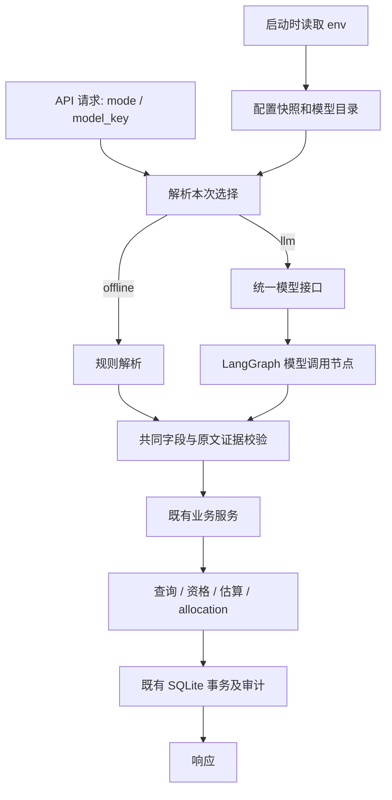

# 多模型供应商适配方案

方案已实施。使用方式见 [多模型接入说明](MULTI_PROVIDER_SETUP_CN.md)。下文保留设计与分工约定；具体实现结果见文末。

## 1. 需求与运行规则

支持 OpenAI、Anthropic Claude、Google Gemini、DeepSeek 四家在线供应商，以及现有 offline 规则解析。一个供应商可以配置多个模型。

服务启动时读取一次环境配置，保存为进程内的配置快照。后续请求根据该快照选择模型，业务代码不再次读取 `.env` 或调用 `os.getenv()`。同一模型集成可能有自己的环境变量默认行为，所以工厂必须从快照显式传入密钥、模型名和调用参数，不能让它在请求期间重新从环境推导配置。

用户可选择 `offline` 或 `llm`，默认 `llm`。LLM 模式下，可以从界面中选择启动配置里注册的模型；接口只传 `model_key`，系统自动找到对应供应商。未选择具体模型时使用配置中的默认模型，用户无需在自然语言中声明供应商或模型。

只读一次环境配置是明确要求。客户端是否共享、模型对象是在启动时构建还是首次使用时构建、图是否缓存，属于实现选择。本方案建议在启动时注册模型配置，并可提前构建模型对象供请求取用；具体资源生命周期根据集成库和 checkpoint 的连接管理决定。

多家密钥同时存在时，将对应模型都注册进目录，不随机轮换，不按 request_id 猜选供应商。请求选择优先于服务默认模型。服务运行中编辑 `.env` 后需重启才能应用新配置，模式和已有模型之间的请求级切换则立即生效。

## 2. 现有代码与本次范围

目前 `app/agent/intake/parser.py` 根据 `offline`、`llm`、`deepseek` 构建 backend；其中旧名称 `llm` 指 Gemini。`app/core/config.py` 也只接受这三个 backend。当前没有 OpenAI、Claude 集成依赖。

LangGraph 用于 session 的意图、澄清、预览、确认和关闭流程。`POST /api/requests` 经 `services/dispatch.py` 直接调用 Parser，没有经过多轮会话图。两条入口应复用相同的模型目录、调用节点和解析校验，但保留各自的业务行为：单轮接口成功即提交，session 先预览、显式确认才提交。

模型负责理解文本和产生结构化字段。确定性资格判断、交期/成本计算、allocation、SQLite 业务提交继续由现有代码负责。模型切换不会改变分配器的规则或教授 simulator 的调用入口。

## 3. 技术路线

使用 LangGraph 编排 Agent，使用 LangChain 的统一 chat model 接口连接模型。OpenAI、Anthropic、Gemini 由对应模型集成包提供适配，不必自写三份原始 HTTP/SDK 调用流程；DeepSeek 也使用已有专用集成包。项目新增一个小工厂，负责参数映射和注册，不复制各家的完整通信实现。

官方资料：[LangChain Models](https://docs.langchain.com/oss/python/langchain/models) 说明统一模型接口及 `init_chat_model`；[ChatDeepSeek 集成](https://docs.langchain.com/oss/python/integrations/chat/deepseek) 提供 DeepSeek chat model。

建议新增依赖：`langchain`、`langchain-openai`、`langchain-anthropic`、`langchain-google-genai`、`langchain-deepseek`。实施时与当前 Python、LangGraph 版本核对兼容性，更新依赖锁文件，不在方案中假定特定的新版本号。

LangGraph 的 runtime context 可携带本次调用的模型/解析器。凭证和客户端不放进业务 state 或 checkpoint；state、响应和审计只保存不敏感的模型标识与执行信息。[LangGraph runtime context](https://docs.langchain.com/oss/python/langgraph/graph-api#runtime-context)

## 4. 代码目录与协作职责

下面标注“新增”的是拟增加文件；既有模块表示需要连接的入口，不代表已经修改。

```text
app/
├── core/
│   ├── model_settings.py             新增：启动时读取 env，生成配置快照
│   └── lifespan.py                   接入模型配置和目录初始化
├── schemas/
│   └── api.py                        增加 mode、model_key 输入契约
├── api/routes/
│   ├── requests.py                   接收本次模式/模型选择
│   ├── sessions.py                   每个 turn 可指定模式/模型
│   └── models.py                     新增：公开可用模型目录
├── services/
│   ├── multimodel_gateway.py         新增：请求级选择与既有业务服务衔接
│   ├── dispatch.py                   保留现有 SQL/事务实现
│   └── sessions.py                   保留现有 SQL/事务实现
├── agent/
│   ├── models/
│   │   ├── specs.py                  新增：ModelSpec、ResolvedSelection
│   │   ├── registry.py               新增：模型目录、默认模型、别名查找
│   │   ├── factory.py                新增：统一初始化供应商模型
│   │   ├── result.py                 新增：统一响应/错误/用量类型
│   │   └── legacy_backend_bridge.py  新增：兼容现有 Parser backend 接口
│   ├── providers/                    既有 Gemini/DeepSeek 实现保留兼容
│   ├── intake/
│   │   ├── model_parser.py           新增：共用 prompt 与模型输出转换
│   │   ├── parser.py                 衔接新运行时选择，保持 ParseResult 契约
│   │   └── validator.py              复用原文证据与字段校验
│   ├── router/
│   │   ├── model_context.py          新增：本次调用上下文
│   │   ├── request_graph.py          新增：单轮解析共用图
│   │   ├── graph.py                  保留会话意图/预览/确认路由
│   │   └── nodes/model_call.py       新增：统一模型调用节点
│   ├── prompt_catalog/               按任务管理 prompt，不复制四套业务规则
│   └── responses/                    统一澄清、失败与分配说明
├── tools/                            受保护：计算、allocation、数据库工具
└── db/                               受保护：SQLite 连接、迁移和初始化
```

配置负责人维护 env 契约和启动校验；模型负责人维护 factory、registry 和集成参数；Agent 负责人维护共用 Parser 和 LangGraph 节点；API/UI 负责人维护选择控件和接口字段。工具与数据库负责人继续维护原有实现。

所有既有工具和 SQLite 相关文件不修改内容，包括带 SQL 的 dispatch/session/lifecycle 服务。新增衔接能力放在新 gateway、bridge 或新的数据库辅助文件中。允许调整的现有文件限于配置入口、API/schema、Agent 编排/解析和 UI；实施前先列出保护文件清单。

## 5. 环境配置示例

```dotenv
AGENT_MODE=llm
LLM_DEFAULT_MODEL=sol56

OPENAI_API_KEY=...
OPENAI_MODELS={"sol56":"<实际 API 模型 ID A>","astra6":"<实际 API 模型 ID B>","sol61":"<实际 API 模型 ID C>"}

ANTHROPIC_API_KEY=...
ANTHROPIC_MODELS={"claude-main":"<实际 Claude API 模型 ID>"}

GEMINI_API_KEY=...
GEMINI_MODELS={"gemini-main":"<实际 Gemini API 模型 ID>"}

DEEPSEEK_API_KEY=...
DEEPSEEK_MODELS={"deepseek-main":"<实际 DeepSeek API 模型 ID>"}
```

JSON 映射的 key 是项目内 `model_key`，value 是供应商 API 模型 ID。界面显示名可以另外配置；不能把显示名称当成已经验证可调用的 API ID。上面的值只是占位符，不是有效配置。

启动读取 `OPENAI_*` 就把这些条目归属到 OpenAI，读取 `ANTHROPIC_*` 就归属到 Anthropic，其他供应商同理。用户不需要再输入 provider。保留现有 `GEMINI_API_KEY` 名称，工厂显式传递给 Google 集成，避免要求组员改密钥变量名。

兼容单模型配置：已有 `GEMINI_MODEL`、`DEEPSEEK_MODEL` 等可转换为一项模型目录。新目录配置优先；旧 `--backend` 的兼容映射集中处理，后续推荐只使用 mode 和 model_key。

默认模型未配置时，只有一个模型则自动使用；多个模型按固定、公开的注册顺序采用第一个，并在状态接口显示实际默认值。配置中的显式默认 alias 不存在、alias 重复或模式不合法则报配置错误。

## 6. 启动与单次请求

启动顺序：加载 `.env`（或读取启动进程已有环境）→ 生成配置快照 → 校验并注册模型目录 → 将目录放在应用运行时 → 正常启动服务。当前项目需要通过 `--env-file .env` 显式加载文件，方案不能假定 Python 自动读取 `.env`。

模型配置缺少密钥时将对应条目标记为不可用。没有任何 LLM 时仍允许服务启动并使用 offline；默认 LLM 请求会返回明确的“模型未配置”，不产生业务写入。构造客户端成功只表示本地配置已就绪，不等于远端密钥、额度或模型访问权限已经验证。

请求示例：

```json
{
  "request_id": "dispatch-001",
  "message": "为订单 ORD-041 找最快的工坊",
  "mode": "llm",
  "model_key": "astra6"
}
```

`mode` 可省略，默认 llm；`model_key` 可省略，使用目录默认模型。offline 模式不接受同时指定 model_key，避免输入有两种解释。API 接受已注册 alias，拒绝客户端传任意供应商、地址或密钥。



registry 根据 model_key 返回 ModelSpec；factory 接收配置快照中的参数，提供统一模型对象；每次调用选择一个本次执行上下文。共享客户端是可选优化，不能通过修改全局 active_model 实现请求级切换。

## 7. 初始化和节点参考

以下是架构伪代码，用于说明接口分工，不是直接可运行的实现。

```python
# 启动时唯一的环境读取入口。
settings = load_model_settings_once()
registry = ModelRegistry.from_settings(settings)
runtime = AgentRuntime(settings=settings, registry=registry)

# 本次请求只读取已保存配置。
selection = registry.resolve(
    mode=request.mode or settings.default_mode,
    model_key=request.model_key,
)
context = runtime.context_for(selection)
outcome = request_graph.invoke(input_state, context=context)
```

```python
# 模型工厂：集成包负责各家的通信适配。
from langchain.chat_models import init_chat_model

def build_model(spec, credential):
    return init_chat_model(
        model=spec.api_model_id,
        model_provider=spec.integration_provider,
        api_key=credential,
        **spec.supported_parameters,
    )
```

integration provider 映射为 openai、anthropic、google_genai、deepseek。模型参数按能力配置，不向所有模型强行传相同的 temperature、thinking 等参数。每家初始化参数的小差异放在 factory，不进入业务图节点。

```python
def model_call(state, runtime):
    response = runtime.context.model.invoke(state["prepared_messages"])
    return normalize_model_response(response, runtime.context.selection)
```

输出归一化、schema 验证、原文证据检查都集中处理。仅在支持时采用原生结构化输出；其他情况使用明确 JSON 提示并经过同一 validator。多模型接入本身不等于新增完整对话记忆：当前字段草稿与消息持久化继续由 session 服务负责。

## 8. 与现有业务、会话和幂等机制衔接

单轮入口由新增 `multimodel_gateway` 解析选择，再通过 `legacy_backend_bridge` 给既有 dispatch 提供兼容 backend。bridge 将共用模型调用节点包装成现有 `complete(message, reference_date, feedback)` 契约，原来的 ParseResult 和事务调用继续可复用。bridge 的配置身份必须包含 provider、实际 model ID、影响输出的参数及配置版本，使既有请求指纹能区分模型配置。

会话入口的每个 turn 均可覆盖 mode/model_key；不覆盖则使用默认配置。既有 session.backend 是旧格式字段，不能直接把任意新供应商名写进去。新增 gateway 与 Agent 运行时桥接完成本轮选择，现有 SQLite session schema/SQL 保持原样。必要的请求选择 ContextVar 只作兼容桥接，使用 token 在 finally 中重置；LangGraph 节点优先使用显式 runtime context。

现有 session 请求指纹没有 model_key，新 gateway 必须增加模型选择一致性检查：同 request_id 重试使用先前记录的选择；指定不同模型/模式返回 IDEMPOTENCY_CONFLICT。顺序执行和并发重复请求都要检查，不能只在调用前查一次。新增只读数据库辅助文件可读取既有审计 JSON；本轮元数据通过现有 Agent telemetry 通道保存，不改写既有 SQL 文件。

确认与关闭通常不需要模型调用；仍由原服务保证确认时重新核验订单状态、队列和版本，以及原子提交。响应与审计记录 mode、model_key、provider、实际 model ID、prompt/schema 版本、耗时、重试和可获取的用量。

后台任务跨线程/跨执行边界时需显式携带选择信息，不能假定 HTTP 请求的运行时 context 自动传播。若暂不扩展已有任务格式，后台任务只能使用明确的默认模型，并在界面和文档说明。

现有 checkpoint 在每轮创建独立 SQLite 连接并构建图。图是否只编译一次要结合该连接生命周期决定，不因多模型方案顺带改动现有数据库/checkpointer 文件。

## 9. UI 与状态接口

UI 提供模式选择：LLM / Offline，默认 LLM；LLM 下提供已配置模型列表，默认选中服务默认模型。用户点击选择后，前端自动传 mode/model_key，不需要在文本中说明模型。offline 下隐藏或禁用模型选择。

新增 `GET /api/models` 返回默认模式、默认模型和可用模型的 alias、显示名、provider、API ID、配置状态；不返回凭证。`configured` 表示本地配置存在，远端可调用性以实际调用结果为准。

已有客户端省略新字段时仍按服务默认值执行；旧 endpoint 的分配与确认语义不变。CLI 可以增加 `--mode offline|llm` 和可选 `--model-key`，不要求手工指定 provider。

## 10. 实施顺序和验收

1. 增加配置快照和模型目录；先完成 offline 与单模型选择，固定 env 只读一次的边界。
2. 接入四个集成包和统一 factory；兼容既有 Gemini/DeepSeek 的 prompt 与参数配置。
3. 增加共用模型调用节点、输出归一化和 backend bridge，连接单轮与 session 流程。
4. 增加 gateway、请求模式/模型字段和幂等选择校验；不修改受保护数据库文件。
5. 增加模型目录接口和 UI 选择控件。
6. 用 mock 模型核验配置解析、多模型切换、并发隔离、重试、重复 request_id、会话草稿保持及错误响应；然后使用配置好的真实密钥分别验证四家调用。

验收重点：多次请求没有再次读取 env；A/B 请求使用各自所选模型；同 provider 可注册多个模型；同一 session 的相邻 turn 能切换模型且保留草稿；切换模式不重启；重复请求不重复分配；模型失败不静默换供应商、不产生错误的生产写入；工具与现有 SQLite 文件内容保持不变。

## 11. 实施结果

已新增启动配置快照、四家 LangChain 集成工厂、模型目录、共用 LangGraph 调用图、Parser backend bridge、请求 gateway、只读模型审计 helper、模型目录 API，以及 UI 模式/模型选择。

实际模型调用节点集中在 request_graph.py，输出归一化在 agent/models/result.py；复用原 Parser 校验，没有复制四份业务解析器。后台 worker 的默认模型通过应用注册的运行时传递，不改动原 jobs 和 session SQL 文件。既有 checkpoint 实现保持原逻辑。

新增输入支持 mode/model_key；GET /api/models 提供完整目录。GET /api/ai/status 继续保留旧的三字段返回，避免破坏既有客户端。

283 项 Python 回归测试和 11 项前端测试通过；四家供应商的本地模型初始化通过。真实供应商 API 未调用，所以实际密钥、额度、API model ID 权限与远端解析质量仍需用真实配置验证。

对修改前的 38 个既有 tools、db、repositories 和 services 文件进行了 SHA-256 对比，内容保持一致。验证记录见 evaluation/results/multimodel_verification.json。
