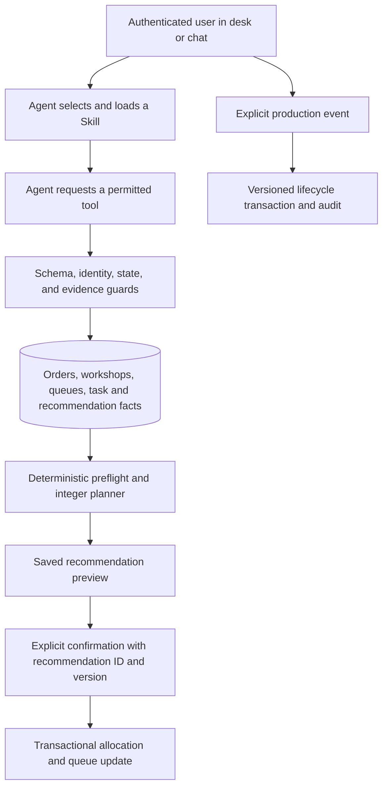

# SweaterCo Dispatch Desk: project overview

This page retains its historical filename so existing links keep working. It describes the current local MVP and should be read with the [Agent architecture](AGENT_SKILL_ARCHITECTURE.md) and [known limits](../KNOWN_ISSUES.md).

## Purpose and users

A dispatcher must match small garment orders to qualified subcontracting workshops while considering status, category capability, batch limit, existing queue, cost, defect rate, and due date. A request may omit an order ID or change constraints over several turns. The application records those requirements, calculates an auditable recommendation, and commits an allocation only after explicit confirmation. Production events record partial completion, cancellation, lapse, or reassignment.

The system has been verified as a local course MVP. It has not measured actual dispatcher time savings, realized financial benefit, or production-site performance.

## Current flow

LLM chat uses native model tool calls in a persistent LangGraph loop. Application `SKILL.md` files provide the business steps and available Toolsets. The model chooses queries, calculations, clarification, or explanation at runtime. Code and database transactions enforce legal state transitions and reject unsupported or stale actions. The older single-request parser and offline rules demonstration remain separate compatibility paths.

## Data and business rules

The bundled seed has 120 orders and eight workshops. Source CSV files are imported on first initialization; subsequent work uses SQLite and does not reload edits to those CSV files. The default course business date is 2026-04-01; audit timestamps use actual UTC time.

A workshop must be active, support the category, fit its batch limit, and satisfy user exclusions and preferences. The maximum workshop count is a cap, not a required split. The planner conserves the remaining order quantity. A specific preferred workshop must take the whole eligible batch. Lateness is normally a warning; an explicit hard deadline makes it a constraint. Queue reservations decay in calendar days and are changed only by controlled production transactions.

The existing task states are `COLLECTING`, `BLOCKED`, `READY`, `RECOMMENDED`, `CONFIRMED`, and `CANCELLED`. The database is authoritative for these states and for orders, recommendations, queue, and working allocations. A preview never writes a production allocation. A changed requirement supersedes its earlier recommendation; confirmation checks owner, ID, versions, and fresh business facts before writing.

## Scoring and evaluation

The supported planning objectives are `min_delay`, `min_cost`, `min_defects`, and the planner's weighted `hybrid`. The weighted hybrid uses `0.6 * estimated_days + 0.4 * defect_rate * 100`. The restored `app/tools/allocation.py` provides four original single-workshop timing and score functions. Its `get_hybrid_score` is deadline-gated defect rate and has different semantics from the planner objective. The Agent's `score_workshop` tool calls all four original functions without copying their formulas.

Earlier fixed-seed single-workshop simulator comparisons reported mean completion days of 21.52 for random, 49.02 for biggest-first, 105.13 for cheapest, 8.05 for planner `min_delay`, and 8.79 for planner `hybrid`. These course-simulator figures do not establish real-world advantage or a globally optimal hybrid policy.

The current automated suite checks API compatibility, state and transaction invariants, native tool binding, Skill loading, original score calls, pause and restart recovery, illegal-action refusal, and UI controller behavior. Mocked or offline tests do not prove live provider reliability. The original labels and parser examples are development regressions rather than an independent blind set.

## Main modules

| Area | Current implementation |
| --- | --- |
| HTTP and authentication | `app/main.py`, `app/api`, `app/core` |
| Dynamic Agent and Skill loading | `app/agent/dynamic.py`, `app/agent/skills.py`, `app/skills/*/SKILL.md` |
| Tool contracts and guards | `app/agent/toolset.py` |
| Chat and confirmation | `app/services/agent_chat.py`, `app/services/chat.py` |
| Preflight, planning, and commitment | `app/services/allocation_preflight.py`, `app/services/allocation.py`, `app/tools/allocator/planner.py` |
| Original single-workshop formulas | `app/tools/allocation.py` |
| Production lifecycle | `app/services/lifecycle.py` |
| Database and migrations | `app/db` |
| UI | `app/ui`, served at `/` and `/chat` |

For setup, see [Setup and data import](UV_SETUP.md). For execution traces, tool contracts, transaction boundaries, and recovery behavior, see the [Agent architecture](AGENT_SKILL_ARCHITECTURE.md).
