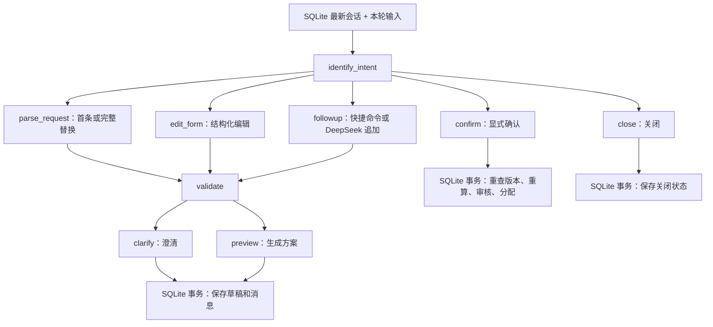

# FastAPI / LangGraph 改造说明

后续账号更新：当前业务库为 v7，新增 user/admin 角色、预置管理员及左上角标识，账号详情见 [初始化指南](UV_SETUP.md)。提示词后续整理：模型指令集中于 `app/agent/prompt_catalog/catalog/` 的版本化 YAML，注册表负责加载与组装；用户回复集中于 `app/agent/responses/`，旧导入路径已于 2026-10-14 退役，调用方直接使用正式路径。新增功能和版本维护见 [英文提示词指南](../app/agent/prompt_catalog/README.md)。以下记录为架构改造时的 v6 说明。

2026-10-13，应用 v0.6。SQLite 业务库升级到 v6；Parser v1、Session v1 和 Pipeline v0.2 的业务指纹保持不变。

## 启动和接口文档

已初始化过数据库的项目执行：

```text
uv sync --locked
uv run --locked python -m app.server --backend offline
```

首次使用先运行 `uv run --locked python -m app.cli.setup`。已有数据库不需要重新导入数据；打开时按顺序事务迁移。服务默认绑定 127.0.0.1，单进程运行。正常关闭服务后再备份 SQLite 文件；如果直接复制运行中的 WAL 数据库，需要连同 WAL 文件一致备份。

界面地址仍是 `http://127.0.0.1:8000/`，旧页面在 `/legacy`。新增：

- `/docs`：按功能分组的 Swagger 交互式接口文档。
- `/redoc`：ReDoc 阅读视图。
- `/openapi.json`：可导入客户端工具的 OpenAPI 契约。

文档页面使用 FastAPI 默认 CDN 资源，因此其视觉界面加载需要网络；API、OpenAPI JSON 和业务 UI 在 offline 模式下无需模型网络。文档页面可公开读取；业务接口沿用登录要求。在同一浏览器通过主页登录后，可在 `/docs` 调用业务接口，HttpOnly Cookie 自动发送。

原有 `--port`、`--db`、`--backend`、`--as-of`、`--no-auth` 参数继续使用。DeepSeek/Gemini 的启动方法和密钥变量保留；`.env` 必须通过 `--env-file .env` 显式加载。

也可用应用工厂启动（使用一个 worker）：

```text
uv run --locked uvicorn app.main:create_app --factory --host 127.0.0.1 --port 8000 --workers 1
```

工厂读取 `DISPATCH_DB`、`DISPATCH_AS_OF`、`DISPATCH_NO_AUTH` 和原有模型配置。两个生产启动入口都要求先完成初始化；显式传入 Settings 的底层测试工厂保留示例数据初始化能力。不要给本机课程部署增加多 worker：worker、限流和业务日期配置按单进程设计。

## 模块分布

| 目录 | 职责 |
|---|---|
| `app/main.py` | 创建 FastAPI、注册路由、静态资源和生命周期 |
| `app/api/` | HTTP 依赖、输入错误、安全策略、状态码与路由 |
| `app/core/` | 配置、认证、应用生命周期 |
| `app/schemas/api.py` | 严格的 Pydantic 输入和可扩展响应模型 |
| `app/services/` | 分配、会话、生产事件、job 和工作台用例；事务与审计在此协调 |
| `app/agent/intake/` | 单条消息解析、规则、校验、字段合并和提示词 |
| `app/agent/router/` | LangGraph 状态、节点、条件路由与 SQLite checkpoint |
| `app/tools/allocator/`、`app/domain/lifecycle.py` | 当前确定性分配器与生产事件的纯校验规则 |
| `app/agent/providers/` | DeepSeek、Gemini 客户端 |
| `app/tools/database/`、`app/db/` | SQLite 数据访问、初始化、CSV 导入、迁移 |
| `app/cli/` | 分配、会话、生产操作、初始化及服务器命令 |
| `app/ui/` | 当前静态业务界面 |

2026-10-14 已移除旧模块转发，所有调用方直接使用职责目录中的正式实现。账号、初始化、会话和生产命令统一到 `app.cli`，详见 [迁移清单](CODE_CLEANUP_CN.md)。`app/server.py` 仍提供 Uvicorn 和本地测试所需的 `make_server()`，HTTP 状态码统一在 `app/api/status.py`。

API 调用 services；工作流节点调用解析器和会话服务的事务回调；分配服务调用 tools/allocator 与 tools/database，生产事件使用 domain/lifecycle 的纯校验规则。services/domain 不依赖 FastAPI。历史 CSV 查询/分配工具和 Week 4 固定样例解析器已移除；数据首次导入继续使用 `app/db/import_data.py`。

## 接口兼容

原 `/api/...` URL 和主要响应字段保留，本轮没有改成 `/api/v1`。Pydantic 拒绝未知字段和隐式类型转换，例如 `expected_version=true` 或字符串版本号返回 400。原有业务返回 `result`，传输错误返回 `error`；输入错误可附带不含原始输入的 `details`。200 仍可能包含 CLARIFY、REFUSE 等业务结果，应检查 `result` 与 `committed`。

Cookie 仍是 HttpOnly / SameSite=Strict、八小时有效，认证模式下操作者由服务端注入。保留同源写入、50KB 请求上限、登录限流和固定静态资源白名单。响应新增 `X-Request-ID` 和耗时信息，不改变业务请求的幂等 key。

`POST /api/requests` 保持单消息直接分配。需要审核确认的流程使用 `/api/sessions` 和 `/api/sessions/{id}/turns`。后台 job 只修订草稿，不自动确认。

## LangGraph 流程与持久化



第一版 `identify_intent` 按显式 action、首轮、表单和追加消息进行确定性路由。自由文本的业务语义仍由现有 parser 处理；未来跨订单查询、复杂任务规划或模型意图分类应扩展这个节点和条件边。本轮没有引入通用自主 Agent，也没有让模型决定资格、金额、工期或直接写库。

每轮从 `sessions` 读取草稿；图执行过程保存在同一 SQLite 文件的 LangGraph `checkpoints` 和 `writes` 表。每次执行使用独立 graph thread，不以历史 checkpoint 覆盖会话草稿。新一轮、重试和重启均重新读取业务会话；生产事务始终重查 request key、会话版本和订单版本。checkpoint 不包含数据库连接、模型客户端或密钥。

预览与澄清只保存会话和审计，确认才调用生产提交。如果业务已提交、但最后的 checkpoint 保存失败，服务查回 requests 中的结果并返回，不误报业务回滚。未提交的数据库故障允许使用同一 request ID 重试。

图执行轨迹保存于 `parser_telemetry.workflow`，含图版本、意图和节点序列。诊断 checkpoint 不自动删除；可在停止服务后清理超过保留时间的执行过程：

```text
uv run --locked python -m app.cli.checkpoints --db runtime/dispatch.sqlite3 --retention-days 30
```

清理不删除 sessions、messages、requests 或生产审计。会话和业务数据恢复依赖 SQLite 备份，不依赖自动恢复旧写节点。

## SQLite 后台队列

生产工坊队列仍是业务数据；jobs 表是后台执行队列。应用生命周期启动一个串行 worker，关闭时停止领取新任务并等待当前任务；超过等待时间的线程保留，避免启动另一个同库 worker。进程退出导致的中断通过租约恢复。

任务原子领取使用 `BEGIN IMMEDIATE`。领取后增加 attempts 并记录 worker 标识和 180 秒租约；执行中每 30 秒续租。无租约的旧 running 任务或租约过期的任务会被恢复。网络解析不持有业务写事务；数据库连接沿用 10 秒 busy timeout。应用先初始化 LangGraph SQLite saver 的 WAL 和表，再启动 worker，避免首次请求切换日志模式时与后台写锁竞争。

默认最多尝试三次，可恢复数据库或 I/O 故障等待 2、4 秒后重试；业务版本冲突、无效参数等直接失败。恢复时优先匹配 requests 的完整指纹并取回已经保存的结果，即使达到重试上限，也不会把已完成会话操作误报失败。后续新操作需要新 request ID。

客户端提供的 job `request_id` 同时是入队幂等 key 和会话操作 key。同 key、同输入和操作者返回原 job；不同输入返回 409。未提供 key 时服务器生成 key，适合单次提交；需要网络重试时客户端应主动提供稳定 key。

取消与会话保存使用同一 SQLite 写锁确定先后：取消先完成时，保存前的 guard 阻止会话变化；会话保存先完成时，取消接口返回已经保存的真实结果。租约被新 worker 接管后，旧 worker 无法保存草稿或覆盖新 worker 的任务结果。租约重试允许重复计算，业务写入依靠原请求幂等机制。

数据库损坏、磁盘写满或 SQLite 文件不可访问时不能承诺继续完成；任务和结果可从持久化记录检查。此方案适用于课程项目的单机、单进程、低并发部署。

## 验证

原有接口、CLI、解析、分配、生命周期、事务与并发测试继续运行。新增测试覆盖 OpenAPI 契约、严格版本类型、静态资源白名单、图节点分支、checkpoint 故障、job 幂等、取消竞争、租约恢复、有限重试和 v5→v6 迁移回滚。

2026-10-13 完成本次验证：232 项 Python 测试、7 项前端测试全部通过；60/60 离线解析、30/30 原有业务行为、14 组模拟器通过且官方基线未变；连续 HTTP 演示完成 20 次预览、10 次确认和 30 条记录导出。预览、确认单次最大耗时分别约 82ms、71ms，仅代表本机离线 HTTP 测量。机器记录见 [改造验证报告](../evaluation/results/framework_refactor_verification.json)。

```text
uv run --locked python -X utf8 -m unittest discover -s tests -q
node --test tests/test_ui_state.cjs
```

离线测试不代表真实 DeepSeek/Gemini 在线调用已通过。参考：[FastAPI 生命周期](https://fastapi.tiangolo.com/advanced/events/)、[LangGraph SQLite saver](https://reference.langchain.com/python/langgraph.checkpoint.sqlite/SqliteSaver)。
