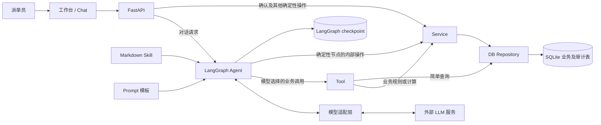

# 目标架构

本文描述项目希望达到的架构与模块职责，不代表当前代码已全部按此实现。现有调用链、文件位置及迁移差距见 [current_architecture.md](current_architecture.md)；开发约定见 [AGENTS.md](../AGENTS.md)。

## 1. 总体架构

系统围绕自然语言派单建立四个协作层次：FastAPI 提供请求入口，LangGraph 与 LLM 处理对话和任务编排，Tool 与 Service 提供受控的业务能力，DB 层保存业务事实和执行记录。推荐是供派单员审阅的方案；分配确认是独立的显式操作。

### 设计思想

- **FastAPI** 接收和处理 HTTP 请求，负责接口输入、身份校验及响应。
- **LangGraph** 管理 Agent 工作流，包括状态、节点路由、工具调用循环、暂停与恢复。
- **LLM** 理解自然语言请求并进行必要的动态推理，选择下一步行动和组织解释；其输出不直接构成业务事实或状态变更。
- **Markdown Skill** 指导 Agent 执行任务，说明步骤、工具使用、分支、澄清与 Fallback 方法。
- **Tool** 向 Agent 暴露标准化能力，验证输入，调用 Service 或 DB Repository，并返回结构化结果。
- **Service** 执行确定性的业务计算、评分、规划、规则校验和状态变更策略。
- **DB 层** 统一管理持久化，包括 Repository、SQL、连接、事务和迁移。

### 系统整体架构

图表示目标职责和允许的调用方向，并非每个请求都经过 Agent。LangGraph 的确定性节点可以直接调用 Service；Tool 仅在需要向 LLM 暴露可调用能力时使用。业务数据与 checkpoint 可以存于同一个 SQLite 文件，但承担不同职责。

### 关键请求路径

1. **自然语言对话：**FastAPI 校验请求及身份后，将消息交给 LangGraph。Agent 根据 Markdown Skill 和 Prompt 调用模型；模型选择已获准的 Tool。Tool 验证输入，再调用 Service 或执行简单的 Repository 查询，将结构化结果返回 Agent 用于后续决策或解释。
2. **推荐与确认：**Service 核对订单、工坊、队列及约束，计算并保存可审阅的推荐。保存推荐不改变生产分配或队列。派单员通过独立的确认操作指定推荐；Service 重新核对身份、版本和最新业务事实后，在事务中提交分配及审计记录。普通对话文本或模型回复不能代替确认。
3. **确定性操作：**不需要模型选择能力的 HTTP 操作可以从 FastAPI 直接进入 Service；LangGraph 的确定性节点也可以直接调用 Service。生产事件沿用同一业务规则与事务入口。
4. **兼容路径：**当前离线规则模式、旧会话接口和单消息派单接口各有独立流程，其现状与语义见 `current_architecture.md`。它们不作为 LLM 原生 Tool 调用的实现依据。

### 状态与可靠性边界

SQLite 业务表是订单、队列、推荐、分配及任务状态的权威来源。LangGraph checkpoint 保存对话上下文、Skill 快照、待答问题和执行位置；恢复执行时仍需重新核对业务数据。Tool 权限、输入校验和 Service 规则共同限制模型可执行的动作。

写操作使用事务、请求 ID、版本检查及幂等机制处理重试和并发。系统记录 Tool 调用、业务决策与状态变化，供事后审计。信息缺失、约束冲突或数据过期时，应澄清、拒绝或重新计算，不能用模型推测补足业务事实。

### 核心技术组件

| 组件 | 职责 |
| --- | --- |
| Python 3.11+、`uv` | 应用运行环境与锁定的依赖管理。 |
| FastAPI、Uvicorn | HTTP 接口、请求处理及本地服务运行。 |
| LangGraph、SQLite checkpointer | Agent 工作流、状态保存、暂停与恢复。 |
| LangChain 模型适配层与 ModelRegistry | 配置并调用 OpenAI、Claude、Gemini、DeepSeek 模型，支持原生 Tool 调用。 |
| Markdown Skill、PyYAML、Prompt 模板 | 保存任务指引、加载 Skill 元数据及管理模型提示内容。 |
| Pydantic | 校验 HTTP 输入输出契约；目标分层也将 Agent State 与 Tool 契约集中管理。 |
| Service 与确定性规划器 | 执行资格判断、交期估算、评分、分配规划和生产规则。 |
| SQLite | 保存业务数据、审计记录、Job 状态及 LangGraph checkpoint；业务表与 checkpoint 的权威范围不同。 |
| 原生 HTML、CSS、JavaScript | 提供工作台和 Chat 界面。 |

上述技术组件依据当前项目选型列出；目标分层尚未全部落实到相应目录，现有代码的位置与差距以 `current_architecture.md` 为准。

## 2. Component Responsibilities & Dependencies（组件职责与依赖关系）

本节定义目标架构的组件职责、依赖方向和组件选择标准。`architecture.md` 是目标架构的设计依据，`AGENTS.md` 应与其保持一致；当前旧实现用于了解现状和规划迁移，不作为目标分层的判定标准。

### 2.1 Component Responsibilities — 组件职责

| 组件 | 主要职责 | 职责边界 |
| --- | --- | --- |
| UI | 收集用户输入，展示澄清问题、候选方案、推荐、确认结果和执行轨迹。 | 不自行计算业务结果，也不将页面状态当作业务事实。 |
| API（`app/api/`） | 定义 HTTP 接口，校验请求与身份，调用 LangGraph Runtime 或 Service，将结果转换为 HTTP 响应。 | 不实现派单算法或生产状态规则。 |
| LLM Agent（`app/agent/`） | 理解任务、根据 Skill 选择 Tool、分析结果、提出下一步智能操作并与用户交互。 | 可以提出 Tool 调用、澄清或回答，但不直接控制节点跳转、强制暂停或修改工作流及业务状态。 |
| LangGraph Runtime（`app/agent/`） | 管理节点执行、路由、工作流状态、Agent–Tool 循环、强制暂停与恢复。 | 根据代码定义的节点、边和状态规则执行；不将模型提出的行动直接视为已完成的操作。 |
| Skill（`app/skills/`） | 用 Markdown 描述任务步骤、工具使用、分支、澄清及 Fallback。 | 是由 Loader 加载的资源，不主动依赖或执行 Agent；文本不授予权限，也不代替代码中的业务规则。 |
| Prompt（`app/prompts/`） | 保存模型提示模板及其版本，供 Loader 读取并组装模型输入。 | 是被加载的资源，不主动依赖或执行 Agent；不保存需要确定性执行或审计的业务规则。 |
| Tool（`app/tools/`） | 向 LLM Agent 暴露具名能力；校验接口参数、调用权限与上下文，调用下层接口，并返回结构化结果。 | 不复制业务计算，不直接编写业务 SQL；Tool 的校验不能代替 Service / Policy 的业务校验。 |
| Service / Policy（`app/services/`） | 独立执行确定性业务操作与规则，包括资格判断、交期估算、评分、规划、约束校验、推荐、确认和生产事件。 | 无论调用方是 Tool、API 还是 LangGraph 确定性节点，都必须自行强制执行业务规则；不依赖上层已完成的检查。 |
| DB（`app/db/`） | 管理连接、SQL、CRUD、Repository、事务和迁移，提供业务数据访问接口。 | 不决定派单策略，也不依赖 Agent、Tool、Service 或 API。 |
| Schema（`app/schemas/`） | 定义 HTTP、Agent State、Tool 输入输出及业务数据契约。 | 承载数据结构与校验，不编排工作流或执行持久化。 |
| Config（`app/config/`） | 启动配置（数据库路径、业务日期、模型环境）。 | 不承载派单规则或 LLM 调用实现。 |
| Core（`app/core/`） | ASGI 生命周期、本地账号与 Cookie 鉴权。 | 不存放 LLM 客户端或业务规则。 |
| LLM（`app/llm/`） | LLM ModelRegistry、LangChain 工厂与选择/错误契约。 | 不实现派单算法；不代替 Prompt/Tool。 |

*Policy 是 Service 层中负责确定性业务决策与约束执行的逻辑，可以实现为独立模块或函数，不要求每项规则都创建单独的 Service。*

### 2.2 Dependency Rules — 模块依赖规则

依赖总体由入口和编排层指向业务层，再指向数据层：

1. **UI → API。**浏览器通过 HTTP 使用业务能力，不直接访问数据库或模型客户端。
2. **API → LangGraph Runtime 或 Service。**自然语言对话进入 LangGraph Runtime；确认分配、查询、生产事件等确定性操作可以直接调用 Service。API 不重复业务规则。
3. **LangGraph Runtime → LLM Agent、Tool 或 Service。**Runtime 根据代码定义的状态与路由规则执行流程。LLM 提出 Tool 调用或下一步行动，Runtime 负责调度、校验和状态更新；确定性节点可直接调用 Service。LLM 不直接执行操作或绕过流程守卫。
4. **Runtime → Loader → Skill / Prompt。**加载器按需提供任务指令和提示模板。Skill 可以声明候选 Tool，但 Markdown 文本本身不构成授权；实际调用须通过 Runtime 和 Tool 的代码校验。Markdown 资源不执行代码。
5. **Tool → Service / Policy 或 DB Repository。**Tool 校验参数格式、调用权限及上下文。涉及计算、业务判断或状态变更时调用 Service / Policy；仅需简单读取数据时可以直接调用 DB Repository。Tool 不直接执行 SQL。
6. **Service / Policy → DB Repository。**Service / Policy 独立校验资格、约束、版本、业务状态及写入前置条件，通过 DB 层的 Repository 与事务接口读写数据。即使入口已经由 Tool 校验，也必须执行自身的业务检查；Service / Policy 不调用 Agent、Tool 或 API。
7. **Schema 为跨层契约。**共享数据结构放在 Schema 层，避免将 API、Agent 或数据库内部对象作为其他层的公共接口；模块之间不得形成循环依赖。

LangGraph checkpoint 是 Runtime 执行状态的持久化设施，可以通过专用 checkpointer 接入；它不是业务数据访问入口。订单、队列、推荐和分配仍须通过 DB Repository 读取，并由 Service / Policy 判断其业务含义。

### 2.3 Skill vs Tool vs Service — 组件选择标准

| 需要实现的内容 | 放置位置 | 判断依据 |
| --- | --- | --- |
| “推荐前先核对订单；缺少订单 ID 时追问；Tool 失败时如何继续” | Skill | 这是 Agent 执行任务的步骤与分支指引。 |
| “首选工坊不可用时，查询替代工坊；仍无可行方案时澄清或说明限制” | Skill | Skill 定义 Fallback 流程和 Agent 应采取的后续步骤，不自行判定工坊是否合格。 |
| “理解用户目的、选择查询还是计算、分析 Tool 结果并组织回复” | LLM Agent | 这需要基于当前对话和结果进行智能判断。 |
| “决定实际进入哪个节点、是否强制暂停、何时恢复、如何更新工作流状态” | LangGraph Runtime | 这是必须由代码执行的工作流控制。 |
| “让 LLM 查询订单、读取队列或请求工坊资格检查” | Tool | 模型需要可选择、可校验、可记录结果的调用接口；Tool 将资格判断交给 Service / Policy。简单查询可由 Tool 调用 DB Repository。 |
| “判断首选工坊的状态、产品能力、批量上限及其他业务约束是否满足” | Service / Policy | 这是确定性条件判断。无论通过 Tool 还是其他入口调用，都必须执行同一规则。 |
| “计算预计交期、拆单方案或候选排序” | Service / Policy | 结果由确定性计算得出，并可供 Agent、API 或后台任务复用。 |
| “提交推荐、更新队列、记录生产完成” | Service / Policy + DB | 这是需要版本检查、事务与审计的业务状态变更；若允许 Agent 发起，再提供受限的 Tool 接口。 |
| “保存或读取订单、工坊、推荐与审计记录” | DB Repository | 这是数据访问；Repository 不决定方案是否可行。 |

简要判断顺序：**任务步骤与 Fallback 写 Skill；LLM Agent 根据 Skill 提出下一步操作；LangGraph Runtime 执行节点调度、状态管理和强制流程约束；面向模型的能力做成 Tool；业务计算与确定性条件判断写 Service / Policy；数据存取写 DB Repository。**同一业务规则只保留一份确定性实现。

## 3. Agent & LangGraph Execution

### 3.1 Overall Execution Flow

系统收到用户消息后，Runtime 结合已有任务上下文理解意图，通过主 Graph 的通用任务入口调用相应业务流程，并将结构化任务结果交给回复生成节点。MVP 仅实现 Allocation 业务任务。

Allocation Subgraph 先执行固定准备阶段：使用 Prompt 和 LLM 提取派单字段，由代码校验输入，并通过 Service / Policy 查询和核对业务事实；此阶段不使用 Skill 或 Tool。准备阶段不能继续时，子图返回澄清、阻止或失败结果。准备完成后，子图加载 allocation Markdown Skill，进入 Agent–Tool Loop。LLM 依据 Skill 提出行动，Runtime 控制实际执行，Service / Policy 完成确定性判断与计算。

推荐与业务提交是不同阶段。Allocation 生成的推荐是待确认结果，不因 Agent 完成回复而自动提交。用户可以在后续对话中继续该任务；任务状态、恢复与提交控制由第四章规定。

### 3.2 Intent Routing & Skill Loading

意图识别节点使用 Prompt 调用 LLM，结合当前消息和已有任务上下文输出结构化判断。Runtime 校验判断结果，由代码决定继续已有任务、创建新任务或调用哪个业务流程。澄清答复、确认及修改请求不默认创建独立任务。

Intent、Business Task 和 Skill 不要求一对一。Intent 表示用户当前目的，Business Task 承担任务执行，Skill 是按需加载的指导资源。业务任务可以使用零个、一个或多个 Skill；MVP 中的 Allocation 与 allocation Skill 只是首个实例。

业务流程在需要 Skill 的阶段调用 Loader，读取 `SKILL.md` 的元数据和正文，向 Agent 提供任务步骤、策略、Tool 使用及 Fallback 指引。Skill 不执行代码，也不授予 Tool 权限。MVP 的 Allocation 在固定准备阶段不加载 Skill，进入推荐阶段才加载 allocation Skill。已有任务如何识别和续接由第四章规定。

### 3.3 Agent–Tool Execution Loop

Agent Executor 提供可复用的模型与 Tool 循环：Runtime 向 LLM 提供任务上下文、已加载 Skill 和当前允许的 Tool；LLM 提出调用；Runtime 校验并执行 Tool，将结构化结果交还 LLM，再决定是否继续循环。调用记录、执行上限、强制暂停和循环出口由代码控制，不隐藏在普通 Python 节点的手写 `while` 中。

LLM 不再调用 Tool 仅表示模型没有提出下一次调用，不代表任务成功。循环退出前必须经过 Completion Guard。Agent Executor 提供执行记录和终止原因；各业务流程自行检查结果及必要前置条件，决定任务是否完成、需要用户输入或失败。不能依据模型回复宣称未经验证的业务结果。具体状态转换与恢复规则由第四章规定。

### 3.4 Tool Registry & Dynamic Binding

Tool Registry 集中登记 Tool 名称、用途、输入输出契约和执行入口。Runtime 根据已注册 Tool、已加载 Skill、当前任务状态及调用权限，动态确定每次模型调用实际可见的 Tool 集合。Skill 可以声明候选 Tool，但其文本不构成授权。

模型提出 Tool Call 后，Runtime 仍须校验名称、参数、权限和上下文。Tool 返回结构化结果；简单读取可调用 DB Repository，业务判断、计算或状态变更必须调用 Service / Policy。Service / Policy 独立强制执行业务规则。各业务自行确定所需 Skill 与候选 Tool，共享 Registry 和执行校验机制。

### 3.5 Main Graph & Subgraph Design

主 Graph 负责通用的任务识别与路由、业务流程调用及回复生成。它依据统一的任务结果进行调度，不解析订单字段、推荐 ID 或其他业务专有数据。MVP 通过通用任务入口调用独立的 Allocation Subgraph；Allocation 的固定准备阶段、Agent–Tool Loop 和 Completion Guard 均在子图内部。

仅有少量确定性操作、无需内部路由或独立恢复的业务，可以实现为业务节点；具有多个阶段、循环、分支或暂停需求的业务，使用 Subgraph。MVP 的 Allocation 采用 Subgraph；未来业务按自身复杂度选择，两者均向主 Graph 返回统一的 `TaskResult`。

Agent Executor 的模型与 Tool 循环可供不同业务流程复用；各业务保留自己的准备流程、Skill、Tool 集合和 Completion Guard。`TaskResult` 的状态含义、任务续接及主图与子图的 State 边界由第四章规定。

## 4. State Management & Workflow Control（状态管理与工作流控制）

### 4.1 Graph State

主 Graph State 保存通用的会话与任务上下文，包括当前消息、任务身份、任务类型、执行阶段以及业务流程返回的 `TaskResult`。业务 Subgraph 保存自身的工作状态，例如已提取字段、待处理问题、已加载 Skill、Agent 消息和 Tool 结果。业务专有字段不放入主 Graph 的通用 State。

各节点通过返回结构化的 State 更新来传递结果；LLM 输出须先经过解析和校验，不能直接修改工作流状态。主 Graph 与 Subgraph 通过明确的输入输出契约传递任务身份、消息和结果，Subgraph 的内部 State 不作为主 Graph 的公共接口。

checkpoint 保存工作流进度与恢复所需的上下文。订单、推荐、分配等业务事实以数据库为准；State 中保存的业务快照仅供当前执行参考，不能覆盖数据库中的最新事实。

### 4.2 Workflow Routing & Guards

Runtime 根据已有任务状态、结构化意图和业务流程返回的结果执行条件路由。主 Graph 决定继续已有任务、创建新任务或调用哪个业务流程；Subgraph 控制其内部准备阶段、Agent–Tool Loop 及出口。LLM 可以提出下一步行动，实际节点跳转和状态转换由代码控制。

业务流程守卫在执行前检查必要条件。固定准备阶段识别字段缺失或模糊、实体不存在、事实冲突及系统错误，并将其导向相应的澄清、阻止或失败出口；MVP 对可由数据库权威事实消解的差异，记录后继续处理。这里规定出口类型，不在 Runtime 中复制 Service / Policy 的业务规则。

Agent–Tool Loop 设定模型调用和 Tool 调用上限，并在退出时经过 Completion Guard。模型不再调用 Tool 不等于任务成功；业务流程必须核对结构化结果、必要的 Tool 结果和前置条件。提交等状态变更还须由 Service / Policy 再次检查当前业务事实，不能依据模型的成功声明执行。

### 4.3 Clarification, Interrupt & Resume

当任务需要用户澄清信息或确认方案时，业务流程记录待答复事项及当前任务上下文，由 LangGraph Runtime 暂停执行或进入等待状态。用户后续回复应关联已有任务，并交由对应业务流程处理，避免被重新识别为一项独立任务。

流程依据保存的 State 和 Checkpoint 恢复，避免不必要的重复处理；设计时必须考虑节点重执行。使用 `interrupt()` 时，恢复会从发生中断的 Node 开头重新执行。涉及数据库写入、业务提交等副作用的操作，应通过幂等保护或合适的节点边界，避免恢复时重复执行。

MVP 中，无法继续处理的缺失或模糊信息可直接产生 `blocked` 结果。未来增加持续追问时，可让任务进入 `waiting_user`，并在收到回复后继续已有任务。

### 4.4 Completion, Failure & Progress

各业务流程通过统一的 `TaskResult` 向 Main Graph 返回任务结果。`TaskResult` 的主要状态限定为以下四种：

| Status | 含义 |
| --- | --- |
| `completed` | 任务已完成 |
| `waiting_user` | 等待用户澄清或确认 |
| `blocked` | 按当前输入或业务条件无法继续，包括业务规则明确拒绝 |
| `failed` | 系统执行失败 |

具体的阻止或失败原因由 `issues` 表达，不再为每类原因单设主要状态。推荐结果已经生成、但仍等待用户确认时，任务为 `waiting_user`；确认后的业务提交由相应流程继续处理。

`running` 属于 Workflow State 或进度事件，不作为 `TaskResult` 的主要状态。Runtime 可向前端报告当前执行阶段和等待事项；最终任务状态以业务流程返回并通过守卫检查的 `TaskResult` 为准。

## 5. Business Workflows & Decision Policies

业务流程负责定义自身的准备步骤、可用能力、结果契约和完成条件。Skill 指导 Agent 如何寻找、比较和解释方案；Service / Policy 独立执行确定性业务判断。Main Graph 只接收通用 `TaskResult`，不承载派单或生产规则。

### 5.1 Allocation & Recommendation

Allocation Subgraph 先执行固定准备阶段。字段提取节点使用 Prompt 和 LLM 将用户请求转换为结构化派单信息；代码校验提取结果，Service / Policy 通过 DB Repository 查询订单和相关业务事实。此阶段不加载 Skill，也不通过 Tool 执行固定操作。

字段缺失或模糊、订单不存在时，MVP 跳过推荐并返回带有 `issues` 的 `blocked` 结果。提取信息与数据库记录不一致时，以数据库作为业务事实依据；用户明确提出的约束仍须保留并验证。无法安全处理的冲突不得由 LLM 自行猜测。系统执行错误返回 `failed`。

准备完成后，Subgraph 加载 allocation Skill，进入 Agent–Tool Loop。Skill 定义推荐策略，包括核对哪些信息、如何寻找候选与备选、何时调用相应 Tool，以及如何解释结果。Agent 根据 Skill 和 Tool 结果提出下一步调用；Runtime 限定并执行调用。工坊资格、产能与队列约束、交期估算、评分、拆分和排序等确定性判断由 Service / Policy 执行。

推荐须包含可供用户审阅的方案、依据及限制。Completion Guard 核对必要业务结果后，才允许报告推荐已生成。推荐是待确认结果，不改变已提交分配或生产队列；等待确认时，`TaskResult.status` 为 `waiting_user`，推荐数据放在业务 `result` 中。

### 5.2 Confirmation & Business Commit

确认是独立于推荐生成的业务阶段，可以发生在后续对话中。Runtime 将确认回复关联到原任务；业务流程识别待确认方案，并要求明确的用户确认及执行所需的身份、方案和版本信息。模型提出“确认”或生成“已分配”的文字，都不能代替实际提交结果。

Service / Policy 在提交前重新读取最新订单、工坊、队列和推荐状态，检查身份、方案有效性、版本及业务约束。检查通过后，通过 DB 层的事务接口一次性完成分配、队列更新和审计记录；重复请求须通过稳定的幂等标识避免重复提交。

条件已经变化时，不沿用过期推荐直接提交。业务流程返回具体 `issues`，由用户决定是否重新推荐或采取其他行动。只有事务成功且持久化结果可验证时，才能返回表示业务提交完成的 `completed` 结果。

### 5.3 Fallback & Alternative Recommendations

准备阶段的异常由 Workflow Guards 处理。推荐阶段的 Fallback 由 Skill 指导 Agent 寻找备选方案，并由 Service / Policy 判断是否允许及是否可行。Fallback 必须遵守用户约束，不得自动放宽硬性条件或提交未经授权的替代分配。

例如首选工坊不可用时，Skill 可以指导 Agent 查询其他候选、比较可行方案或说明限制。Tool 向 Agent 暴露所需的查询和计算能力；候选是否满足资格、交期及其他约束，由 Service / Policy 判定。Skill 的指引不能绕过业务规则。

Agent 可以在执行上限内多次调用 Tool 寻找备选。若仍无可行方案，业务流程返回 `blocked` 及具体 `issues`；模型或系统执行错误返回 `failed`，不将其描述为业务无解。

### 5.4 Production State Transitions

生产完成、取消、失效、重分配等事件属于已提交分配之后的业务状态变更，与推荐预览分开处理。Service / Policy 统一定义合法动作、状态转换、数量与队列规则，并在写入前核对当前数据库事实、版本、操作者及必要原因。

HTTP 接口和 Agent Tool 可以作为不同入口，但必须调用同一业务服务。Tool 负责验证面向模型的参数和调用上下文；Service / Policy 独立执行状态规则，通过 DB 事务更新业务记录并写入审计。事件重试使用稳定标识避免重复生效。

## 6. Infrastructure & Integration

基础设施为业务流程提供一致的接口、模型调用、持久化和恢复能力；不得在这些通用组件中复制 Allocation 专有规则。

### 6.1 FastAPI & Application Lifecycle

FastAPI 负责 HTTP 请求、身份与输入校验，并将自然语言消息交给 LangGraph Runtime，将确定性业务请求交给相应 Service。API 将结构化任务结果转换为前端响应，不依据模型文本推断业务操作是否成功。

应用启动时加载配置、初始化数据库与迁移、模型客户端及 Registry、Prompt 与 Skill Loader、LangGraph checkpointer 等运行资源；关闭时释放相关连接和后台资源。依赖由应用生命周期统一提供，避免请求处理中临时创建互不共享的状态来源。

API 向前端返回任务身份、通用状态、业务结果和 `issues`，并可提供由 Runtime 产生的进度事件。身份和权限信息来自受信任的请求上下文，不由模型参数决定。

### 6.2 Model & Prompt Management

模型客户端与配置由通用基础设施管理，Agent 节点通过统一接口调用所选模型。意图识别、派单字段提取和回复生成使用各自的 Prompt 模板；Prompt 在 `app/prompts/` 中独立管理，由 Loader 读取并组装模型输入。Markdown Skill 保存在 `app/skills/`，在需要任务指引的阶段加载。

Prompt 与 Skill 都是被加载的资源，不主动执行 Agent 或业务操作。模型输出必须按对应 Schema 解析和校验；解析失败、模型不可用及调用错误交由 Runtime 按流程处理。模型配置或提示内容的变化不改变 Tool 权限、Service 规则或数据库事实的权威性。

### 6.3 Database & Repository

`app/db/` 统一管理连接、SQL、CRUD、Repository、迁移和事务接口。Tool 可以通过 Repository 执行简单读取；Service / Policy 通过 Repository 取得业务数据，并负责解释事实、校验规则和发起状态变更。Agent、Skill 和 Prompt 不直接访问业务数据库。

订单、工坊、队列、推荐、分配、生产事件及业务审计记录以数据库为权威来源。对多个业务记录产生影响的操作在明确的事务边界内完成，并结合版本检查和幂等机制处理并发与重试。Schema 定义跨层数据契约，不将数据库内部记录直接作为 Main Graph 的通用 State。

### 6.4 Checkpointing & Audit

LangGraph checkpoint 保存执行位置、消息上下文、任务身份、等待事项及恢复所需的工作状态。业务数据库保存权威业务事实；从 checkpoint 恢复后，提交前仍须重新核对可能变化的数据。使用 `interrupt()` 时要考虑中断 Node 重新执行，checkpoint 本身不保证业务写入仅发生一次。

审计记录应能够关联任务、用户操作、Tool 调用、推荐依据、确认结果和生产状态变化。业务写入的幂等标识与事务记录用于防止重复生效；执行轨迹用于解释过程与排查失败。两者职责不同，不能仅凭模型回复或 checkpoint 判定业务操作已经完成。

## 7. Architecture Validation

验证既检查目标分层是否得到遵守，也检查业务规则与跨轮工作流在实际执行中是否成立。当前实现与目标架构的差距以 `current_architecture.md` 记录，不将旧路径作为新功能的设计标准。

### 7.1 Architectural Compliance

检查 Main Graph 是否只依赖通用任务契约，Allocation 专有准备流程、结果判断和 Completion Guard 是否留在业务流程中；检查 Agent–Tool Loop 是否由 LangGraph 节点与路由表达，Runtime 是否掌握实际调用、暂停和状态转换。

检查 Skill 与 Prompt 是否仅作为加载资源，Skill 声明的 Tool 是否仍受 Registry、动态绑定和执行校验约束。检查 Tool 是否只承担接口职责，Service / Policy 是否独立强制业务规则，SQL 与事务是否归 DB 层管理。新增业务时按相同边界评审，不要求复制 Allocation 的内部结构。

### 7.2 Functional Regression

Allocation MVP 至少覆盖：有效请求生成可解释推荐；字段缺失或模糊、订单不存在时不生成推荐；提取信息与数据库不一致时依据数据库事实处理，同时保留并验证用户明确提出的约束；无可行工坊时给出明确 `issues`；推荐不会自动提交。

确认流程覆盖显式确认、过期推荐、版本冲突、业务条件变化和重复请求；生产事件覆盖合法转换、拒绝非法转换及重复事件。修改目标分层时，还应验证受影响的既有 HTTP 入口与前端交互，确保迁移未改变其约定的业务语义。

### 7.3 Workflow & Integration Testing

使用可预测的模型替身验证意图路由、字段提取、Skill 加载、动态 Tool Binding、多次 Agent–Tool 循环、执行上限和 Completion Guard。测试应确认模型停止调用 Tool、生成成功措辞或请求未授权 Tool 时，Runtime 不会据此直接宣告成功或执行越权操作。

通过持久化测试验证等待用户、后续消息续接、checkpoint 恢复和中断节点重执行；重点检查重复执行不会造成重复推荐提交或生产事件。端到端验证 FastAPI、Graph、Tool、Service 与 DB 的关键调用链，并区分模拟模型测试与真实模型调用的结论。
