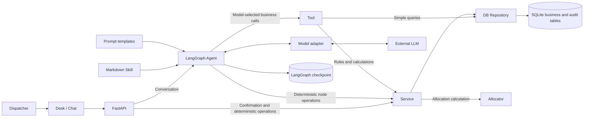

# Target architecture

This document defines the intended architecture and module responsibilities. It does not claim that every boundary is already implemented. See [current architecture](current_architecture.md) for running paths and migration gaps, and [development conventions](../AGENTS.md) for repository-wide constraints.

## 1. System architecture

The system combines four cooperating layers: FastAPI accepts requests; LangGraph and the LLM handle conversation and task orchestration; Tools and Services expose controlled business operations; the DB layer persists facts and execution records. Recommendations are proposals for human review. Allocation confirmation is a separate explicit operation.

### Design principles

- **FastAPI** validates HTTP inputs, identity, and responses.
- **LangGraph** controls workflow state, routing, Tool loops, suspension, and recovery.
- **LLM** interprets requests, reasons about the next action, and organizes explanations. Model output is not an authoritative fact or a state change.
- **Markdown Skill** describes task steps, Tool use, branches, clarification, and fallback.
- **Tool** exposes a named capability, validates input, delegates to a Service or Repository, and returns structured results.
- **Service / Policy** independently enforces deterministic rules and coordinates recommendation, confirmation, and state-change policies.
- **Allocator** performs independent deterministic calculations through `allocate(AllocationRequest)`. Splitting depends only on `max_workshops`: default 1; multiple workshops are considered only when the limit is at least 2.
- **DB layer** owns Repositories, SQL, connections, transactions, and migrations.

These are permitted responsibilities and call directions; not every request needs an Agent. Deterministic nodes may call Services directly. Tools are needed when the LLM must choose a callable capability. Business tables and checkpoints may share a SQLite file but have different authority.

### Request paths

1. **Conversation:** FastAPI validates identity and input, then calls LangGraph. The Agent uses Skills and prompts to select permitted Tools. Tools validate inputs and call Services or simple Repository queries; the Agent uses structured results for subsequent actions and explanations.
2. **Recommendation and confirmation:** Services check orders, workshops, queues, and requirements, then calculate and save a reviewable recommendation. Saving does not allocate production or change queues. An explicit confirmation identifies the proposal; the Service rereads facts, checks identity and versions, and commits allocation and audit atomically. Ordinary message text cannot replace confirmation.
3. **Deterministic operations:** HTTP handlers and fixed graph nodes can call Services without model-selected Tools. Production events share the same rules and transaction entry points.
4. **Compatibility:** Offline rules and retained internal compatibility flows remain separate from native LLM Tool execution. Their current status, including retired HTTP endpoints, belongs in `current_architecture.md`.

### Authority and reliability

SQLite business tables are authoritative for orders, queues, recommendations, allocations, and tasks. Checkpoints preserve conversation context, Skill snapshots, pending questions, and execution position. Recovery must recheck business data. Tool permissions, input validation, and Service rules jointly constrain model actions.

Transactions, request IDs, versions, and idempotency protect writes against concurrency and retries. Record Tool calls, decisions, and state transitions for audit. Missing, conflicting, or stale facts require clarification, rejection, or recalculation; the model must not invent replacements.

### Technology

Python 3.11–3.14 and `uv` provide the runtime and locked dependencies. FastAPI/Uvicorn serve HTTP. LangGraph and its SQLite checkpointer manage execution. LangChain adapters and ModelRegistry support OpenAI, Claude, Gemini, and DeepSeek. Markdown Skills and YAML prompts are loaded resources. Pydantic defines validated contracts. SQLite persists business, audit, retained job, and checkpoint records. HTML, CSS, and JavaScript provide the local UI.

## 2. Responsibilities and dependencies

The target design remains authoritative when existing implementation differs. `AGENTS.md` must stay consistent with this document.

| Component | Responsibility and boundary |
| --- | --- |
| UI | Collect input and present questions, alternatives, recommendations, confirmations, and traces. Do not calculate business results or treat browser state as authoritative. |
| API | Define HTTP contracts, validate identity, invoke Runtime or Service, and translate results. Do not implement allocation or production rules. |
| LLM Agent | Understand tasks, select Tools using Skills, interpret results, and communicate. Propose actions without directly controlling graph transitions or changing workflow/business state. |
| LangGraph Runtime | Execute nodes, routes, State updates, Tool loops, mandatory suspension, and recovery according to code-defined rules. A proposed action is not a completed operation. |
| Skill | Loaded task guidance. Does not execute code, depend actively on the Agent, grant permissions, or replace business rules. |
| Prompt | Versioned model instructions loaded to construct inputs. Does not execute operations or hold rules requiring deterministic enforcement or audit. |
| Tool | Named model interface with parameter, permission, and context checks. Delegate calculations and business judgments; do not write SQL. Tool validation never replaces Service validation. |
| Service / Policy | Independently enforce requirements and coordinate recommendation, confirmation, and production. Use the Allocator for allocation mathematics. Apply the same rules for every caller. |
| Allocator | Structured eligibility, scoring, plan enumeration, and integer splitting without DB/Agent dependencies. Accept `AllocationRequest`; respect `max_workshops` in 1–8, default 1. Do not parse messages or authorize actions. |
| DB Repository | Connections, SQL, CRUD, transactions, and migrations. No allocation policy and no dependencies on Agent, Tool, Service, or API. |
| Schema | HTTP, Agent State, Tool, and business contracts. Structure and validation only; no workflow or persistence. |
| Config | Startup database, business-date, and model settings; no allocation policy or model transport. |
| Core | ASGI lifespan, accounts, and cookie authentication; no model clients or business rules. |
| LLM | ModelRegistry, LangChain factories, selection, and errors; no allocation algorithm or replacement for prompts and Tools. |

Policy is deterministic decision logic within the Service layer. It may be a module or function; a separate Service class is not required for every rule.

### Dependency rules

1. UI accesses API through HTTP, never databases or model clients directly.
2. API invokes LangGraph for natural-language work or Services for deterministic operations.
3. Runtime invokes the Agent, Tools, or Services. Code schedules and validates proposed actions and updates state; the LLM cannot bypass guards.
4. Runtime uses Loaders for Skills and prompts. Skill Tool declarations are candidate capabilities, not authorization.
5. Tools invoke Services for calculations, decisions, and writes, or Repositories for simple reads. Tools do not execute SQL.
6. Services enforce eligibility, constraints, versions, state, and write preconditions through Repository and transaction interfaces. Services do not call Agent, Tool, or API layers.
7. Shared Schemas define cross-layer contracts. Do not expose internal API, Agent, or DB objects as another layer's public interface; avoid circular dependencies.

A dedicated checkpointer persists Runtime state. It is not a business-data access path. Repositories supply facts; Services determine their business meaning.

### Choosing a component

| Requirement | Owner |
| --- | --- |
| Steps before recommendation, missing-ID questions, and fallback after Tool errors | Skill |
| Interpreting intent, selecting a query or calculation, and explaining results | LLM Agent |
| Actual routing, forced suspension, recovery, and workflow State updates | LangGraph Runtime |
| A model-selectable order query, queue read, or eligibility request | Tool |
| Workshop status/capability/batch checks, delivery estimates, ranking, and splitting | Service / Policy and Allocator |
| Recommendation commit, queue updates, and production completion | Service / Policy with DB transactions; add a restricted Tool only if Agent initiation is allowed |
| Reading and storing orders, workshops, recommendations, and audit | DB Repository |

Keep one deterministic implementation of each business rule.

## 3. Agent and LangGraph execution

### Execution flow

Runtime combines the current message and existing task context, identifies intent, invokes a business flow through the Main Graph, and sends its structured result to response generation. Allocation is the original MVP business-flow example; other tasks follow the same boundaries.

The Allocation subgraph begins with fixed preparation: prompts and the LLM extract fields; code validates them; Services retrieve and check business facts. This phase uses neither Skill nor Tool. It returns clarification, blocked, or failed results when it cannot proceed. Once ready, the subgraph loads the allocation Skill and enters the Agent–Tool loop. The Skill guides proposed actions; Runtime executes; Services perform deterministic judgments and calculations.

A recommendation is pending human confirmation. Finishing an Agent reply never submits it. Later messages can continue the same task.

### Intent and Skill loading

Intent classification uses a prompt, the current message, and task context to produce a validated decision. Runtime decides whether to continue a task, create one, or invoke a business flow. Clarification answers, confirmations, and revisions do not automatically create separate tasks.

Intent, Business Task, and Skill are not one-to-one. Tasks can load zero, one, or several Skills. The Loader reads metadata and body only at the stage that needs guidance. Allocation loads its Skill after fixed preparation. Skill text is neither executable code nor permission.

### Reusable Agent–Tool loop

Runtime provides context, loaded Skills, and allowed Tools to the model, validates proposed calls, executes them, and returns structured results. Code controls traces, model/Tool-call limits, mandatory waiting, and loop exits. Express the loop using graph nodes and routes rather than hiding it in an ordinary node's handwritten `while` loop.

The model stopping Tool calls is only a termination signal. Before exit, the business Completion Guard checks required results and preconditions and determines completion, waiting, or failure. The shared executor provides execution records and termination reasons; business flows own their guards. Unverified model success statements cannot establish business outcomes.

### Registry and dynamic binding

The Registry records Tool names, purposes, contracts, and entry points. Runtime determines visible Tools from registration, loaded Skills, task state, and permission. After a call is proposed, Runtime still validates its name, arguments, authority, and context. Services independently enforce business rules.

### Main Graph and business flows

The Main Graph handles generic task identification, routing, invocation, and response generation through `TaskResult`. It must not parse order fields, recommendation IDs, or other business-specific data. Allocation preparation, Tool loop, and Completion Guard belong inside its subgraph.

A small deterministic business operation without internal routing or independent recovery may use a business node. A workflow with stages, loops, branches, or suspension should use a subgraph. Both return the same task-result contract. Reuse the executor while keeping business-specific preparation, Skills, Tool sets, and guards separate.

## 4. State and workflow control

### Graph State

Main State holds generic conversation/task context: message, task identity/type, execution phase, and `TaskResult`. Subgraph State holds extracted fields, issues, loaded Skills, Agent messages, and Tool results. Business-specific fields do not belong in generic Main State.

Nodes return structured updates. Parse and validate model output before updating State. Explicit input/output contracts connect Main Graph and subgraphs; internal subgraph State is not their public interface. Checkpoint snapshots cannot overwrite newer business facts.

### Routing and guards

Runtime routes using current task state, structured intent, and business results. The Main Graph selects a task flow; each subgraph controls its own preparation, loops, and exits. Code owns actual transitions.

Preparation guards identify missing or ambiguous fields, nonexistent entities, conflicting facts, and system errors. They route to clarification, blocking, or failure without duplicating Service rules. Differences resolvable using authoritative DB facts may be recorded before continuing.

Enforce model and Tool-call limits and check structured results at loop exit. State-changing Services recheck current facts regardless of the model's success claim.

### Clarification and recovery

Persist pending questions and task context before Runtime waits. Later replies resume the existing task rather than becoming unrelated tasks. Restore State and checkpoints to avoid unnecessary work, but design for node re-execution: `interrupt()` resumes from the beginning of its node. Use idempotency and appropriate node boundaries for side effects.

The initial MVP may return `blocked` for missing or ambiguous data; a continuing clarification workflow may return `waiting_user` and resume the task after a reply.

### TaskResult

| Status | Meaning |
| --- | --- |
| `completed` | The task is complete. |
| `waiting_user` | Clarification or confirmation is required. |
| `blocked` | Current inputs or business conditions prevent progress, including explicit business-rule rejection. |
| `failed` | System execution failed. |

Use `issues` for specific reasons instead of adding a primary status per cause. A generated recommendation awaiting confirmation is `waiting_user`, with the proposal in its business `result`. `running` is workflow/progress state, not a final TaskResult status. Only a business result that passes its guards determines completion.

## 5. Business workflows and policies

### Allocation

Fixed extraction produces structured order information; code validates it and Services use Repositories to check orders and related facts. Do not load a Skill or use a Tool for these fixed operations.

Missing/ambiguous fields or an absent order prevent recommendation and produce issues. Registered facts remain authoritative when extracted facts differ, while explicit user constraints must be retained and validated. Do not guess unresolved conflicts. Execution failures return `failed`.

After preparation, the allocation Skill guides comparisons, candidates, alternatives, Tool selection, and explanation. Services and the Allocator enforce eligibility, capacity, queues, delivery, scoring, splitting, and ranking. Services pass the authorized `max_workshops` limit to the Allocator.

A recommendation includes a reviewable plan, evidence, and limits. The Completion Guard verifies necessary results before reporting it. Saving a proposal does not change committed allocations or production queues.

### Confirmation and commit

Confirmation is a separate phase associated with the original task. Require explicit human confirmation and trusted identity, proposal, and version information. Model-generated confirmation or allocation claims cannot substitute for commit.

Before committing, reread orders, workshops, queues, and recommendation state. Check identity, validity, versions, and constraints. Atomically save allocation, queue changes, and audit through DB transactions; stable idempotency keys prevent duplicate commits.

Changed conditions invalidate direct submission of the old recommendation. Return specific issues and require review of further action. Report `completed` only after the transaction succeeds and the persisted outcome is verifiable.

### Fallback and alternatives

Workflow guards handle preparation failures. Skills guide recommendation fallback, but Services determine permission and feasibility. Never relax hard constraints automatically or submit an unauthorized alternative.

If a required workshop is unavailable, the Agent may query alternatives, compare feasible plans, or explain limits. Repeat calls only within execution limits. No feasible plan yields `blocked` with issues; model/system failure yields `failed`, not a business infeasibility claim.

### Production

Completion, cancellation, lapse, and reassignment change committed business state and are separate from previews. Services define legal transitions, quantities, and queue rules, checking current facts, versions, actor, and required reason before writing.

HTTP and Agent Tool entry points must use the same Service. Tools validate model-facing input and context; Services independently enforce rules and write business and audit records transactionally. Stable event IDs prevent duplicate effects.

## 6. Infrastructure

### API and lifespan

FastAPI validates HTTP input and identity, delegates to Runtime or Services, and converts structured outcomes into responses. Never infer business success from prose.

Startup loads configuration, DB/migrations, model clients and Registry, prompt/Skill Loaders, and checkpoints. Shutdown releases resources. Lifespan supplies shared dependencies instead of creating competing state sources during requests. Responses expose task identity, status, business results, issues, and Runtime progress. Trusted request context supplies identity and authority.

### Models and prompts

Generic infrastructure manages model configuration and transport. Intent, extraction, and explanation use separate templates under `app/prompts/`. Skills reside under `app/skills/`. Both are passive resources. Validate model output against its contract and route parse, availability, and transport failures explicitly. Configuration or prompt changes cannot override Tool permission, Service rules, or DB authority.

### Repositories

`app/db/` owns SQL, connections, CRUD, migrations, and transactions. Tools may perform simple reads through Repositories. Services interpret facts and initiate controlled changes. Agents, Skills, and prompts do not directly access business data.

Database authority covers orders, workshops, queues, recommendations, allocations, production events, and audit. Multi-record changes use explicit transactions, versions, and idempotency. Shared schemas do not expose internal DB records as generic Main State.

### Checkpoints and audit

Checkpoints store execution position, messages, task identity, pending work, and recovery context. Recheck mutable business facts before commit after recovery. Checkpoints alone do not guarantee exactly-once writes, particularly when an interrupted node restarts.

Audit must link tasks, human actions, Tool calls, recommendation evidence, confirmations, and production changes. Idempotency and transaction records prevent duplicate effects; execution traces explain processing and failures. Neither prose nor a checkpoint alone proves a committed operation.

## 7. Architecture validation

- **Layering:** Check generic Main Graph contracts, business-owned preparation and guards, graph-expressed Tool loops, Runtime control, passive Skills/prompts, independent permissions, thin Tools, Service enforcement, and DB-owned SQL/transactions. New businesses follow these boundaries without copying Allocation's internal structure.
- **Regression:** Cover valid recommendations, missing/ambiguous/absent orders, authoritative registered facts with preserved user constraints, infeasible workshops, and no automatic submission. Test explicit confirmation, stale proposals, version changes, replay, legal/illegal production transitions, and affected HTTP/UI behavior.
- **Integration:** Use predictable model substitutes for routing, extraction, loading, binding, repeated Tool calls, limits, and guards. Ensure model silence, success wording, and unauthorized calls cannot bypass controls. Persist and restore waiting tasks and checkpoints; repeated nodes must not duplicate commits or production events. Distinguish mocked integration evidence from real-provider observations.
