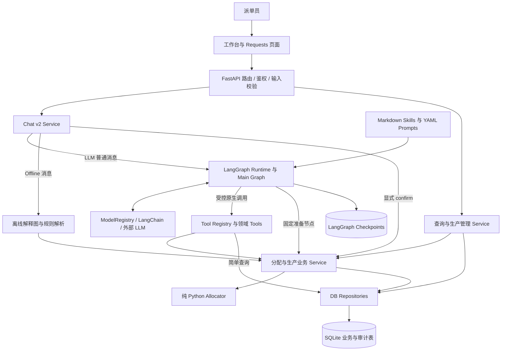
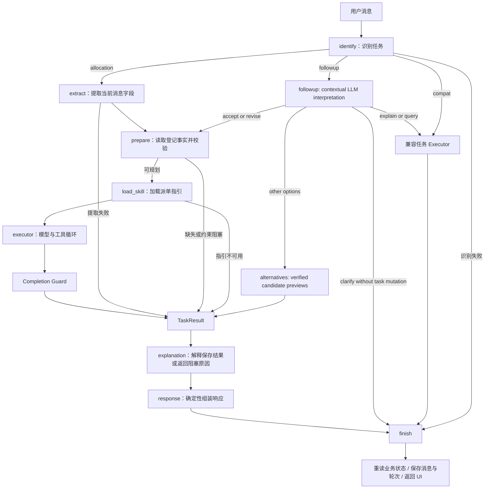
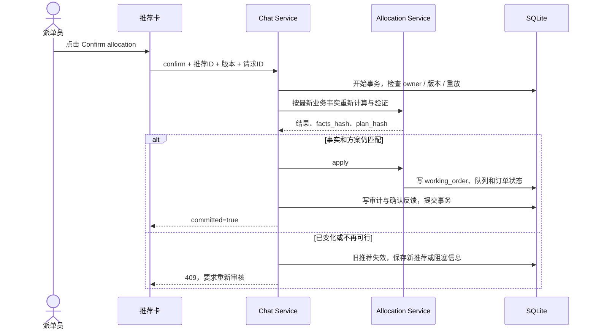

# SweaterCo 系统架构：当前实现

更新日期：2026-10-28。代码核对基线：`ningtao` 分支，提交 `a6792ae`。

本文描述当前系统的实际结构、运行流程和能力边界，供项目介绍、演示与后续开发使用。目标设计仍以 [architecture.md](architecture.md) 和 [AGENTS.md](../AGENTS.md) 为准；本文不将现有实现中的差距视为新的架构原则。所有代码路径均相对于仓库根目录 `Workspace/`。

## 1. 系统定位与总体架构

SweaterCo 是面向服装外协生产的本地派单系统。派单员通过自然语言描述需求，系统读取登记订单和工坊资料，检查约束、计算候选方案、解释推荐，并在人工确认后记录分配。后续支持生产完成、取消、失效、重分配及决策历史查询。

当前采用 **FastAPI 单体应用 + LangGraph 工作流 + 确定性业务服务 + SQLite**。前端与 API 由同一应用提供，外部依赖主要是可选的 LLM 服务。



图中的业务表和 checkpoint 使用同一个 SQLite 文件，但承担不同职责：订单、队列、推荐及已确认分配以业务表为准；checkpoint 保存工作流恢复位置和执行上下文。

核心分工是：**LLM 理解需求、提出工具调用并解释结果；Runtime 控制流程和权限；Service 与 Allocator 执行业务规则和计算；数据库保存真实状态。**

## 2. 技术栈与运行形态

| 层次 | 当前实现 | 作用 |
| --- | --- | --- |
| 前端 | 原生 HTML、CSS、JavaScript | Dashboard、Requests、Orders、Workshops、推荐审核、Allocation history |
| HTTP 服务 | FastAPI + Uvicorn | 页面、JSON API、OpenAPI 文档及认证入口 |
| 工作流 | LangGraph + SQLite checkpointer | 任务路由、派单子图、模型与工具循环、暂停和恢复 |
| 模型集成 | LangChain + ModelRegistry | 模型选择、原生 Tool Calling、参数和错误处理 |
| 数据契约 | Pydantic + TypedDict | HTTP、字段提取、工具、任务结果和推荐快照 |
| 业务计算 | Python Service + 独立 Allocator | 资格、交期、成本、质量、约束与数量分配 |
| 持久化 | SQLite + Repository + SQL migrations | 业务数据、账号、审计、幂等记录及 checkpoint |
| 依赖管理 | `pyproject.toml`、`uv.lock` | 声明和锁定依赖；项目支持 Python 3.11–3.14 |

本地服务器默认监听 `127.0.0.1:8000`，使用一个 Uvicorn worker。模型请求期间的会话执行锁是进程内锁，当前没有多副本部署所需的分布式执行协调。

## 3. 目录职责与实际入口

| 路径 | 当前职责 |
| --- | --- |
| [`app/main.py`](../app/main.py) | `create_app()`：组装 FastAPI、路由、中间件、异常处理和静态页面 |
| [`app/server.py`](../app/server.py)、`app/cli/server.py` | 本地 Uvicorn 启动入口、端口及 CLI 参数 |
| `app/ui/` | 工作台与 Chat 页面；共享推荐卡、确认请求和 UI 状态 |
| `app/api/` | 路由、登录身份依赖、请求策略、错误响应 |
| `app/config/` | 启动环境快照、数据库路径、业务日期、模式和模型配置 |
| `app/core/` | ASGI lifespan、账号初始化、密码与登录 Cookie 管理 |
| `app/agent/` | Main Graph、Allocation Subgraph、Executor、解释、响应组装和 Skill Loader |
| `app/offline/` | 独立规则解释图与离线回复 |
| `app/skills/` | 任务指引、工具使用顺序与失败处理等 Markdown 资源 |
| `app/prompts/` | Prompt Registry、版本化 YAML、manifest 和重试提示 |
| `app/tools/` | 模型可调用 Tools、注册表、权限过滤和可信上下文注入 |
| `app/services/chat/` | 会话、轮次、约束变更、固定准备、工具业务操作、完成检查及恢复 |
| `app/services/allocation/` | 预检、方案准备与复核、替代方案、提交及审核差异 |
| `app/services/production/` | 生命周期、队列、订单跟踪、Agent 生产事件授权 |
| `app/services/desk/`、`app/services/responses/` | 工作台查询与确定性展示文案 |
| `app/services/intake/` | 订单编号与文本规范化、规则解析 |
| `app/allocator/` | 独立分配算法，不依赖数据库或 Agent |
| `app/db/` | 连接、迁移、种子数据导入和领域 Repository |
| `app/schemas/` | HTTP、业务、提取、推荐、Tool 和部分 Agent 契约 |
| `tests/`、`evaluation/`、`harness/` | 自动化测试、在线验证、评估及独立模拟 |

旧文档中的 `app/services/chat.py`、`agent_chat.py`、`agent_operations.py` 等扁平路径，现分别对应 `chat/service.py`、`chat/agent_turns.py`、`chat/operations.py`。文件迁移历史见 [app_file_migration_map.md](app_file_migration_map.md)。

## 4. 自然语言派单的完整调用链

### 4.1 从 HTTP 进入 Main Graph

```text
POST /api/chat/sessions/{session_id}/turns
  → app/api/routes/chat.py
  → app/services/chat/service.py:turn
  → app/services/chat/agent_turns.py:turn       [mode=llm, action=message]
  → app/agent/runtime.py:run
  → Main Graph: main_v2
```

Chat Service 检查会话 owner；Agent Turn 层建立或恢复请求记录，并持有当前会话的执行锁。每轮包含 `request_id` 与 `expected_version`，分别用于幂等重放和版本冲突检查。

新请求使用 `main_v2`。中断的 `main_v1` 或更早的动态 Graph 按保存版本恢复，避免升级后丢失执行位置。



`compat` 当前承接订单查询、工坊查询、已有推荐问答和受控生产操作等通用任务，复用动态 Executor；这些任务尚未分别拆成独立业务子图。

The active `agent.intent` v6 routes named-workshop/specific-order feasibility
questions, such as "QuickStitch for the scarves on ORD-103?", through Allocation
preparation. Extraction v9 retains the order, stated product, and candidate workshop
as the evaluated sole workshop. The Service then returns actual eligibility or a
saved preview; it does not ask for confirmation merely to check feasibility.
General status/capacity lookups and explicit hypotheticals about recommendations
remain on the compatibility route. Production submission still requires explicit
recommendation-card confirmation.

### 4.2 字段提取与固定准备

派单子图首先执行固定节点，此时尚未让模型自由选择业务 Tools。

1. **提取**：`allocation.extract` 要求模型返回当前消息中的 `set` patches 和原文引用。Runtime 填入消息序号，校验字段格式、引用和字段值的用户输入依据。
2. **Extraction repair**: format, evidence, and explicit-reference completeness failures allow at most two attempts. An unambiguous order reference must be retained or already bound to the task. Supported hard workshop assignments must retain the required workshop and cannot be relabeled as an unsupported capability. Model/provider failures retain the request-recovery behavior.
3. **事实补全**：`allocation_preparation.prepare()` 根据订单号读取登记订单，补齐产品、数量、交期等。LLM 路径遇到输入与登记事实不同时采用登记值，并保存 `resolved_differences`。
4. **预检**：检查订单状态、工坊状态、产品能力、批量限制、排除项、指定工坊和交期要求；需要澄清时返回具体阻塞原因。
5. **Skill input**: `order_id`, `product`, and `pieces` are required; `due_date` may be null. A pending replacement date is retained in task sources instead of reusing the old registered date. An explicit planning instruction such as "line something up" permits a preview without that date. Informational pending-date messages still require clarification. Hard deadline constraints always require a confirmed date.

Without a due date, completion, cost and defect estimates remain available, while
`delay_days` and `deadline_met` are null. Every saved plan and candidate carries
`DUE_DATE_UNCONFIRMED`; response assembly and the card disclose the missing date.
A later evidenced date replaces the pending task date, supersedes the old preview,
and recalculates the plan without changing the registered order record. Normal
registered-fact precedence remains unchanged for unrelated intake. Explicit card
confirmation, owner/version checks, fresh-fact validation and replay rules remain
in force for both dated and undated previews.

最新修复区分缺少订单号与真正的歧义：补充订单号后清除对应缺失提示，其他未解决约束继续保留；已验证的单个排除工坊统一保存为列表。

Order-reference normalization recognizes labeled lists such as `order 024, 035
and 040`, including plural labels and lists anchored by a canonical ID. Each
allocation request still handles exactly one order. Both LLM intake (including
contextual follow-ups) and Offline interpretation require order selection before
applying patches from a multi-order turn; the model cannot silently choose the
first ID. Existing requirements and unsupported blockers remain in force. The
selection question is scoped to `order_id`, so a later grounded single-order
answer clears it, including legacy `multiple_order_ids` questions, while unrelated
issues and the existing order-switch guard remain intact. No batch planning or
automatic production submission is added.

The active extraction prompt is `allocation.extract` v12. Outsourcing is the normal
allocation domain; factory-capacity background does not add a routing constraint.
The prompt preserves real unsupported requirements and does not authorize capacity
or queue changes. Existing saved blockers are not automatically rewritten.
A request such as
"OldMill is free right now — give them ORD-008" means a recommendation preview
with `order_id=ORD-008` and a hard `preferred_workshop` constraint. The user's
availability claim does not override registered status or queues. Extraction
uses the existing bounded repair loop for omitted references. The model-facing
unsupported-constraint list accepts only `unsupported_constraint` and
`soft_workshop_preference`; arbitrary model prose cannot become a business issue
code. Legacy direct-assignment refusals can be cleared by a new, fully evidenced
order/workshop request while real unsupported constraints remain in force.

Eligibility refusals use shared English descriptions from
`app/services/allocation/messages.py`, including the registered workshop name/ID,
capability, status, exclusion and batch-limit reasons. The preflight issue retains
`workshop_id` and `rejection_reason` for audit; allocator reason codes are unchanged.
Both LLM blocked responses and Offline replies use readable text without a model
call. Planning-failure explanations also translate codes into English, and Offline
recommendation explanations reuse the same eligibility descriptions.

Missing-information replies use the shared presentation helper
`clarification_questions()` in `app/services/allocation/messages.py`. It replaces
raw field diagnostics with one natural English statement listing only the
reported missing fields. Known fields are never added to a fixed three-field list. It
preserves the original LLM clarification and business explanations. Only the
fixed trailing sentence `Provide the order ID, such as ORD-045.` is removed from
`MISSING_ORDER_ID` template messages; the preceding order-selection question and
model-authored wording remain. Structured issues, readiness checks and audit
records are unchanged. Both LLM blocked replies and Offline clarifications use
this formatter without an additional model call.

### Accepting conditional alternatives

The Main Graph's `agent.intent` v6 selects `followup` for contextual replies.
`app/agent/followup.py` uses `agent.followup` v2 to interpret bounded history,
current questions and authoritative saved offers. The LLM distinguishes acceptance,
explanation, questions, negation and revisions by meaning. For example, "sure, use
your suggested workshop" follows `identify → followup → allocation`; it is not
matched against a phrase whitelist. Explanations enter the compatibility executor;
unresolved references ask a dialogue question without persisting a business blocker.
The Main Graph and Allocation subgraph pass the validated interpretation and sequence
forward, avoiding a second extraction that could lose the resolved reference.

`app/agent/intake.py` provides the shared model invocation, current-message evidence
validation, two-attempt repair and persisted attempt recovery. Follow-up attempts use
separate `followup_interpretation` / `followup_validation_failed` audit events and
record model usage under the `followup` stage. A retry reuses the saved model output.
Existing `main_v1` / `main_v2` node names remain available for checkpoint recovery;
new-turn initialization clears resolved follow-up state. No Tool or Skill is added.

Every offer has an ID bound to the task/order and requirements. The LLM resolves
option numbers, ordinals and workshop references to that saved ID. A unique offer
may omit its ID; multiple offers without one require selection. The Service does
not parse acceptance sentences or ordinals in LLM mode. It validates the entire
current-message quote, the current owned task, ID freshness, mode restrictions and
whitelisted `required_changes`. It preserves exclusions and other requirements,
recomputes against fresh business facts and saves a normal preview. Acceptance
never commits production or reuses the historical plan. Explicit card confirmation
and its identity, version and freshness checks remain required.

Pending offers survive dialogue-only turns. Existing sessions can recover matching
offers from bounded preparation audit snapshots. To resolve legacy reference errors,
the LLM can name pending question IDs in `resolved_reference_issue_ids`; the Service
allows only current `AMBIGUOUS_MESSAGE` issues with field `message`. It never resolves
business-field or unsupported-constraint issues through this channel. This replaces
hardcoded matching of old error prose. Resolved IDs remain in acceptance provenance.

A consumed offer normally stays consumed. A narrow legacy recovery covers an old
acceptance that never reached successful preparation because a dialogue error
remained, followed by restoration of its original requirements. Recovery requires
matching task/requirements and an audited prior offer, exposes the required dialogue
question IDs, and needs a new acceptance resolving those references. An acceptance
that reached ready-for-planning, a closed task, or changed requirements cannot use
this recovery. Existing JSON report/audit storage is reused; no migration is needed.

Offline mode retains a deliberately limited deterministic grammar, including option
numbers. It does not participate in LLM follow-up routing. Split-only alternatives
remain restricted to Offline mode.

Short order-reference lists exclude quantity phrases using the shared product
vocabulary, including comma-grouped quantities such as `1,200 scarves`. Thus
`ORD-024, 300 vests` contains one order reference; explicit IDs and genuine lists
such as `orders 024, 035 and 040` remain supported. This vocabulary guard does not
look up orders or change date/dispatch semantics. Correctly extracted current
facts can clear an older false multiple-order clarification through normal intake.

### Contextual candidate previews and selection

`agent.followup` v4 distinguishes `request_alternatives`, `explain_recommendation`
and `select_workshop`. The Main Graph adds an `alternatives` node for the first;
explanations use the compatibility executor with a `followup_readonly` Tool
allowlist enforced at binding and invocation; selections enter Allocation with
current-message evidence. A named choice such as "W1 then" sets that exact sole
workshop. An ordinal choice resolves the saved candidate ID. A mismatching concrete
workshop/option reference is rejected by intake repair and independently by Service.

Implementation responsibilities:

| Files | Responsibility |
| --- | --- |
| `app/schemas/chat.py`, versioned Agent prompts | Separate query, explanation and selection semantics; expose structured alternatives. |
| `app/agent/followup.py`, `main_graph.py` | Interpret once and route to preview, read-only explanation or allocation. |
| `app/services/chat/candidate_options.py` | Owner-checked, request-cached candidate preparation using the existing planner. |
| `alternative_acceptance.py`, `interpretation.py` | Validate current references and apply only a saved candidate's exact authorized changes. |
| `preparation_repository.py`, `agent_repository.py`, `agent_turns.py` | Audit/cache previews and preserve candidate snapshots in assistant-message metadata. |
| `presentation.py`, `app/ui/chat-common.js`, `chat.js`, `chat.css` | Return typed candidate data and render safe, selectable tables with history recovery. |

Candidate preparation relaxes the existing sole workshop only on a comparison copy.
It preserves exclusions, hard deadlines and unresolved requirements, and uses the
same `allocate()` candidate plans and rounded calendar dates as normal recommendations.
Each single-workshop offer pins `preferred_workshop` to its displayed workshop;
selecting it cannot silently clear that condition and choose a different workshop.
The original draft, task version, valid recommendation, queues and production rows
are unchanged by viewing. Only report/audit/message metadata is saved. No options
clears the old offer list. A selected offer is freshly checked and recomputed before
saving a confirmable recommendation; production still requires explicit confirmation.

The response exposes an `alternatives` list and persists the same snapshot in the
assistant message, so historical tables survive reload and pagination. The review
panel shares the same renderer. Buttons send an ordinary selection message, never
a confirm operation, and check current offer IDs before sending. Historical stale
options have disabled selection buttons and cannot be applied by clicking. Unknown due dates show no lateness claim.

Historical model-authored Markdown tables and bold/code spans render through a
small DOM-only formatter. It inserts model text with `textContent`, never raw HTML,
and supports horizontal scrolling. New candidate tables are built from structured
Service data instead of model-generated numbers or Markdown. Typing completion and
"Show full reply" use the same formatter. No new Tool, Skill or DB migration is needed.

### 4.3 受控推荐执行

派单指引从 [`allocation-recommendation/SKILL.md`](../app/skills/allocation-recommendation/SKILL.md) 加载。Skill 是文本资源，不能自行授予工具权限。

当前基础派单策略为 `allocation_v2`，Runtime 仅允许按以下顺序调用：

```text
check_requirements → compute_plan → save_recommendation
```

| 步骤 | 实际行为 |
| --- | --- |
| `check_requirements` | 重验准备后的事实与约束 |
| `compute_plan` | 通过 Service 调用 `app.allocator.allocate()`，生成结果及事实、方案 hash |
| `save_recommendation` | 重验事实与任务版本，保存推荐快照；不提交生产分配 |
| `Completion Guard` | 检查调用顺序、保存结果、当前推荐与任务版本，形成 `TaskResult` |

可复用 Executor 的模型循环上限为 12 步、可执行 Tool 调用上限为 32 次。基础派单遇到 `STALE_PLAN` 时允许重新检查、计算、保存一次。保存成功后停止工具循环，进入解释节点。模型停止调用工具或计算完成本身不能证明业务任务成功。

## 5. 推荐解释与响应组装

当前 `main_v2` 将解释与响应组装分为两个节点：

| 节点 | 输入与输出 | 边界 |
| --- | --- | --- |
| `app/agent/explanation.py:explain` | 已验证的 `TaskResult` 与推荐快照 → 英文解释 | 使用 `allocation.explain`；不提供业务 Tools；阻塞或失败直接使用问题文案 |
| `app/agent/response.py:assemble` | 解释文本与任务结果 → 标准响应 | 确定性组装推荐字段与 UI 回复，不再次调用模型 |
| `chat/agent_turns.py` | 当前数据库事实与工作流输出 → 持久化轮次 | 复核推荐过期状态，拦截无依据的提交成功声明，保存消息及版本 |

单工坊推荐保存 `explanation_evidence`，包括实际方法、公式、所选分数、候选对比、排队/生产/运输时间、排除原因和硬交期约束。解释读取已保存证据，不使用稍后变化的工坊资料重新编造选择理由。

当前 `allocation.explain` v5 参考项目提供的 Explanation Template，按以下顺序组织：

1. **Allocation plan**：订单、工坊、件数、交付、成本和缺陷率。
2. **Allocation method**：实际分配目标与评分规则。
3. **Why this recommendation**：候选比较、资格、约束与取舍。
4. **Review before allocation**：风险、估算限制和人工确认提示。

模板规定结构，但代码没有逐句证明自然语言中的每个表述。结构化推荐卡及保存的业务结果仍是数值和状态的权威来源。旧推荐缺少 `explanation_evidence` 时保留读取兼容性。

## 6. 分配算法与能力边界

计算入口为 [`app/allocator/allocator.py`](../app/allocator/allocator.py)，规划在 `planner.py`，资格检查在 `eligibility.py`，新增策略及解释证据在 `strategies.py`。

### 6.1 资格与估算

先按用户排除、工坊 Active 状态、产品能力和批量上限筛选候选。指定工坊无法承接时阻塞请求，不自动更换用户要求。

```text
生产天数 = 分配件数 / 工坊日产能
预计完成天数 = 当前排队天数 + 生产天数 + 运输/取货提前期
预计交付日期 = 业务日期 + 向上取整后的预计完成天数
预计成本 = 分配件数 × 单件成本
```

拆单时整单完成天数取各部分最大值，成本求和，缺陷率按件数加权。软交期允许生成晚交警告；显式硬交期会过滤无法按期完成的方案。保存与确认都检查整数件数守恒及实际约束。

### 6.2 当前五种规划目标

| 目标 | 规划器比较规则，分数越低越优 |
| --- | --- |
| `min_delay` | 最小预计完成天数；同一订单下等价于最小有符号延迟 |
| `min_cost` | 最小预计总成本 |
| `min_defects` | 最小按件数加权的预计缺陷率 |
| `hybrid` | `0.6 × 完成天数 + 0.4 × 缺陷率 × 100` |
| `weighted_hybrid` | `0.8 × 标准化有符号延迟 + 0.2 × 标准化质量暴露量` |

`weighted_hybrid` 来自 `zhen` 分支 `0ffc0b8` 的集成。质量暴露量为 `defect_rate × pieces / daily_capacity`。两个分量分别在可行候选之间做 min-max 标准化；某分量全部相同时贡献为零。它不是现有 `hybrid` 的别名。

规划器以分数排序，并以完成时间、成本、工坊数量和 ID 确定稳定的并列顺序。响应最多展示五个不同的候选完整方案。这是当前候选生成与评分规则的结果，不是对任意真实生产问题的全局最优保证。

### 6.3 单工坊、拆单与模拟的区别

| 范围 | 当前支持情况 |
| --- | --- |
| LLM 基础 Allocation 子图 | **仅支持单工坊**；明确要求多个工坊会被阻止 |
| 共享 Allocator / Offline Chat | 其他目标在显式授权工坊上限后可整数拆单；默认上限为 1 |
| `weighted_hybrid` | 所有规划入口均仅支持单工坊，多工坊请求明确拒绝 |

`scoring.py:get_hybrid_score()` 还保留原始“按交期门控的缺陷率”比较函数，晚交或非 Active 时返回惩罚值；它与上述两个 hybrid 规划目标含义不同。

`harness/` 中引入的插单与队列重排是独立模拟。线上 `workshop_queue` 主要记录聚合排队天数，尚未接入完整的工序级日历或动态队列重排。

## 7. 人工确认、事务与生产生命周期

用户点击 **Confirm allocation** 后，前端发送 `action=confirm`、`recommendation_id`、`expected_version` 和 `request_id`，直接进入确定性确认流程，不依赖 LLM 宣告成功。



成功提交使订单进入 `WORKING`、推荐进入 `confirmed`、任务进入 `CONFIRMED`。队列增加的是生产加工负荷，运输时间不占用生产产能。重复确认同一推荐复用已保存结果，不再次增加分配。

生产事件统一调用 [`app/services/production/lifecycle.py`](../app/services/production/lifecycle.py)：

| 事件 | 行为 |
| --- | --- |
| `complete` | 记录完成件数，检查数量、工坊、版本与状态 |
| `cancel` | 取消当前分配，按业务规则处理队列及剩余量 |
| `lapse` | 记录订单失效 |
| `reassign` | 处理剩余生产量的重新分配 |

HTTP `/api/events` 和 Agent 的 `record_production_event` 复用同一服务。Agent 入口额外校验当前消息中的明确动作、订单、原因及动作所需字段；actor 来自认证用户，事件 ID 由 Runtime 生成以支持幂等重试。

## 8. 数据、状态与中断恢复

### 8.1 主要持久化分组

| 数据表或设施 | 保存内容 |
| --- | --- |
| `orders`、`workshops`、`workshop_queue` | 登记订单、工坊能力与成本质量参数、排队快照 |
| `working_order`、`completed_order`、`unassigned_order` | 分配、完成及未分配业务记录 |
| `chat_sessions` | owner、会话模式/模型、业务日期、版本、Open/Archived 状态 |
| `chat_allocation_tasks` | 草稿、字段来源、变更历史、阻塞项、报告、任务版本与状态 |
| `chat_recommendations` | 推荐结果、解释证据、事实/方案 hash、确认关联与提交结果 |
| `chat_turns`、`chat_messages` | 幂等键、输入输出及对话消息 |
| `chat_agent_runs` | Agent 请求执行与恢复状态 |
| `chat_agent_tool_calls`、`chat_agent_events` | 工具参数/结果、Skill hash、执行与模型事件、提取诊断；准备结果以事件形式保存 |
| `requests`、`decision_log`、`lifecycle_events` | 业务决策与生产审计 |
| `desk_users`、`login_sessions` | 账号、角色、密码 hash、登录 token hash 与有效期 |
| LangGraph checkpoint 表 | Main Graph / Executor 的消息、节点位置、Skill 快照与工作状态 |

`Database` 使用迁移版本 1–9，写事务由 `BEGIN IMMEDIATE` 保护。只有新数据库初始化时导入种子数据，已有数据库不会重复导入订单。计划使用业务日期，审计使用实际 UTC 时间。

### 8.2 不同层的状态

| 对象 | 状态 |
| --- | --- |
| Chat 会话 | `OPEN`、`ARCHIVED` |
| 分配任务 | `COLLECTING`、`BLOCKED`、`READY`、`RECOMMENDED`、`CONFIRMED`、`CANCELLED` |
| 推荐 | `valid`、`superseded`、`confirmed` |
| Agent 请求 | `running`、`finished`、`failed`；主动结束另有事件记录 |
| 跨图 `TaskResult` | `completed`、`waiting_user`、`blocked`、`failed` |

生成有效推荐时，任务为 `RECOMMENDED`，而 `TaskResult` 为 `waiting_user`，因为尚待人工确认。订单的 `WORKING` 是生产业务状态，与 Agent 是否正在执行无关。

### 8.3 恢复与幂等

1. 相同 `request_id`、相同输入可恢复请求或重放已保存响应；相同 ID 配不同输入会冲突。
2. Main Graph 与 Executor 分别保存 checkpoint，使用同步 durability；旧图按保存版本恢复。
3. Tool 重放键为 `<request_id>:<native_tool_call_id>`。推荐保存与工具记录使用受控事务；生产事件另有稳定事件 ID。
4. 中断请求未处理前，新请求不能越过它。用户可重试或显式结束；已保存推荐及业务记录保留。
5. `expected_version` 防止旧页面覆盖新状态；`task_version`、`facts_hash`、`plan_hash` 防止确认过期方案。
6. 等待用户回复时保留 Skill 文本及 hash；修改文件不会悄悄改变正在恢复的执行指引。

checkpoint 提供恢复位置，不替代业务事务、幂等键或再次确认。

## 9. API 与前端交互

所有业务路由挂载于 `/api`。

| 方法与路径 | 用途 |
| --- | --- |
| `GET /api/health` | 健康状态、默认模式、业务日期及版本 |
| `POST /api/auth/login`、`POST /api/auth/logout`、`GET /api/auth/me` | 登录、登出与身份 |
| `GET /api/models`、`GET /api/ai/status` | 模型目录及可用状态，不返回密钥 |
| `POST /api/chat/sessions`、`GET /api/chat/sessions` | 新建及分页读取用户会话 |
| `GET /api/chat/sessions/{id}` | 会话快照 |
| `GET /api/chat/sessions/{id}/messages`、`/{id}/trace` | 消息与执行轨迹；两者均在 `/api/chat/sessions` 前缀下 |
| `POST /api/chat/sessions/{id}/turns` | 消息、确认、归档等会话动作 |
| `POST /api/chat/sessions/{id}/requests/{request_id}/end` | 显式结束中断请求 |
| `GET /api/chat/recommendations` | 当前用户的推荐列表 |
| `GET /api/dashboard`、`GET /api/workshops` | 工作台与工坊查询 |
| `GET /api/orders/{id}`、`POST /api/events` | 订单跟踪与生产事件 |
| `GET /api/audit`、`/api/audit/{request_id}`、`/api/audit/export`、`/api/history` | 审计查询、详情、JSON/CSV 导出与历史 |

页面入口为 `/` 和 `/chat`，接口文档在 `/docs`。前端使用同源 JSON 请求；Requests 展示澄清、推荐、解释和确认，工作台展示订单、工坊、生产与历史。

`/api/requests`、旧 `/api/sessions*`、`/api/jobs` 已退役，不再挂载。历史表及兼容查询仍可能存在，不代表旧产品入口仍开放。

## 10. 模型、Skill、Prompt 与配置

模型调用路径为 `ModelRegistry → LangChain init_chat_model → provider integration`。代码支持 OpenAI、Anthropic、Gemini、DeepSeek；实际可用模型取决于启动配置、密钥及原生工具能力。

当前本地演示使用 DeepSeek，别名 `deepseek`，API 模型 `deepseek-flash`。这是已配置演示环境的信息，不代表未来供应商默认模型。`DEEPSEEK_API_KEY` 从启动进程环境读取，应用代码不会主动读取 `.env`；如使用该文件，应由启动工具注入环境。

| 配置 | 作用 |
| --- | --- |
| `DISPATCH_DB` / `--db` | SQLite 文件 |
| `DISPATCH_AS_OF` / `--as-of` | 业务日期，不得早于当前队列快照 |
| `AGENT_MODE` / `--mode` | 默认 `llm` 或 `offline` 模式 |
| `LLM_DEFAULT_MODEL` / `--model-key` | 默认模型别名 |
| `DEEPSEEK_API_KEY` | DeepSeek 认证；值不进入前端模型目录 |
| `DEEPSEEK_MODEL`、`DEEPSEEK_MODELS` | 模型 ID 或别名映射 |
| `DEEPSEEK_OPTIONS`、`DEEPSEEK_TIMEOUT_SECONDS` | 模型参数与超时 |

配置在 ASGI lifespan 解析并保存为启动快照；变更环境变量需重启生效。会话保存其模式与模型，UI 更改选择影响新建请求。

Skill 资源包括派单推荐、订单查询、工坊查询、约束修订、推荐解释和生产操作。目录中存在 Skill 不代表每次请求都会加载它。基础派单自动加载推荐 Skill；`compat` 可动态加载。Tools 的真实可用集合还受任务类型、状态和执行策略约束。

Prompt 激活版本由 `app/prompts/catalog/manifest.yaml` 管理，当前派单提取和解释均为 v4。Prompt Registry 保存模板信息和 hash，支持调用追溯。

Offline Chat 使用 `app/offline/graph.py` 的规则解释节点，再由 Chat Service 生成和保存推荐。它复用业务规则及确认机制，但不经过 LLM Main Graph，也不能作为真实大模型调用的演示证据。

## 11. 已实现的保护与当前边界

已实现的保护包括本地密码 hash 与 Cookie 登录、登录限流、账号角色、Chat owner 校验、同源 POST 检查、JSON 格式及请求体上限、安全响应头，以及 Tool 参数与可信上下文隔离。推荐和生产写入由事务、版本、事实复核及幂等机制保护。

以下边界是后续迁移与扩展事项，本次整理不调整架构原则或运行代码。

| 项目 | 当前状态 |
| --- | --- |
| 多租户 | owner 隔离会话访问；账号仍共享一个业务工作区 |
| 部署扩展 | 本地单 worker、SQLite；未实现多进程/多副本分布式执行协调 |
| 自由需求 | 基础 LLM 派单仅单工坊；预算上限、精确拆分、任意质量阈值等不会自动成为可执行约束 |
| 业务子图 | Allocation 已独立，其他任务主要走 `compat` Executor |
| SQL 分层 | `core/security.py`、`services/desk/queries.py`、`services/allocation/dispatch.py` 仍有直接业务 SQL，尚需下沉 Repository |
| 数据层依赖 | `db/database.py` 仍依赖 `core/admin_account.py` 初始化账号，与目标 DB 职责独立性有差距 |
| State 集中管理 | MainState、AllocationState、AgentState 仍定义在图模块，部分公共契约已进入 `schemas/` |
| 旧流程 | checkpoint、历史表及部分查询为兼容保留；旧 HTTP 派单入口和 jobs worker 已退役 |
| 排程精度 | 当前使用聚合产能及排队天数；插单、工作日历实验不能视为已集成生产能力 |
| 自然语言解释 | 已约束证据及来源，尚未对每句话做完整事实证明 |

## 12. 启动、验证与相关阅读

已有依赖、已初始化数据库及模型环境时，从仓库根目录启动：

```sh
uv run --locked python -m app.server --db runtime/demo.sqlite3 --mode llm --model-key deepseek
```

将 `runtime/demo.sqlite3` 替换为实际已初始化的演示数据库。离线运行改用 `--mode offline` 并省略 `--model-key`。账号初始化、环境准备及本机 Python 的特殊处理见项目说明和 [DeepSeek 集成记录](STRATEGY_EXPLANATION_INTEGRATION.md)。架构文档不保存密钥或登录凭据。

| 验证关注点 | 代码或记录 |
| --- | --- |
| 工作流、工具与完成守卫 | `tests/test_architecture_alignment.py`、`tests/test_allocation_node.py`、`tests/test_dynamic_agent.py` |
| 解释与结构化响应 | `tests/test_explanation_response.py` |
| 策略和分配计算 | `tests/test_weighted_strategy.py`、`tests/test_allocator.py` |
| 澄清恢复与排除项 | `tests/test_clarification_recovery.py` |
| 会话、确认和生产生命周期 | `tests/test_chat.py`、`tests/test_lifecycle.py` |
| 前端交互 | `tests/test_chat_ui.cjs`、`tests/test_ui_state.cjs` |
| 真实 DeepSeek 调用 | `evaluation/verify_deepseek_live.py`，使用独立数据库 |
| 演示流程与历史彩排 | [DEMO_RECORDING_GUIDE.md](DEMO_RECORDING_GUIDE.md) |

本文依据当前代码静态核对，并校验路径、接口、公式与链接；本次未重新运行完整回归或调用外部模型。历史验证见 [策略与解释集成记录](STRATEGY_EXPLANATION_INTEGRATION.md) 和录屏脚本，不能视为本次重新测试的结果。

进一步阅读：[目标架构](architecture.md)、[Tool 开发规范](tool_development.md)、[Skill 开发规范](skill_development.md)、[数据库说明](DATABASE_SCHEMA_CN.md)。历史文档的旧路径与能力描述应结合对应提交时间阅读。


## October 31 remediation

See [the remediation report](REMEDIATION_RESULTS_2026-10-31.md) for incremental patches, date/name grounding, registered-fact disclosure, conservative explanation checks, current evaluation layers, and the portable backed-up demo reset. The environment now uses a working local Python interpreter; the old PYTHONPATH workaround is no longer required.

### Partial facts and order-reference clarification

Allocation extraction v11 preserves explicit product/customer facts even if the
order reference or quantity is unknown. The evidence/completeness validator retries
an omitted unambiguous product before preparation; it never supplies a guessed
quantity or customer. `ord 34`, `ORD-34`, and `ORD-034` refer to ORD-034. A model's
bare `34` value is normalized only when its exact current quote contains one
matching labeled reference; an unlabeled number, quantity, or different ID fails.

Follow-up v3 returns current field patches for missing-fact answers. The shared
clarification scope also recognizes the older order-reference question about usual
quantity, allowing saved sessions to recover. A legacy `answered_question_ids`
AMBIGUOUS_MESSAGE marker is accepted without withdrawal only when every pending
ambiguity covered by that code is a recognized order-reference question answered
by a validated order_id patch. Legacy substring heuristics cannot authorize this
resolution. Mixed or unrelated ambiguities remain blocking. Preparation retrieves
registered quantities, discloses supplied/registered differences under the existing
policy, and enforces order status. Identifying an already completed order does not
make it eligible for allocation. Regression tests use scripted models and isolated
SQLite fixtures, including both the reported completed-order case and a matching
unassigned-order fixture; no live model reliability is implied.

### Optional split requests without blocking allocation

The LLM allocation workflow still supports one workshop per preview. Extraction
v12 and follow-up v4 use the specific `optional_split` category for a secondary
request to split only if it yields faster completion. The intake policy in
`app/services/chat/optional_requirements.py` checks current conditional split
evidence, keeps all normal patches and unrelated blockers, and derives an
`allocation_notices` entry. It never sets a multi-workshop limit from that optional
clause. Mandatory exact counts/ratios, budgets and quality thresholds keep their
existing blocking behavior; this change does not implement split allocation.

Preparation persists notices in the task report, separately from blocking issues.
Allocation tools retain them as preparation provenance, completion returns them as
warning issues, and presentation appends the unsupported-split disclosure and an
explicit statement that the split was not applied. Generated explanations and
fallbacks cannot omit that disclosure. A later explicit workshop-limit revision
clears the earlier notice; ordinary revisions and missing-fact answers retain it.
Notices do not change recommendation confirmation or production state rules.

The exact legacy two-shop refusal from the reported case is normalized only with
current optional-split evidence and no other unsupported requirement detected by
the evidence baseline. An existing task can clear its isolated legacy refusal pair
only upon new optional authorization; any additional saved issue prevents that
recovery. Historical audit events and business records remain unchanged. Tests use
scripted models and temporary SQLite fixtures, including successful preview,
missing information, unsupported hard constraints, replay, and saved-task recovery.
