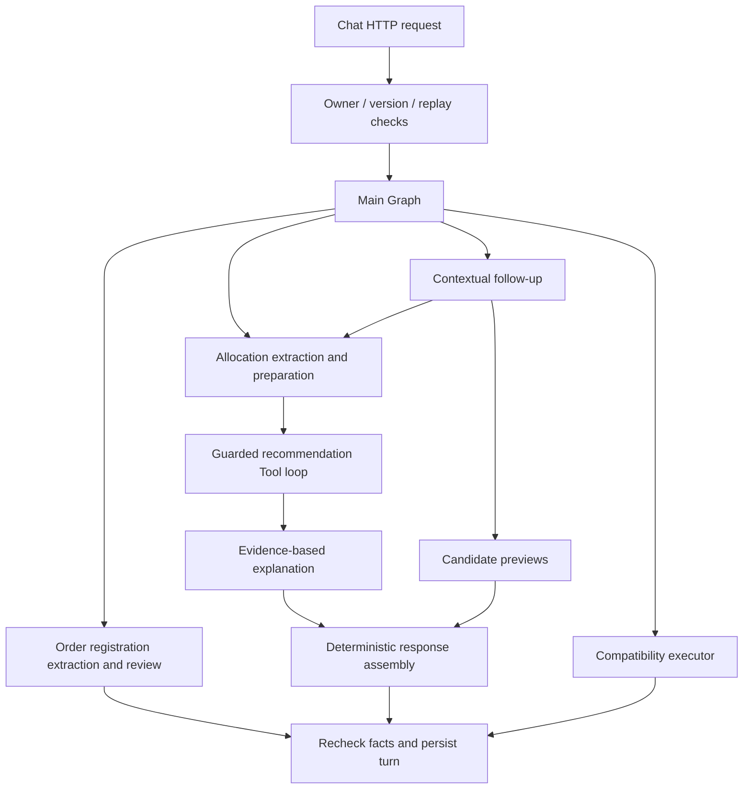

# Current implementation

This document describes the running implementation. [Target architecture](architecture.md) defines the design authority; implementation gaps below do not change those principles.

## Entry points and ownership

SweaterCo is a local FastAPI/Uvicorn application with a plain HTML/CSS/JavaScript UI, SQLite business storage, and a LangGraph LLM runtime. Chat v2 at `/chat` and `/api/chat/*` owns conversational allocation. Offline rules and the native LLM Agent are separate execution modes. Parser v1, legacy session HTTP APIs, and background session jobs are retired; historical tables and checkpoint readers remain for compatibility.

| Area | Entry points and responsibility |
| --- | --- |
| Application | `app/main.py`, `app/core/lifespan.py`: routes, shared resources, startup and shutdown. |
| Configuration | `app/config/`: startup settings, business date, DB path, provider catalogue. |
| HTTP | `app/api/routes/`: authentication, chat, orders, registration, desk queries, and production. |
| Conversation | `app/services/chat/service.py`, `agent_turns.py`: owner/version/replay checks, persisted turns, and confirmation. |
| Agent | `app/agent/runtime.py`, `main_graph.py`, `allocation_graph.py`, `executor.py`, `dynamic.py`: checkpoints, routing, preparation, guarded Tool execution. |
| Offline | `app/offline/`: deterministic interpretation and replies. |
| Business | `app/services/allocation/`, `production/`, `intake/`: validation, dispatch, alternatives, production and evidence. |
| Allocation | `app/allocator/`: independent eligibility, scoring and integer planning. |
| Persistence | `app/db/`: Repositories and migrations through schema 11. |
| Resources | `app/prompts/`, `app/skills/`, `app/tools/`: versioned prompts, task instructions and explicit registered capabilities. |
| UI | `app/ui/`: login, dashboard, Requests, recommendations, orders, workshops, production and audit. |

## Conversation routing

LLM messages enter the durable Agent-turn service. It records the request fingerprint and base session version, claims execution, then invokes LangGraph. `main_v2` identifies allocation, contextual follow-up, order registration, or compatibility work. Earlier graph entry points remain available for checkpoint recovery.



The compatibility executor handles order/workshop queries, recommendation questions, and controlled production operations using its allowed Tools. An active order-registration task routes directly to its own business node. Intent, extraction, and follow-up prompt defaults come from `app/prompts/catalog/manifest.yaml` rather than hardcoded documentation versions.

## Allocation preparation

Fixed preparation precedes Skill loading. `allocation.extract` proposes current-message patches with exact evidence quotes. `app/agent/intake.py` validates structure, grounding, and completeness, with at most two extraction attempts. Attempt outputs and prompt versions are persisted for retry. Model failures use the request-recovery path.

Services read registered order facts through Repositories, validate state and constraints, and retain supplied/registered differences as `resolved_differences`. LLM allocation uses registered master data; it does not edit the order. Explicit user constraints remain in force. Missing order identity does not erase valid partial customer/product facts or unrelated blockers.

Preparation checks workshop state, capability, capacity/batch limits, exclusions, a required sole workshop, and delivery requirements. A direct instruction such as `Give ORD-008 to OldMill` requests a preview with a hard workshop constraint. A user's availability claim cannot override registered status or queues. Supported direct assignment is distinct from unsupported budget, exact-split, or quality requirements.

Each allocation handles one order. Labeled order lists require selection before any patches are applied; a grounded later answer resolves only the order-selection question. Quantity phrases such as `ORD-024, 300 vests` are not extra order IDs. The shared normalization and evidence modules preserve this distinction.

### Unconfirmed dates and optional splits

An explicit planning request can obtain a preview with an unknown due date. The task records the pending date instead of restoring an older registered value. Completion, cost, and quality estimates remain available; `delay_days` and `deadline_met` are null. Cards and responses disclose `DUE_DATE_UNCONFIRMED`. Hard deadlines require a confirmed date. A later evidenced date supersedes and recalculates the preview without editing the order master record.

An optional split request can be separated from a single-workshop preview only through the documented clarification/authorization rules. The base LLM recommendation path remains single-workshop. Offline mode and the shared Allocator support explicitly authorized multi-workshop planning for supported objectives. `weighted_hybrid` remains single-workshop in every entry point.

## Follow-ups and alternatives

`app/agent/followup.py` interprets bounded history, current questions, and saved offers. It distinguishes accepting an offer, choosing a candidate, asking for alternatives, explaining a recommendation, and revising requirements. A validated interpretation and message sequence pass into preparation without extracting the same turn again.

Offers carry IDs bound to task, order, and requirements. Services check the current owned task, full-message evidence, offer freshness, supported mode, and allowed changes. An ordinal resolves a saved candidate; an explicit workshop must match the selected offer. Multiple unresolved choices require clarification. Accepting an offer recomputes a preview against fresh facts and never commits production.

Candidate browsing uses a comparison copy: it may relax the current sole workshop for comparison while preserving exclusions, hard deadlines, and other requirements. It does not alter the draft, task version, valid recommendation, queues, or production rows. Each candidate pins its displayed workshop. Candidate snapshots persist in assistant metadata, survive reload, and become nonselectable when stale. Read-only explanation routes enforce their own Tool allowlist.

Pending offers survive dialogue-only turns. Bounded preparation history can recover older matching offers. Only current dialogue-reference issues can be resolved through `resolved_reference_issue_ids`; this channel cannot clear business-field or unsupported-constraint issues. Consumed offers stay consumed except for the narrow audited recovery of an old acceptance that never reached ready-for-planning and later regained its original requirements.

## Guarded recommendation and explanation

The allocation Skill is a passive resource. Runtime policy `allocation_v2` enforces:

```text
check_requirements -> compute_plan -> save_recommendation -> Completion Guard
```

The checks revalidate prepared facts; computation delegates to the existing Service/Allocator; saving verifies facts and task version before storing a preview. The guard verifies order, saved results, and current task/recommendation versions. The shared executor permits at most 12 model steps and 32 Tool calls. A stale plan allows one recheck/recompute/save cycle. Saving ends the Tool loop; model silence alone cannot complete it.

`app/agent/explanation.py` receives verified task results and saved evidence, with no business Tools. `response.py` assembles the structured response without another model call. `agent_turns.py` rereads persisted state, reconciles stale recommendations, rejects unsupported commitment claims, and saves messages and version changes.

Saved single-workshop evidence includes the actual objective/formula, selected score, alternatives, queue/production/transport contributions, exclusions, and hard deadline. Explanations cover the plan, method, comparisons, and human review. Checked fallback text is visibly identified when needed. These guards do not prove every sentence; the structured card and persisted business results remain authoritative. Older recommendations without full explanation evidence remain readable.

## Allocation calculations

Eligibility filters excluded, inactive, incapable, and over-batch workshops. An infeasible required workshop blocks the request instead of silently selecting another.

```text
production_days = assigned_pieces / daily_capacity
completion_days = current_queue_days + production_days + pickup_lead_days
delivery_date = business_date + ceil(completion_days)
cost = assigned_pieces * cost_per_piece
```

For splits, total completion is the maximum part completion, cost is summed, and defect rate is weighted by pieces. Soft due dates generate warnings; hard deadlines filter late plans. Save and confirm enforce integer quantity conservation.

| Objective | Lower-is-better comparison |
| --- | --- |
| `min_delay` | Estimated completion time; equivalent to signed lateness for one order. |
| `min_cost` | Total estimated cost. |
| `min_defects` | Quantity-weighted defect rate. |
| `hybrid` | `0.6 * completion_days + 0.4 * defect_rate * 100`. |
| `weighted_hybrid` | `0.8 * normalized_signed_lateness + 0.2 * normalized_quality_exposure`. |

Quality exposure is `defect_rate * pieces / daily_capacity`. Weighted-hybrid components use candidate-set min-max normalization; a constant component contributes zero. It differs from `hybrid` and the original deadline-gated comparison score retained in `scoring.py`. Deterministic tie breakers use completion, cost, workshop count, and IDs. At most five distinct complete candidate plans are displayed; this is not global optimization across future orders.

`harness/` contains separate simulation experiments. Live queues use aggregate queue days, not an integrated operation-level work calendar or dynamic insertion scheduler.

## Confirmation and production

The card sends `action=confirm`, recommendation ID, expected session version, and request ID. The deterministic service checks owner, replay, and version, recalculates against fresh order/workshop/queue facts, and compares facts/plan hashes. A valid result atomically writes working allocations, queue reservations, order state, audit, and conversation feedback. Changed facts require renewed review; a model message cannot confirm.

Successful allocation moves the order to `WORKING`, the recommendation to `confirmed`, and the task to `CONFIRMED`. Queue load includes processing, not pickup time. Repeating the same confirmation returns the saved result without adding capacity again.

Production `complete`, `cancel`, `lapse`, and `reassign` share `app/services/production/lifecycle.py` across HTTP `/api/events` and the Agent Tool. The Service enforces quantities, state, versions, reasons, queue rules, audit, and idempotency. Agent production additionally requires evidenced current-message action details. The authenticated account supplies actor identity; Runtime supplies stable event IDs.

## Order registration

[Order registration](order_registration.md) supports a manual form and conversational Requests. Registration uses a separate durable task rather than allocation-state fields.

- `app/agent/order_registration.py` extracts grounded partial facts; `app/services/chat/order_registration.py` validates and saves drafts, clarification, and reviews. Offline mode uses a conservative extractor with the same Service.
- `chat_order_registration` stores current registration state. `chat_registration_steps` caches prepared results across interrupted graph finalization.
- `app/services/order_intake.py` owns comparison, creation, correction eligibility, version checks, secondary verification, and durable decision audit for both entry points.
- An explicit `order_decision` binds the saved review and order version to the current owner and session version. Order changes, decisions, and chat messages commit atomically.
- Missing orders need confirmation; identical orders are not duplicated. Corrections require all differences checked, exact order-ID re-entry, and a reason. Approval and rejection are both retained. Revised or ambiguous input withdraws the old review.
- Active production protections remain in force. Registration does not allocate the order; a later allocation request creates a separate preview.

## Persistence and recovery

Schema 11 preserves existing order, production, account, audit, session, Agent, and checkpoint records. Business data, graph state, browser state, and model text have distinct authority. See [database mapping](database.md).

Session ownership and versions protect conversation changes. Request fingerprints reject changed payloads under a reused ID. Execution claims prevent overlapping runs. Saved Tool invocation keys and preparation events support retries; resuming a checkpoint may rerun a node, so Services remain idempotent. The UI retains uncertain operations with the original request ID, session, and model. Ending an interrupted request does not authorize its pending writes.

## Configuration, UI, and remaining gaps

ModelRegistry reads a startup configuration snapshot and caches base models. Tool binding happens per permitted call. Existing sessions retain mode and model. Prompt versions and Skill snapshots are retained for recovery. Configuration changes require restart; failures do not silently switch providers or enter Offline mode.

The UI uses safe DOM rendering for model prose, review comparisons, structured candidates, and timelines. Confirmation is separate from selection and explanation. APIs enforce cookie authentication, same-origin writes, request/body validation, owner boundaries, and administrator roles.

Remaining departures from the target design include some business SQL in security/desk/dispatch modules, DB initialization depending on account infrastructure, and graph State classes still defined in graph modules. Allocation has its own subgraph; several other tasks still share the compatibility executor. These are migration items, not alternative design rules.

The supported deployment is one local process/worker with SQLite. Accounts share a business workspace. Distributed execution, tenant isolation, arbitrary workshop scale, detailed production calendars, and complete natural-language proof are not implemented. See [known limits](../KNOWN_ISSUES.md), [setup](setup.md), and [testing](testing.md).
