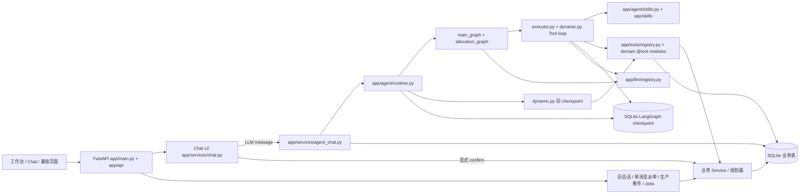

# 系统架构：当前实现

本文描述 **2026-10-16 当前工作区代码**的运行方式与职责边界，包括尚未提交的迁移。目标分层另见 [architecture.md](architecture.md) 和 [AGENTS.md](../AGENTS.md)；文件级正式路径、兼容导入和旧流程见 [迁移表](app_file_migration_map.md)。重点是从请求入口到 Agent、确定性业务逻辑和 SQLite 的实际调用链。具体 Tool 契约与恢复场景见 [动态 Agent 说明](AGENT_SKILL_ARCHITECTURE.md)，数据库表和状态语义见 [数据库说明](DATABASE_SCHEMA_CN.md)。

## 1. 系统全貌

- 浏览器页面由 `app/main.py` 从 `app/ui/` 提供，业务接口集中在 `/api`。路由、鉴权依赖、错误转换和请求策略分别位于 `app/api/routes/`、`dependencies.py`、`errors.py` 和 `middleware.py`。
- LLM 负责理解请求、选择 Skill/Tool 和组织回答；订单资格、方案计算、状态检查及业务写入由确定性 Python 与 SQLite 完成。模型生成的成功描述不是业务提交依据。
- SQLite 同时保存业务记录和 LangGraph checkpoint，但二者职责不同：业务表决定订单、队列、任务及推荐的真实状态；checkpoint 保存消息、Skill 快照与执行位置。

## 2. 启动、配置与接口

`app/server.py` 是本地 Uvicorn 入口，`app/main.py:create_app` 创建 FastAPI 应用。`app/core/lifespan.py` 在启动期间解析配置、初始化 `app/llm` 注册表和 SQLite checkpoint；停止时释放这些资源（HTTP jobs worker 已退役）。`app/config/settings.py` 管理数据库路径、`offline`/`llm` 模式、业务日期和鉴权开关；`app/config/model_settings.py` 读取各供应商模型别名与密钥。运行中的模型请求使用该配置快照；应用不会自行加载 `.env`。

数据库由 `app/db/database.py:Database` 打开，执行 `001_initial.sql` 至 `009_agent_runtime.sql` 的适用迁移，并以 `BEGIN IMMEDIATE` 包装写事务。已有数据库不会重新导入 CSV。业务日期影响队列折旧与交期估算；审计时间使用实际 UTC 时间。HTTP 默认使用文件型 SQLite，服务器默认监听 `127.0.0.1`。

主要 HTTP 入口：

| 接口 | 当前调用链与语义 |
| --- | --- |
| `/api/chat/sessions`、`/{id}/turns` | Chat v2 会话、LLM/离线消息、推荐和显式确认；`app/api/routes/chat.py` 调用 `app/services/chat.py`。对话产品以此为准。 |
| `/api/chat/sessions/{id}/trace` | 返回该 owner 可访问的 Agent Tool 调用及事件记录。 |
| `/api/orders/{id}`、`/api/events` | 订单查询及生产完成、取消、失效、重分配；调用 `app/services/lifecycle.py`。 |
| `/api/auth`、`/api/models`、工作台查询 | 登录身份、可用模型目录、工坊、仪表盘与审计读取。 |

已退役（不再挂载）：`/api/requests`（Parser v1 单消息直派）、`/api/sessions*`（旧多轮会话）、`/api/jobs`（`session_revise`）。本地离线播种可用 `app/services/dispatch.py:seed_allocation`，不是 HTTP API。Desk「新建请求」引导至 `/chat`。

`app/schemas/api.py` 与 `app/schemas/chat.py` 定义严格的 HTTP 输入契约，包括请求 ID、版本、动作和确认目标。账号默认经登录 Cookie 识别；Chat v2 会话与 Trace 按 owner 限制访问。普通账号与管理员当前共享一个业务工作区，未实现租户隔离。

## 3. Chat v2：LLM Agent 与离线分支

创建 Chat v2 会话时，`app/services/chat.py` 保存 owner、固定业务日期、模式、模型选择、版本号及初始 `COLLECTING` 任务。会话可选择 `llm` 或 `offline`；模式与模型随会话保存。每次 Turn 使用 `request_id` 与 `expected_version` 防止重复提交和旧页面覆盖新状态。

### LLM 消息路径

1. `app/services/chat.py:turn` 将 LLM 模式的普通消息交给 `app/services/agent_chat.py:turn`。后者建立或恢复 `chat_agent_runs`，由 `app/agent/runtime.py` 按 checkpoint 状态选择 Main Graph 或继续旧 Graph，并检查所选模型的原生 Tool 接口；会话图使用 `chat-agent:<session_id>` checkpoint thread。
2. 选用 Main Graph 时，`app/agent/main_graph.py` 识别业务任务。派单进入 `app/agent/allocation_graph.py`，先按固定节点提取字段、调用 Service 准备事实，再通过 `app/agent/skills.py` 加载 `app/skills/allocation-recommendation/SKILL.md`。其他兼容任务可由模型调用 `load_skill`。Skill 内容及 SHA-256 hash 在需要恢复时随 checkpoint 保存。
3. `app/agent/executor.py` 使用 `app/agent/dynamic.py` 的有界 Agent–Tool Loop。`app/tools/` 下显式 `@tool` 函数经 `registry.py` 登记；Runtime 通过 `invoke_tool` 注入可信上下文。复杂业务调用 `app/services/agent_operations.py` 具名函数；分配计算经 Tool 显式调用 `app.allocator.allocate`；生产事件在 `production.py` 做消息授权后委托 lifecycle。
4. `ask_user` 保存待答问题并结束本轮；下一条用户消息沿对应 executor checkpoint 恢复，并保留等待时的 Skill 快照。普通完成的 Turn 会清除已加载 Tool 权限。Tool Loop 每轮最多 12 次模型步骤和 32 次可执行 Tool 调用；退出时由代码检查完成条件。调用参数、结果、Skill hash 和状态变化记录在 Agent Trace。
5. `agent_chat.py` 从数据库重读任务及推荐，检查最终答复是否无依据地宣称已确认或已记录生产事件，再保存用户消息、答复和会话版本。界面上的 `committed` 标志与推荐卡来自数据库事实。

模型调用使用 `app/llm/registry.py:ModelRegistry`（LangChain）；旧直连 `core/providers` 已删除。Prompt 模板、加载器及版本化 YAML 位于 `app/prompts/`。模型不会执行看似 JSON 的文本“工具计划”；没有原生 Tool 调用能力的模型返回 `TOOLS_UNSUPPORTED`。

### 离线路径

Chat v2 的 `offline` 消息使用 `app/offline/graph.py`、`interpreter.py`、`reply.py`，再由 `app/services/chat.py` 计算或保存推荐。这是规则演示路径，不等同于 LLM 原生 Tool Agent（`app/agent/runtime.py` → Main Graph）。Parser v1 与旧 Session API 已退役。

## 4. 推荐、确认与生产状态

`app/services/allocation_preflight.py` 依据登记订单、工坊资料、队列及用户约束形成阻塞项与事实 hash。`app/services/allocation.py:recommend` 调用 `app/allocator.allocate`（`max_workshops` 默认 1；≥2 才拆单；Chat/Agent 仅在 `sources` 含用户授权的工坊上限时传入 ≥2）计算整数方案，再检查资格、数量守恒、工坊数、指定工坊与硬交期。方案 hash 与事实 hash 随推荐保存。推荐是预览，**不写** `working_order` 或生产队列。

Chat v2 任务状态为 `COLLECTING`、`BLOCKED`、`READY`、`RECOMMENDED`、`CONFIRMED`、`CANCELLED`。修改约束会增加任务版本并使旧推荐失效；工坊或队列事实改变也会使旧推荐过期。显式 `confirm` 必须带推荐 ID 和会话版本；`app/services/chat.py` 在同一写事务里复核 owner、任务版本、最新事实和方案，才调用 `app/services/allocation.py:apply` 写入分配、队列、订单状态、审计及确认反馈。同一确认可按请求 ID 或已确认推荐重放，不再分配一次。带修订内容的确认请求会被拒绝；普通 LLM 消息不能直接提交推荐。

生产完成、取消、失效与重分配统一由 `app/services/lifecycle.py:process_event` 处理，校验订单版本、动作、数量、队列和审计原因。Agent 的 `record_production_event` 还要求当前用户消息明确给出动作、订单和原因，并从已认证会话取得 actor；它使用稳定事件 ID 以支持重试。HTTP `/api/events` 使用同一生产服务。

`app/allocator/scoring.py` 的四个函数是单工坊评分公式，供 `score_workshop` 使用。其中原始 `get_hybrid_score` 是“按交期门控的缺陷率”。完整规划器的 `hybrid` 则使用 `0.6 × estimated_days + 0.4 × defect_rate × 100`。这两种分数的含义不同，不能互换。

## 5. 持久化、恢复与审计

| 数据 | 当前用途 |
| --- | --- |
| `orders`、`workshops`、`workshop_queue`、`working_order` | 订单主数据、工坊资料、排队与已提交的生产分配。 |
| `chat_sessions`、`chat_allocation_tasks`、`chat_turns`、`chat_messages`、`chat_recommendations` | Chat v2 的 owner、版本、任务、消息、推荐与确认结果。 |
| `chat_agent_runs`、`chat_agent_tool_calls`、`chat_agent_events` | Agent 请求恢复、Tool 幂等结果及可查询执行轨迹。 |
| LangGraph checkpoint 表 | Agent 消息历史、Skill 快照、待答问题、临时计划和图执行位置。 |
| `requests`、`decision_log`、`lifecycle_events` | 派单决策审计、生产事件；历史 `jobs` 表可保留，但 HTTP jobs worker 已退役。 |

中断的 LLM Turn 用**相同** `request_id` 恢复；新请求不能越过尚在运行的请求。Tool 调用使用 `<request_id>:<native_tool_call_id>` 作为重放键。推荐写入与 Tool Trace 同事务；生产事件的稳定事件 ID 使“业务事务已完成、Tool Trace 尚未保存”的重试仍可复用原结果。checkpoint 只提供恢复位置，不能代替幂等键、用户确认或数据库复核。

## 6. 当前代码与目标分层的差距

[AGENTS.md](../AGENTS.md) 约定将 Agent 编排、Tool、Service、DB Repository、Prompt 与 Schema 分开。主要实现已经迁到对应目录，但仍有以下兼容路径和跨层边界；新开发使用右列正式路径，不向兼容文件添加业务实现：

| 职责 | 当前状态与正式路径 |
| --- | --- |
| Tool | 正式 `@tool` 在 `app/tools/{orders,workshops,allocation,requirements,recommendations,conversation,production}.py`；`registry.py` 登记并 `invoke_tool`。`agent_operations` 仅保留具名 Service 函数，无 `execute(name, args)`。 |
| 业务规则与规划 | 正式资格、评分及规划在 `app/allocator/`（`allocate` / eligibility / scoring / planner）。 |
| DB Repository | 正式实现与迁移在 `app/db/`。`app/services/auth.py` 的 `auth_me` 已走 `account_repository`；`dispatch.py`、`read_models.py` 与 `core/security.py` 仍有直接 SQL，后续分阶段下沉。 |
| Prompt | Chat 与 Agent 的正式 YAML、加载器及版本信息在 `app/prompts/`；Parser v1 专用模板已移除。 |
| 模型与状态 | LLM 注册表在 `app/llm/`。`app/core/` 仅 lifespan 与鉴权。`AgentState` 等仍在 Agent 图模块，尚未统一到 `app/schemas/`。 |

文件级处理顺序见 [迁移表](app_file_migration_map.md)。实施目标分层时须保留现有 API、状态和事务语义，并避免产生第二套业务计算或数据库真相。

## 7. 验证边界

`tests/` 覆盖 HTTP、Chat v2、动态 Agent、分配、生产事件、迁移和前端控制器。动态 Agent 的核心回归在 `tests/test_dynamic_agent.py`；其模型是可预测的原生 Tool-call 测试替身。`evaluation/verify_dynamic_agent.py` 可生成可复核的执行轨迹，但会写入 `evaluation/results/`。完整 Python 回归与前端控制器测试的入口见 [AGENTS.md](../AGENTS.md)。这些测试验证代码路径与业务不变量，不构成在线模型选择质量或真实生产环境的验收结果。
